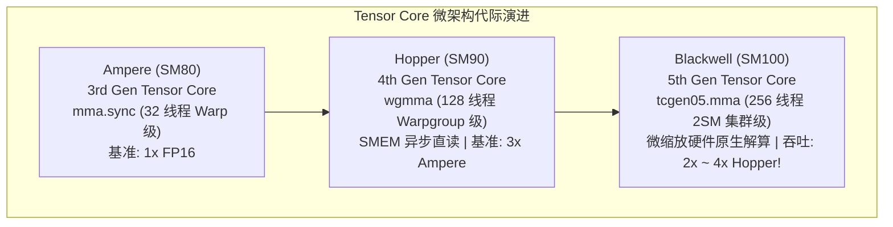
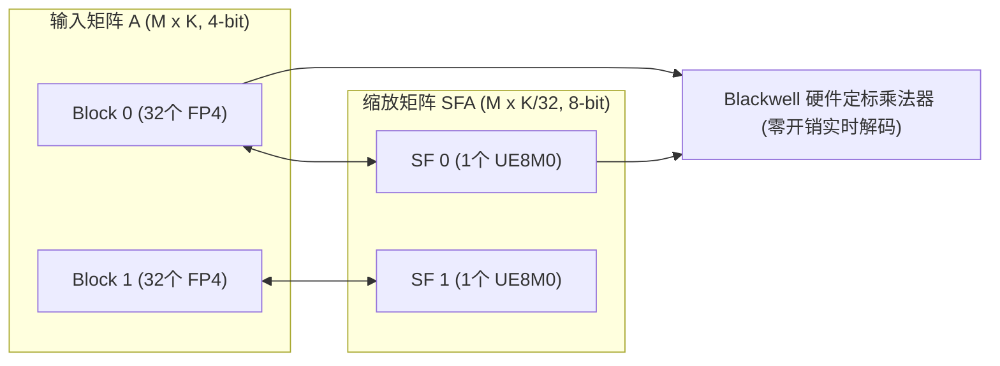
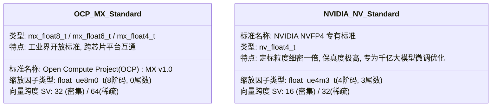
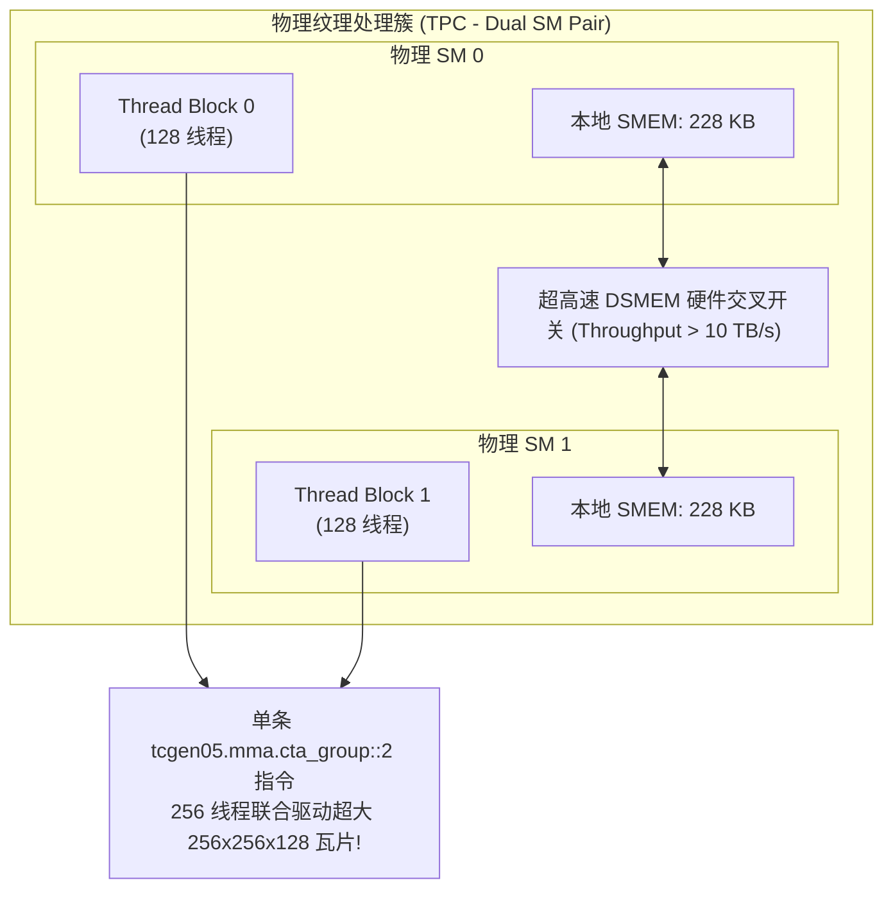

# NVIDIA Blackwell (SM100) 架构核心特性：第 5 代 Tensor Core、微缩放 (MXFP4/NVFP4) 与双 SM 协同深度解析

> **重要免责声明**：本网站只是用来消耗反重力额度的，并且给有需要的人看一看，准确度极低。可用度极低，不想看的请不看，造成错误概不负责。
> 本篇由 AI 辅助汉化与深度解析，非 NVIDIA 官方技术文档。涉及 GPU 底层硬件架构参数与生产算子调优，请以 [NVIDIA CUTLASS 官方源码](https://github.com/NVIDIA/cutlass) 为准。

---
> [!NOTE] 原文参考
> 本章对应官方核心前沿规范文档 [`media/docs/cpp/blackwell_functionality.md`](https://github.com/NVIDIA/cutlass/blob/main/media/docs/cpp/blackwell_functionality.md)，并在原文档基础上补充了 Blackwell SM100 微架构拓扑、微缩放（Microscaling）数学误差界限推导、OCP MX 规范与 NVIDIA NVFP4 标准深度对比以及双 SM 协同执行（2SM Cooperative）工程实战。

在生成式人工智能（Generative AI）迈向数万亿参数混合专家模型（MoE）与多模态大模型的时代背景下，计算吞吐量与内存墙的矛盾已成为整个人类算力架构的最核心挑战。

**NVIDIA Blackwell 架构（SM100 / B200 / GB200）** 带来了 GPU 计算史上最激进的飞跃：
* 单芯片集成 2080 亿晶体管，通过 10 TB/s 的 NV-HBI 互联接口将双 Die 封装为单一统一逻辑 GPU；
* 引入了 **第 5 代 Tensor Core 指令集 —— `tcgen05.mma`**；
* 原生支持 **4-bit（MXFP4 / NVFP4）、6-bit（MXFP6）与 8-bit（MXFP8）微缩放（Microscaling / Block-Scaled）数据格式**；
* 其密集矩阵乘（Dense GEMM）吞吐量达到 Hopper (H100) WGMMA 的 **2 倍至 4 倍**，全面统治新一代大模型训练与推理基础设施！

---

## 0. Blackwell 微架构代际飞跃与第 5 代 Tensor Core



### 0.1 传统量化痛点与微缩放（Microscaling）的诞生
在传统的 INT8 或 FP8 量化中，通常采用 **Per-Tensor（整个张量）** 或 **Per-Channel（逐通道）** 的定标策略：
* 当数据位宽进一步压缩到 4-bit（如 FP4，仅有 16 个离散数值槽位）时，张量内部的**极值异常点（Outliers）**会彻底摧毁整个动态范围，导致严重的数据下溢与精度雪崩；
* **微缩放（Microscaling / Block Scaling）的核心思想**：将矩阵沿归约轴 $K$ 切分为极小的物理微块（例如每 16 个或 32 个元素构成一个微块），**每个微块分配一个专属的独立高动态范围浮点缩放因子（Scale Factor, SF）**！
* 这样一来，异常点的影响仅被严格局限在微观局部（16 或 32 个元素内），全局张量依然维持极高的数值保真度，成功实现在 4-bit 下大模型精度无损推理！

---

## 1. Blackwell `tcgen05.mma` 硬件指令全景

Blackwell SM100 架构引入了 7 类核心的 `tcgen05.mma` 硬件指令体系：

| PTX 硬件指令前缀 | 相比 Hopper 吞吐提升 | 支持的数据类型与物理排布 | 关键微架构特性 |
| :--- | :---: | :--- | :--- |
| **`tcgen05.mma.cta_group::[1\|2].kind::tf32`** | **2x Hopper TF32** | $A(\text{TF32}) \times B(\text{TF32})$，支持 TN, NT, TT, NN | 传统精度翻倍加速 |
| **`tcgen05.mma.cta_group::[1\|2].kind::f16`** | **2x Hopper FP16** | $A(\text{FP16/BF16}) \times B(\text{FP16/BF16})$ | 传统精度翻倍加速 |
| **`tcgen05.mma.cta_group::[1\|2].kind::i8`** | **2x Hopper INT8** | $A(\text{INT8/UINT8}) \times B(\text{INT8/UINT8})$ | 经典整型推理加速 |
| **`tcgen05.mma.cta_group::[1\|2].kind::f8f6f4`** | **2x Hopper FP8** | 混合超低精度：$A(\text{F4/F6/F8}) \times B(\text{F4/F6/F8})$ | 无需缩放因子的混合超窄精度 |
| **`tcgen05.mma.kind::mxf8f6f4.block_scale`** | **2x Hopper FP8** | 块级微缩放混合精度（OCP MX 标准） | 块大小 32，硬件自动定标 |
| **`tcgen05.mma.kind::mxf4.block_scale`** | **4x Hopper FP8** | 块级微缩放 MXFP4（专供 TN 布局） | **极致吞吐：4 倍于 H100 FP8！** |
| **`tcgen05.mma.kind::mxf4nvf4.block_scale`** | **4x Hopper FP8** | 块级微缩放 MXFP4 与 NVIDIA 原生 NVFP4 | 支持向量尺寸 16 与 32 |

> [!IMPORTANT] 2:4 结构化稀疏硬件翻倍（Structured Sparsity）
> 所有上述 `tcgen05.mma` 指令均原生支持 `.sp` 稀疏修饰符（如 `tcgen05.mma.sp...`）。
> 在 2:4 稀疏模式下，矩阵 $A$ 沿 $K$ 轴在物理显存中被压缩 2 倍，**硬件有效计算吞吐量在上述理论倍率基础上再次翻倍**！

---

## 2. 块级微缩放（Block-Scaled GEMM）代数数学模型

### 2.1 形式化数学定义
在块级微缩放矩阵乘中，输出矩阵 $D$ 的计算公式为：

$$D_{ij} = C_{ij} + \sum_{k} \left( A_{ik} \times \text{SFA}_{i, \lfloor k / \text{SV} \rfloor} \right) \times \left( B_{jk} \times \text{SFB}_{j, \lfloor k / \text{SV} \rfloor} \right)$$

其中：
* **$\text{SV}$（Scale Factor Vector Size）**：缩放因子向量尺寸，密集矩阵中为 **16 或 32**（在 2:4 稀疏下压缩为 32 或 64）；
* **$\text{SFA}$**：矩阵 $A$ 的缩放因子矩阵，其几何形状为 $M \times \lceil K / \text{SV} \rceil$；
* **$\text{SFB}$**：矩阵 $B$ 的缩放因子矩阵，其几何形状为 $N \times \lceil K / \text{SV} \rceil$。



### 2.2 硬件数据流解算机制
* **存储开销仅增加 3.125%~6.25%**：当 $\text{SV} = 32$ 时，每 32 个 4-bit 元素（总计 128 bit）仅额外附加一个 8-bit 缩放因子，内存膨胀率仅为 $8 / 128 = 6.25\%$！
* **ALU 内部零开销解算**：Blackwell 硬件乘加单元在内部直接将 4-bit 尾数与 8-bit 缩放因子的阶码进行硬件加法融合，**不需要先写回寄存器进行解包反量化，完全不消耗任何指令周期！**

---

## 3. Blackwell 窄精度（Narrow-Precision）数据类型全景

Blackwell SM100 架构支持了业界最完备的窄精度浮点族谱：

| 数据类型标识符 | 符号位 (Sign) | 阶码位数 (Exponent) | 尾数位数 (Mantissa) | 物理总位宽 | 动态范围 (Dynamic Range) | 核心应用场景与标准 |
| :--- | :---: | :---: | :---: | :---: | :---: | :--- |
| **`float_e4m3_t`** | 1 | 4 | 3 | 8-bit | $\approx \pm 448$ | 标准 FP8 权重与激活 |
| **`float_e5m2_t`** | 1 | 5 | 2 | 8-bit | $\approx \pm 57344$ | 标准 FP8 梯度与反向传播 |
| **`float_e2m3_t`** | 1 | 2 | 3 | 6-bit | 窄范围高精度 | 6-bit 权重量化 (MXFP6) |
| **`float_e3m2_t`** | 1 | 3 | 2 | 6-bit | 宽范围中精度 | 6-bit 激活量化 (MXFP6) |
| **`float_e2m1_t`** | 1 | 2 | 1 | 4-bit | $\pm 6$ | **基础 FP4 数值 (MXFP4 / NVFP4)** |
| **`float_ue8m0_t`**| 0 (无符号) | 8 | 0 | 8-bit | $2^{-127} \sim 2^{128}$ | **OCP MX 规范缩放因子** (纯纯指数基底) |
| **`float_ue4m3_t`**| 0 (无符号) | 4 | 3 | 8-bit | 高精度细粒度缩放 | **NVIDIA NV 专有缩放因子** |

---

### 3.1 OCP MX 与 NVIDIA NV 规范深度对比

在 Blackwell 的 CUTLASS 实现中，微缩放格式分为两大阵营：



* **`mx_float4_t`（OCP 规范）**：缩放因子仅包含 8 位阶码（`float_ue8m0_t`），本质上是纯粹以 2 的幂次方（$2^E$）进行缩放，硬件解码器布线极其简单，能效比极高；
* **`nv_float4_t`（NVIDIA 规范）**：缩放向量粒度缩小到 16，且缩放因子携带 3 位尾数（`float_ue4m3_t`），能够在微观局部进行极其细腻的非等比缩放，是极端要求数值精度的 LLM 首选。

---

## 4. 颠覆性硬件协同：双 SM 协同执行 (`cta_group::2`)

在之前的 GPU 架构中，一个 Thread Block（CTA）严格受限于单个物理 SM 的资源天花板（如 Ampere 单 SM 共享内存最大 164 KB，Hopper 为 228 KB）。

Blackwell 创造性地引入了 **`cta_group::2`（双 SM 协同）** 硬件指令修饰符：



### 4.1 双 SM 协同的技术红利
1. **共享内存容量瞬间翻倍**：两个协同 SM 的 SMEM 通过超高速分布式共享内存交叉开关（DSMEM Crossbar）无缝拼合，单次协同可调用的共享内存池**突破 450 KB**！
2. **支持前所未有的超大瓦片（Tile Shapes）**：
   * 单 SM 调度典型尺寸：$128 \times 128 \times 128$；
   * **双 SM 协同调度典型尺寸**：高达 **$256 \times 128 \times 128$** 乃至 **$256 \times 256 \times 128$**！
3. **全局访存复用率翻倍**：更大的分块意味着在全局显存读取相同的输入数据量下，数学计算复用率翻倍，彻底突破算力受限（Compute-Bound）的物理天花板！

---

## 5. 布局与子字节内存对齐约束（Subbyte Alignment Rules）

由于 FP4 和 FP6 的位宽小于一个标准字节（8-bit），它们在全局显存和共享内存中是以**紧凑打包（Packed）**的形式存储的（例如一个 `uint8_t` 打包 2 个 FP4 元素）。

PTX 指令对张量加载施加了极其严苛的物理对齐约束：

| 矩阵精度模式 | A 矩阵布局 | A 最小物理对齐 (元素数) | B 矩阵布局 | B 最小物理对齐 (元素数) | 硬件指令支持情况 |
| :--- | :---: | :---: | :---: | :---: | :--- |
| **MXFP8 / FP8** | **TN** (行优先 A, 列优先 B) | 16 (16 字节) | **TN** | 16 (16 字节) | 完美支持单 SM 与双 SM |
| **MXFP8 / FP8** | **NN** / **NT** / **TT** | 16 (16 字节) | 对应转置 | 16 (16 字节) | 需检查非对齐回退 |
| **MXFP4 / NVFP4** | **TN** | **32 元素 (16 字节)** | **TN** | **32 元素 (16 字节)** | **最高性能路径 (4x 峰值吞吐)** |
| **MXFP4 / NVFP4** | **NN** / **NT** / **TT** | 32 元素 | 对应转置 | 32 元素 | 仅部分混合指令支持 |

> [!CAUTION] 子字节对齐铁律
> 对于 4-bit 矩阵乘，**矩阵连续维度的大小以及步长必须是 32 个元素的整数倍（即物理显存按 16 字节对齐）**，否则 TMA 硬件将直接触发地址未对齐异常（Misaligned Address Trap）！

---

## 6. 生产级实战：构建 Blackwell MXFP4 微缩放 GEMM

在 CUTLASS 3.x 中，得益于高度模块化的设计，编写一个跑满 Blackwell 4 倍算力的 MXFP4 算子与编写普通 FP16 算子几乎完全同构！
我们只需将输入类型切换为 `cutlass::mx_float4_t`，并指定 2SM 协同调度器：

```cpp
#include <cutlass/cutlass.h>
#include <cutlass/numeric_types.h>
#include <cutlass/gemm/device/gemm_universal_adapter.h>
#include <cutlass/gemm/collective/collective_builder.hpp>
#include <cutlass/epilogue/collective/default_epilogue.hpp>

using namespace cute;

// =========================================================================
// 1. 声明 Blackwell SM100 MXFP4 微缩放主循环
// =========================================================================
using CollectiveMainloop = typename cutlass::gemm::collective::CollectiveBuilder<
    cutlass::arch::Sm100,                                   // 目标微架构: Blackwell SM100
    cutlass::arch::OpClassTensorOp,                        // 硬件第 5 代 Tensor Core
    cutlass::mx_float4_t, cutlass::layout::RowMajor, 32,   // A: OCP MXFP4, 32 元素(16字节)对齐
    cutlass::mx_float4_t, cutlass::layout::ColumnMajor, 32,// B: OCP MXFP4, 32 元素(16字节)对齐
    float,                                                 // 累加器精度: FP32
    Shape<_256, _128, _128>,                               // 2SM 超大规模瓦片: 256x128x128!
    Shape<_2, _1, _1>,                                     // Cluster 集群拓扑
    cutlass::gemm::collective::StageCountAuto,             // 自动计算多级流水线
    cutlass::gemm::KernelTmaWarpSpecialized2SmSm100        // 🚀 激活双 SM 协同调度引擎！
  >::CollectiveOp;

// =========================================================================
// 2. 声明尾声段 (Epilogue)
// =========================================================================
using CollectiveEpilogue = cutlass::epilogue::collective::DefaultEpilogue<
    cutlass::half_t,                                       // 输出数据精度 (例如 FP16)
    cutlass::gemm::TagToStrideC_t<cutlass::layout::RowMajor>,
    cutlass::gemm::TagToStrideC_t<cutlass::layout::RowMajor>,
    cutlass::epilogue::thread::LinearCombination<cutlass::half_t, 1, float, float>>;

// =========================================================================
// 3. 内核合成与设备端适配器包装
// =========================================================================
using GemmKernel = cutlass::gemm::kernel::GemmUniversal<
    cute::Shape<int, int, int, int>,
    CollectiveMainloop,
    CollectiveEpilogue
>;

using GemmHandle = cutlass::gemm::device::GemmUniversalAdapter<GemmKernel>;
```

---

## 7. 本章核心小结与前沿展望

```mermaid
mindmap
  root((Blackwell SM100 前沿体系))
    硬件指令突破
      tcgen05.mma: 第 5 代 Tensor Core
      算力飞跃: 2x ~ 4x Hopper 极限吞吐
      2:4 结构化稀疏: 硬件级计算带宽再次翻倍
    微缩放数学框架 (Microscaling)
      OCP MX 规范: mx_float4_t + float_ue8m0_t (SV=32)
      NVIDIA NV 规范: nv_float4_t + float_ue4m3_t (SV=16)
      实时硬件解码: 零指令周期开销, 4-bit 精度无损推理
    微架构拓扑创新
      双 SM 协同 (cta_group::2): 跨 SM DSMEM 互联
      超大瓦片平铺: 256x128x128 突破单 SM 容量极限
      数据复用率翻倍: 彻底粉碎内存墙瓶颈
```

至此，关于 NVIDIA 硬件最前沿的 Blackwell SM100 架构与微缩放算子体系已被完整剖析。
在接下来的章节中，我们将探索 **CUTLASS 3.x 的宏观软件设计哲学** 以及 **端到端 GEMM 性能调优的终极实战指南**！
