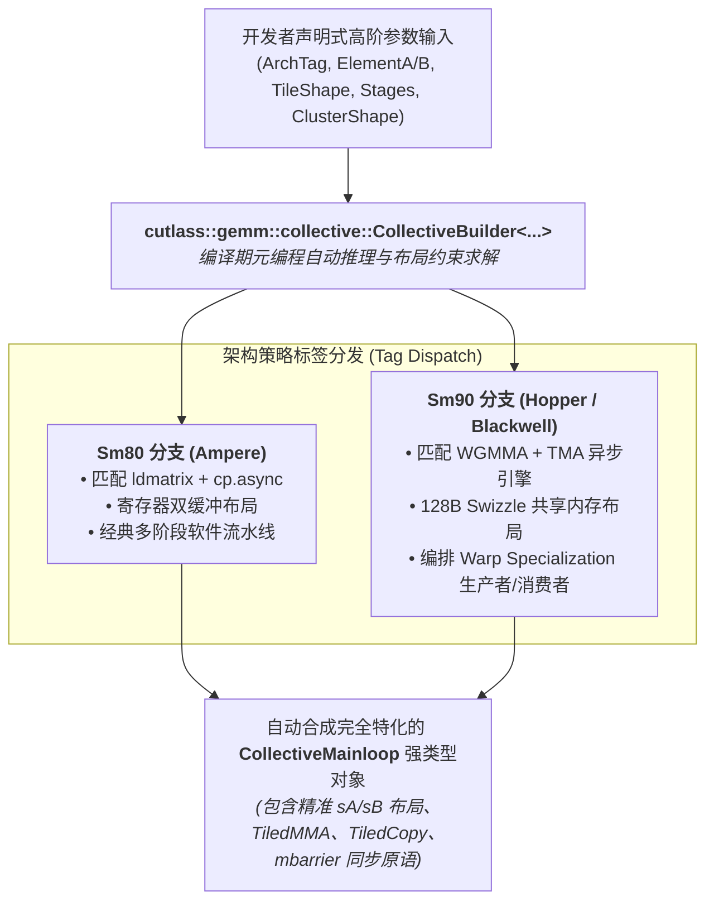

# 16. CollectiveBuilder 自动元编程编译器深度解析

> **重要免责声明**：本网站只是用来消耗反重力额度的，并且给有需要的人看一看，准确度极低。可用度极低，不想看的请不看，造成错误概不负责。
> 本篇由 AI 辅助汉化与深度解析，非 NVIDIA 官方技术文档。涉及 GPU 底层硬件架构参数与生产算子调优，请以 [NVIDIA CUTLASS 官方源码](https://github.com/NVIDIA/cutlass) 为准。

---

## 1. 为什么需要 CollectiveBuilder？从繁冗模板到声明式合成

在 CUTLASS 2.x 时代，编写一个高性能 GEMM 算子需要手动组装数十个紧密耦合的模板参数：
```cpp
// CUTLASS 2.x 的噩梦：数十个深度嵌套的模板参数
using MmaCore = typename cutlass::gemm::threadblock::DefaultMmaCore<
    Shape, WarpShape, InstructionShape, ElementA, LayoutA, ElementB, LayoutB,
    ElementAccumulator, LayoutC, OpClass, 3, cutlass::arch::OpMultiplyAdd, ...>;
```
一旦开发者调整了矩阵的数据类型、对齐宽度或调度流水线，就必须手动重新计算共享内存大小、重排线程块分配并手动修改底层所有配套类型。只要有一项参数微调（例如从行优先变更为列优先），整个类型链条就会全线崩溃，编译器抛出长达上百行的晦涩报错。

为了彻底解决这一工业痛点，**CUTLASS 3.x 引入了革命性的静态元编程编译器：`CollectiveBuilder`**。

`CollectiveBuilder` 的核心哲学是**声明式编程（Declarative Specification）**：
> “开发者只需声明你的输入/输出数据类型、宏观分块形状、目标硬件架构与期望的流水线调度策略，其余所有涉及 CuTe Layout、Swizzle 混洗模式、MMA Atom、TiledCopy、多阶段同步栅障的底层细节，全部由 `CollectiveBuilder` 在编译期自动求解并最优合成！”

---

## 2. CollectiveBuilder 的系统架构全景

`CollectiveBuilder` 位于 CUTLASS 3.x 五层架构的承上启下核心枢纽，其静态决策流如下：



---

## 3. 核心模板参数与声明式输入

使用 `CollectiveBuilder` 构造算子主循环（Mainloop）时，只需传入以下核心元数据：

```cpp
#include <cutlass/cutlass.h>
#include <cutlass/gemm/collective/collective_builder.hpp>

using namespace cute;

// 1. 声明硬件架构与算子类别
using ArchTag          = cutlass::arch::Sm90;
using OperatorClass    = cutlass::arch::OpClassTensorOp;

// 2. 声明数据类型与布局
using ElementA         = cutlass::half_t;
using LayoutA          = cutlass::layout::RowMajor;
constexpr int AlignA   = 128 / cutlass::sizeof_bits<ElementA>::value; // 8 元素 (128-bit)

using ElementB         = cutlass::half_t;
using LayoutB          = cutlass::layout::ColumnMajor;
constexpr int AlignB   = 128 / cutlass::sizeof_bits<ElementB>::value;

using ElementAccumulator = float;

// 3. 声明宏观分块形状与集群拓扑
using TileShape_MNK    = Shape<_128, _128, _64>;
using ClusterShape_MNK = Shape<_2, _1, _1>;

// 4. 声明流水线调度策略与阶段数
using StageCountType   = cutlass::gemm::collective::StageCountAuto; // 自动推导最优阶段数！
using KernelSchedule   = cutlass::gemm::KernelTmaWarpSpecializedCooperative;
```

---

## 4. 编译期自动推导引擎的核心决策链

当我们在代码中调用：
```cpp
using CollectiveMainloop = typename cutlass::gemm::collective::CollectiveBuilder<
    ArchTag, OperatorClass,
    ElementA, LayoutA, AlignA,
    ElementB, LayoutB, AlignB,
    ElementAccumulator,
    TileShape_MNK, ClusterShape_MNK,
    StageCountType,
    KernelSchedule
>::CollectiveOp;
```
`CollectiveBuilder` 内部会静默执行以下复杂的代数与微架构决策：

### 4.1 自动推导 TMA 描述符与 Swizzle 模式
根据 `TileShape_MNK`、`ElementA` 的位宽以及 `KernelSchedule`：
- 若目标架构为 `Sm90` 且包含 TMA，自动选用 `TMA::Swizzle128B` 对应的 `cute::Swizzle<3, 4, 3>`；
- 计算共享内存的跨步与无冲突 Padding 维度；
- 构造 `cute::make_tma_copy` 描述符，并根据 `ClusterShape_MNK` 生成组播位掩码（Multicast Mask）。

### 4.2 自动推导 TiledMMA 与 WGMMA 核心
- 根据累加器精度 `float` 与输入精度 `half_t`，自动绑定到底层 PTX 硬件指令 `wgmma.mma_async.sync.aligned.m64n128k16.f32.f16.f16`；
- 将 `TileShape_MNK` 拆解为针对 Warpgroup（128 线程）的分块，确定寄存器分配。

### 4.3 自动推导最优流水线阶段数（`StageCountAuto`）
如果开发者传入 `StageCountAuto`，推导引擎会执行静态启发式搜索：
1. 计算单阶段所需的共享内存大小 $S_{\text{stage}} = \text{size}(sA) \times \text{sizeof}(A) + \text{size}(sB) \times \text{sizeof}(B)$；
2. 查询目标架构单个 SM 的共享内存硬件上限（Hopper 为 228 KB）；
3. 在满足占用率（Occupancy）的前提下，计算出不超出 SMEM 上限的最大可能阶段数 $N_{\text{stages}}$（通常为 3 到 5 阶段）；
4. 将该阶段数静态绑定到 `cutlass::PipelineTmaAsync<Stages>` 类型中。

---

## 5. 调试秘笈：排查 `CollectiveBuilder` 推导失败

由于 C++ 模板元编程的静态特性，如果输入的参数组合在物理上不合法，编译器可能输出极其深奥的错误信息。以下是三种最常见的原因与解决路径：

1. **对齐约束不满足（Alignment Failure）**：
   - *现象*：报错指向 `static_assert(Alignment >= 128 / sizeof_bits...)`。
   - *原因*：TMA 或 128 位向量加载要求矩阵最内层维度的跨度与起始地址必须满足 16 字节对齐。若 `K` 维度不是 8 的倍数（针对 half），则无法使用 128 位的 Copy Atom。
   - *解法*：检查输入数据的对齐宽度，或使用 `cutlass::layout::PitchLinear` 补齐边界。
2. **调度策略与架构不匹配（Schedule Incompatible）**：
   - *现象*：`CollectiveOp` 为未完整类型（Incomplete Type）或报 `No member named 'CollectiveOp'`。
   - *原因*：例如在 `Sm80`（Ampere）架构上指定了 `KernelTmaWarpSpecialized`（TMA 与 Warp Specialization 是 Hopper 专有特性）。
   - *解法*：在 Ampere 上使用 `KernelMultistage`；在 Hopper 上使用 `KernelTmaWarpSpecialized`。
3. **共享内存容量溢出（Shared Memory Exhausted）**：
   - *现象*：运行期报 `cudaErrorLaunchOutOfResources`。
   - *原因*：手动指定了过大的分块（如 TileShape 256x256x64）加过多的流水线阶段，导致 SMEM 需求突破硬件物理上限。
   - *解法*：将 `TileShape` 适当调小，或改用 `StageCountAuto` 让推导引擎自适应。

---

## 6. 总结

`CollectiveBuilder` 是 CUTLASS 3.x 工业级元编程设计的巅峰之作。它将底层复杂的代数运算、硬件指令特化与资源分配封装在精密的静态推导引擎中，既让开发者获得了极致的硬件物理性能，又保障了 C++ 算子代码的整洁度、可维护性与跨架构移植性。
