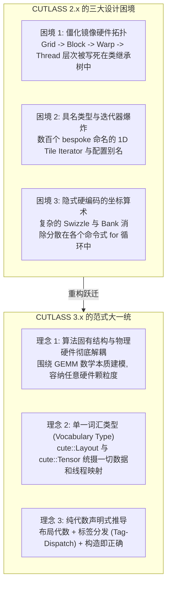
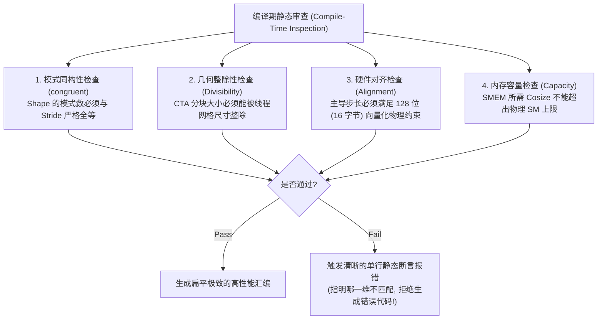

# CUTLASS 3.x 核心架构演进与现代泛型设计哲学 (Design & Architecture)

> **重要免责声明**：本网站只是用来消耗反重力额度的，并且给有需要的人看一看，准确度极低。可用度极低，不想看的请不看，造成错误概不负责。
> 本篇由 AI 辅助汉化与深度解析，非 NVIDIA 官方技术文档。涉及 GPU 底层硬件架构参数与生产算子调优，请以 [NVIDIA CUTLASS 官方源码](https://github.com/NVIDIA/cutlass) 为准。

---
> [!NOTE] 原文参考
> 本章对应官方架构设计核心规范文档 [`media/docs/cpp/cutlass_3x_design.md`](https://github.com/NVIDIA/cutlass/blob/main/media/docs/cpp/cutlass_3x_design.md)，并在原文档基础上补充了 CUTLASS 2.x 到 3.x 的重构全景背景、单一词汇类型（Vocabulary Type）设计模式、编译期“构造即正确（Correct-by-Construction）”的断言体系与面向未来微架构（Hopper / Blackwell）的可扩展性设计原则。

如果说 CUTLASS 2.x 是 GPU 模板元编程在 Volta 和 Ampere 时代的巅峰之作，那么 **CUTLASS 3.x 则是面向现代异构加速器与生成式 AI 时代的一次颠覆式重构**。

在 2022 年前后，随着大语言模型（LLM）的参数量迈入千亿大关，NVIDIA Hopper (SM90) 架构带来了诸如 **Thread Block Clusters（线程块集群）**、**Warpgroup 级 WGMMA（128 线程硬件指令）** 以及 **TMA（硬件张量加速器）** 等一系列颠覆性微架构创新。
此时，传统的 GPU 算子库抽象暴露出严重的体系性危机。为了彻底破局，NVIDIA 团队历时数年重写底层引擎，推出了以 **CuTe 布局代数** 为核心骨架的 CUTLASS 3.x。

---

## 0. 破局前夜：CUTLASS 2.x 的抽象危机与重构动机

为了深刻理解 CUTLASS 3.x 的架构美学，我们必须首先复盘 CUTLASS 2.x 在面对硬件代际演进时所遭遇的瓶颈。



### 0.1 困境一：硬件拓扑强耦合导致的“抽象脆断（Brittleness）”
在 CUTLASS 2.x 中，算子架构被严格划分为四个硬件层级：`Device` $\to$ `Block` $\to$ `Warp` $\to$ `Thread`。
这种设计在 Ampere 及更早时代看似直观，但在新硬件面前瞬间崩塌：
* **Hopper Warpgroup 无法安放**：Hopper 的 `wgmma` 指令由 **4 个 Warp（128 线程）联合发起**。在 2.x 僵化的继承树中，它既不是单个 Warp，也不是整个 Block（一个 Block 可能包含 256 或 384 个线程）。2.x 的模板体系根本找不到任何一个合法的层级来容纳 Warpgroup！
* **Volta QuadPair 的别扭封装**：在 Volta SM70 上，Tensor Core 的最小物理硬件执行单元是 8 个线程构成的 QuadPair。但在 2.x 中，开发者被迫先将 4 个 QuadPair 拼凑成一个伪 32 线程 Warp 级抽象，不仅代码充斥着冗余的包装层，更牺牲了细粒度调度的自由度。

### 0.2 困境二：成百上千个具名类型的“认知过载（Mental Context Overflow）”
在 2.x 中，每一个微小的硬件特性差异，都会催生一整批全新的具名类（Named Types）：
* 例如为了支持不同阶段的流水线，存在 `MmaMultistage`、`MmaPipelined`、`MmaPlanarComplexMultistage` 等五花八门的类；
* 为了让高层代码看起来一致，库中引入了层层嵌套的别名提供器（如 `default_gemm_configuration.h`）。开发者在阅读源码时，往往需要在大脑中连续推导 5 到 8 层 `typedef` 替换，学习曲线极其陡峭。

### 0.3 困境三：一维迭代器（1D Iterator）与高维硬件物理现实的脱节
GPU 的访存单元与计算核心本质上是**多维（N-Dimensional）**协同的：
* 共享内存有 32 个 Bank（二维散列）；
* Tensor Core 要求数据在二维矩阵中交错排布；
* 2.x 却固执地沿用类似 STL 的一维迭代器概念（`TileIterator`）。为了在 1D 迭代器中模拟二维矩阵的跳跃，类内部充斥着晦涩的命令式取模与乘加运算。这种隐式数学运算无法进行形式化验证，稍有改动便引发静默的显存越界崩溃。

---

## 1. CUTLASS 3.x 核心设计公理

针对上述致命痛点，CUTLASS 3.x 确立了五大核心设计哲学：

| 核心设计哲学 | 架构机制与代码范式 | 工程价值与质量保证 |
| :--- | :--- | :--- |
| **算法固有结构解耦** | 统一适应 Thread、QuadPair、Warp、Warpgroup 与 Cluster，不硬编码特定硬件层级 | 算子逻辑与芯片物理拓扑解耦，具备终极跨代移植性。 |
| **单一词汇核心类型** | • 单一 `Layout` 统摄一切几何映射<br/>• 单一 `Tensor` 统摄一切物理存储与视图 | 消灭概念冗余，大幅降低开发者心智负担。 |
| **构造即正确**<br/>*(Correct by Construction)* | 静态常量 `Int<N>` 与编译期前置条件断言静态推导 | 在编译期捕捉一切尺寸不匹配、对齐缺陷与无效平铺。 |
| **标签分发 (Tag-Dispatch)** | 替代庞大冗余的具名类体系，提供唯一清晰的算法插槽 | 模板展开更平整，代码可读性与可维护性数倍提升。 |

### 1.1 公理一：算法固有数学结构高于硬件物理拓扑
CUTLASS 3.x 彻底抛弃了与特定代际硬件严格绑定的类层次，转而围绕 **密集矩阵乘法（GEMM）算法自身的固有层级** 展开建模：
* 无论未来 GPU 架构如何演进，矩阵乘的数学本质永远是：**全图网格分块（Cluster/Grid） $\to$ 共享内存主循环（Mainloop） $\to$ 寄存器微内核（TiledMMA） $\to$ 汇编指令（Atom）**；
* 这种建模使 CUTLASS 3.x 具备了跨越硬件代际的极强韧性。当 Hopper 引入 Warpgroup 和 TMA 时，或者 Blackwell 引入 2-SM 协同集群与 MXFP4 时，**底层的 GEMM 骨干架构一行业务代码都无需重构！**

### 1.2 公理二：单一词汇类型（Vocabulary Type）统摄全体系
现代 C++ 工程经验表明，引入恰当的“词汇核心类型”（如 C++17 的 `std::string_view`、C++20 的 `std::span`）能够大幅度精简代码库并消除类型孤岛。
**CuTe 的 `Layout` 就是 GPU 空间几何体系中最极致的单一词汇类型！**
* 它以纯数学的形式彻底统一了：**矩阵的行列优先、转置、分块瓦片、非连续跨步、32-Bank 混洗（Swizzle）以及线程瓜分（TV 分区）**；
* 整个 CUTLASS 3.x 库中不再有数十个不同的专用迭代器类，所有组件全部使用 `Layout` 与 `Tensor` 进行交流！

---

## 2. 代际深度对比：CUTLASS 2.x vs CUTLASS 3.x

下表系统梳理了从 2.x 到 3.x 的跨时代技术跃迁：

| 评估维度 | CUTLASS 2.x 时代 | CUTLASS 3.x 现代体系 | 架构演进收益 |
| :--- | :--- | :--- | :--- |
| **底层核心引擎** | 手工宏、专有迭代器与手写数学 | **CuTe 布局代数（Layout Algebra）** | 数学严谨性，代码量减少 60% 以上 |
| **几何描述方式** | 隐式、分散在各个 `for` 循环中的下标运算 | **纯声明式（Declarative）多维 Layout** | 线程与数据空间映射单点集中审查 |
| **硬件颗粒度支持** | 仅僵化支持 Thread / Warp / Block | **原生支持任意粒度（QuadPair, Warpgroup, Cluster）** | 完美释放 Hopper / Blackwell 新硬件特性 |
| **多维张量遍历** | 包装为一维的 `TileIterator` | **层次化嵌套张量切片（`local_tile` / `_`）** | 消除一维展开与逆向模除的冗余开销 |
| **流水线状态管理** | 手动管理 `cp.async` 的 `wait/fence` | **`cutlass::Pipeline` 4 步状态机 + `mbarrier`** | 彻底消除死锁、时序竞态与读写冒险 |
| **算法特化机制** | 为每个架构派生独立具名类（数十个类名） | **统一模板架构 + 标签分发策略（Tag-Dispatch）** | 消除类型爆炸，大幅降低认知负荷 |
| **算子融合扩展** | 手写繁复的 Epilogue 模板特化 | **EVT（Epilogue Visitor Tree 访问者树）** | 像拼积木一样在寄存器内原地融合任意算子 |
| **调试与排错体验** | 模板嵌套深度数十层，报错信息达数万字符 | **编译期断言（`CUTE_STATIC_ASSERT_V`）精准提示** | 构造即正确，大幅缩短工程调试周期 |

---

## 3. 标签分发策略（Tag-Based Dispatch Policy）与可扩展性设计

在 CUTLASS 3.x 中，为了彻底终结“为每一种微架构变体创建一个新派生类”的恶习，设计团队全面普及了 **基于类型标签的分发策略（Tag-Based Dispatch Policy）**。

### 3.1 消除类名膨胀的实战设计
在 3.x 中，无论是主循环还是内核调度，主干类名恒定为 **`cutlass::gemm::collective::CollectiveMma`** 与 **`cutlass::gemm::kernel::GemmUniversal`**。开发者通过传入一个轻量级的策略结构体标签来定制微架构行为：

```cpp
// 策略标签仅仅是一个纯粹的元信息携带者：
template<
  int Stages_,                        // 流水线级数
  class ClusterShape_ = Shape<_1,_1,_1>, // 集群几何拓扑
  class KernelSchedule = KernelTmaWarpSpecializedCooperative // 调度器模式
>
struct MainloopSm90TmaGmmaWarpSpecialized {
  constexpr static int Stages = Stages_;
  using ClusterShape = ClusterShape_;
  using ArchTag      = arch::Sm90;
  using Schedule     = KernelSchedule;
};
```

### 3.2 下游开源生态（如 vLLM, FlashAttention）的受益点
* **单一、清晰的标准扩展插槽**：
  当第三方开发者（如 FlashAttention-3 作者）需要开发一种专用的注意力主循环时，**完全不需要修改 CUTLASS 核心框架代码**！
  开发者只需定义一个属于自己的策略标签 `MySpecialAttentionPolicy`，并为 `CollectiveMma<MySpecialAttentionPolicy, ...>` 提供一个特化实现，即可直接无缝插入 CUTLASS 的全局调度金字塔中运转！

---

## 4. 编译期“构造即正确（Correct by Construction）”工程体系

在高性能底层工程中，最恐怖的事情莫过于内核在运行时“静默产生错误结果”或者“偶发性非法显存越界 Crash”。
CUTLASS 3.x 依托现代 C++ 静态反射与常量求值，建立了一套极其完备的**编译期静态断言护栏（Actionable Static Asserts）**。



### 4.1 编译期静态断言经典代码范式
在 CUTLASS 3.x 的源码中，随处可见具备强指导意义的静态断言：

```cpp
// 检查数据布局的整除性
CUTE_STATIC_ASSERT_V(size<0>(cta_tiler) % size<0>(tA) == Int<0>{},
    "CTA Tile M dimension must be evenly divided by Thread Layout M dimension!");

// 检查是否满足 128 位向量化对齐
CUTE_STATIC_ASSERT_V(stride<0>(layoutA) % 8 == Int<0>{},
    "Leading stride must be a multiple of 8 elements for 128-bit vectorization!");
```
这些断言将曾经需要耗费数天排查的运行时访存越界 Bug，全部扼杀在编译阶段。正如 CUTLASS 官方架构规范所言：

> **“在 CUTLASS 3.x 中，如果你的代码能够顺利通过 NVCC 编译，那么它在数学和硬件层面上大概率就是完全正确的！”**

---

## 5. 面向未来硬件代际（Hopper $\to$ Blackwell）的长效演进

架构设计的优劣，终究要经受硬件代际剧变的严苛检验。
当 NVIDIA 在 2024 年发布全新的 **Blackwell (SM100)** 架构时，CUTLASS 3.x 的架构设计展现了惊人的生命力：

1. **新指令集无缝挂载**：
   Blackwell 引入的第 5 代 Tensor Core（`tcgen05.mma`）仅仅作为全新的 `Operation` 结构体和 `MMA_Atom` 被引入，完全不需要重写上层的 GEMM 框架；
2. **微缩放格式完美适配**：
   对于全新的 4-bit 微缩放类型（MXFP4 / NVFP4），CuTe 的 `Layout` 甚至无需改变底层逻辑，仅通过引入子字节包装（Subbyte Packaging）与整数模步长即可完全复用原有的平铺切片流水线；
3. **双 SM 协同（2SM Cooperative）**：
   在 Kernel 层，通过在 `KernelSchedule` 标签中传入 `KernelTmaWarpSpecialized2SmSm100`，整套流水线瞬间升级为跨 SM 分布式共享内存协同！

**这种面对颠覆性硬件革命时的从容不迫，正是 CUTLASS 3.x 泛型设计哲学的至高胜利。**

---

## 6. 本章核心小结与设计决策导图

| 维度分支 | 核心设计哲学与实现准则 | 针对的痛点与工程收益 |
| :--- | :--- | :--- |
| **重构历史动因** | • **打破 2.x 拓扑硬编码**：摒弃紧耦合硬件层级的传统体系<br/>• **消解迭代器类爆炸**：消除数百个冗余具名模板类的认知过载 | 全面适配 Hopper/Blackwell 异步深流水线（TMA、Warpgroup MMA），极大降低二次开发维护成本。 |
| **核心公理与架构** | • **算法固征解耦**：围绕 GEMM 数学闭环而非硬件微架构拓扑建模<br/>• **单一词汇类型**：以 `cute::Layout` 统摄一切内存布局与仿射几何映射<br/>• **策略标签分发**：以 Tag-Dispatch 替代繁冗的面向对象派生继承 | 保证核心算子主干结构恒定（`CollectiveMma` / `GemmUniversal`），实现模块完全正交与极简组合。 |
| **工程品质保证** | • **编译期构造即正确**：通过静态断言护栏严格捕获同构、整除、对齐与容量冲突<br/>• **生态无缝插槽**：为下游算子库（如 FlashAttention、vLLM）提供标准定制接口<br/>• **代际演进韧性**：平滑吸收从 Hopper 到 Blackwell（SM100）的体系结构颠覆 | 运行时零开销，杜绝偶发性非法访存崩溃，支撑大模型前沿 Infra 快速迭代。 |

通过本章的深入剖析，你不仅理解了 CUTLASS 3.x 的代码组织表象，更参透了其背后深刻的软件工程与体系结构哲学。
在下一章 [`efficient_gemm.md`](./efficient_gemm.md) 中，我们将把所有理论付诸实战，从微架构物理极限出发，全面复盘一个极致性能 GEMM 算子的全生命周期调优法则！
