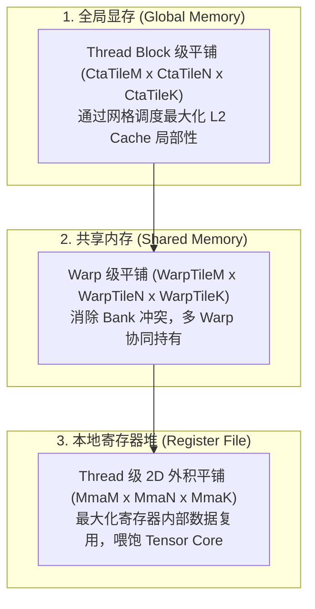

# 高性能 GEMM 硬件理论与微架构优化 (Efficient GEMM in CUDA)

> [!NOTE] 原文出处
> 本文翻译自 NVIDIA CUTLASS 官方性能优化指南 [`media/docs/cpp/efficient_gemm.md`](https://github.com/NVIDIA/cutlass/blob/main/media/docs/cpp/efficient_gemm.md)。

现代 GPU（从 Volta、Ampere 到 Hopper、Blackwell）具备极其庞大的硬件理论算力。然而，要让矩阵乘法（GEMM）真正逼近 95%+ 的理论硬件利用率，必须解决三大核心矛盾：**算力与显存带宽的失配、寄存器堆容量限制、以及内存访问的长延迟**。

---

## 1. 层次化分块结构 (Hierarchical Blocking)

为了完美匹配 GPU 的硬件并发层次与存储层级，CUTLASS 将宏观 GEMM 拆解为三级嵌套分块：



### 1.1 Threadblock 级 GEMM (CTA 级)
* 每个 CTA 负责计算输出矩阵 $C$ 的一个独立宏观分块 $(M_{\text{tile}}, N_{\text{tile}})$；
* **权衡艺术**：CTA 分块越大，从全局显存读取数据的**算术强度（Arithmetic Intensity）**越高（复用率更高，摆脱 DRAM 带宽瓶颈）；但过大的分块会导致小尺寸矩阵（如大模型 Decoding 阶段）无法填满 GPU 的所有流式多处理器（SM）。

### 1.2 Warp 级 GEMM
* CTA 内部的多个 Warp 从共享内存中拉取数据，并加载到私有寄存器中；
* 核心调优目标：**彻底消除共享内存的 Bank Conflict**，并使 Warp 级分块足够大以提高寄存器暂存效率。

### 1.3 Thread 级 GEMM (寄存器 2D 外积展开)
* 由于 CUDA 线程之间无法直接访问对方的寄存器，CUTLASS 在线程内部设计了 **2D 寄存器外积瓦片**；
* 累加器占满单线程寄存器预算的 50% 以上，通过让同一批寄存器中的数据多次参与乘加，最大化指令级并行（ILP）。

---

## 2. 软件双缓冲与延迟隐藏 (Pipelining & Double Buffering)

由于累加器占用了极多的寄存器空间，GEMM 内核在 SM 上的**硬件活跃度（Occupancy，并发线程数）**通常远低于常规轻量内核。这意味着 GPU 无法通过简单的线程上下文切换（Warp Scheduling）来隐藏长达数百周期的显存访存延迟。

CUTLASS 采用 **多级软件流水线（Software Pipelining）** 实现完全的计算与访存重叠：

```text
时间轴 (Time) ----------------------------------------------------->
阶段 1:  [从全局显存异步加载 Tile k+1] ─── (硬件后台 DMA 搬运) ───┐
阶段 0:  [将 Tile k 喂入 Tensor Core] ─── (计算核心满负荷狂飙) ──┴─> 达成零气泡重叠！
```

* **共享内存双缓冲/多缓冲**：分配至少 2 个分块缓冲区。当计算核心正在消费缓冲区 0 的数据时，异步拷贝指令（如 `cp.async` 或 TMA）已在后台向缓冲区 1 预取下一轮循环的数据。
* **寄存器双缓冲**：在 Warp 级别分配两组寄存器片段，交替执行“从共享内存载入”与“向 Tensor Core 发射计算”。

---

## 3. 应对极端长条矩阵：并行归约技术 (Parallelized Reductions)

在生成式 AI 与 LLM 推理场景中，经常遇到极端维度的矩阵：例如 **$M=1$（单批次生成）、$N$ 很小、但 $K$ 极其巨大（长文本上下文）**。
若按常规方式划分，整个 GPU 只能分出几个 Thread Block，导致 90% 以上的 SM 彻底闲置！

### 3.1 Split-K 算法（跨 Block 并行化）
* **原理**：将极其漫长的 $K$ 归约轴强行切分成 $P$ 个切片（Partitions）；
* **调度**：启动额外的 $P$ 倍 Thread Block，每个 Block 并行计算一个子区间的矩阵乘；
* **汇总**：发射一个专门的辅助批处理归约内核（Reduction Kernel），将所有中间结果跨 Block 累加，从而瞬间打满全部 SM！

### 3.2 Sliced-K 算法（跨 Warp 并行化）
* 当 $M, N$ 规模适合单 Block、但内部 Warp 数量不足时，在 CTA 内部沿着 $K$ 轴切分给多个 Warp 并行运算，最后通过共享内存进行 Warp 级局部规约。

---

## 4. Hopper Warp-Specialization (Warp 职责空间特化)

从 Hopper (SM90) 架构起，CUTLASS 迎来了 GPU 计算范式的终极进化 —— **空间分工特化（Spatial Warp-Specialization）**：
不再让所有 Warp 机械地做相同的事情，而是按职责将线程编队为两大阵营：

1. **生产者 Warp 组（DMA Producers）**：
   * 纯粹负责与 TMA 硬件打交道，只管从全局显存把数据抓取进共享内存。
2. **消费者 Warp 组（MMA Consumers）**：
   * 纯粹负责从共享内存拉取数据，驱动 Tensor Core 疯狂计算，并释放缓冲区。

### 4.1 持久化协作架构 (Persistent Cooperative)
* **常驻线程块**：启动恰好填满所有物理 SM 的常驻 Block，整个生命周期内循环消费任务队列（Tile Scheduler），彻底消除反复创建销毁 Block 的系统开销；
* **双消费者协同平分 $M$ 轴**：两个 Consumer 协作组平分 $M$ 轴数据，降低单线程寄存器压力，支持更大的 Tile 尺寸。

### 4.2 持久化乒乓交错架构 (Persistent Ping-Pong)
* 两个 Consumer 协作组分别被调度给不同的输出 Tile；
* **算力零空闲**：当协作组 0 正在执行尾声段（写回显存、应用 Activation）时，协作组 1 正在满负荷发射 Tensor Core；二者如打乒乓球般无缝交替，**彻底填平尾声段引起的计算气泡！**
