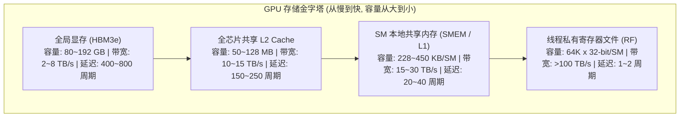
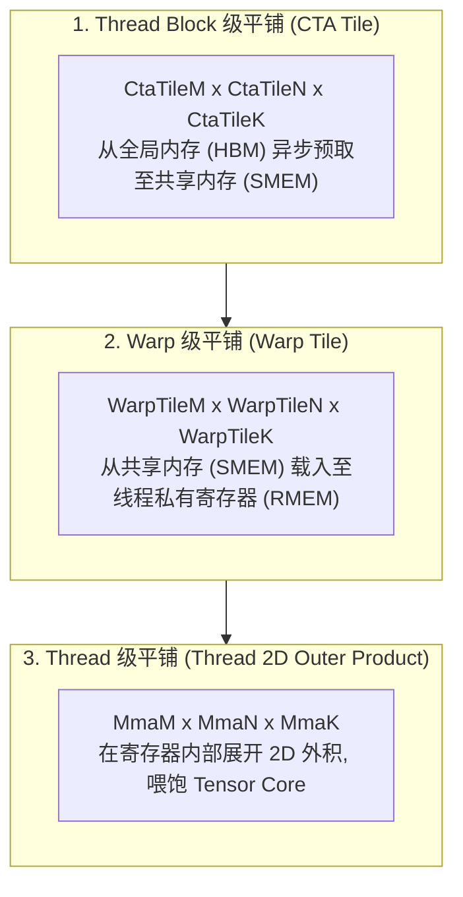
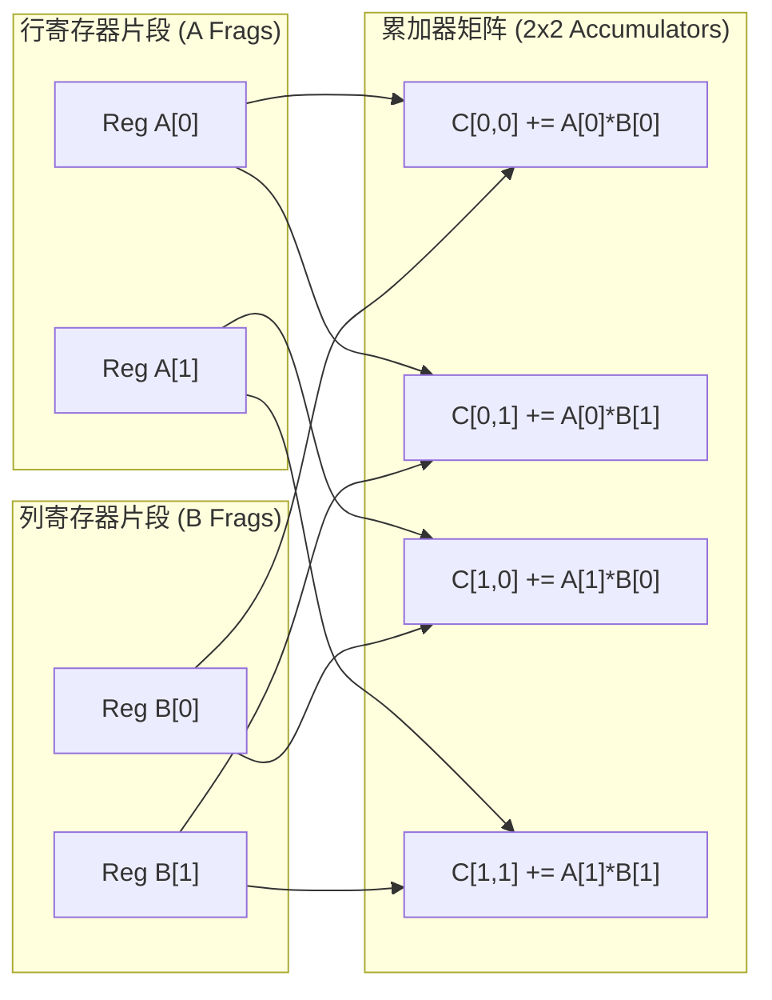
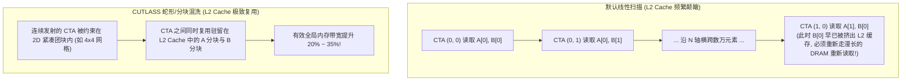
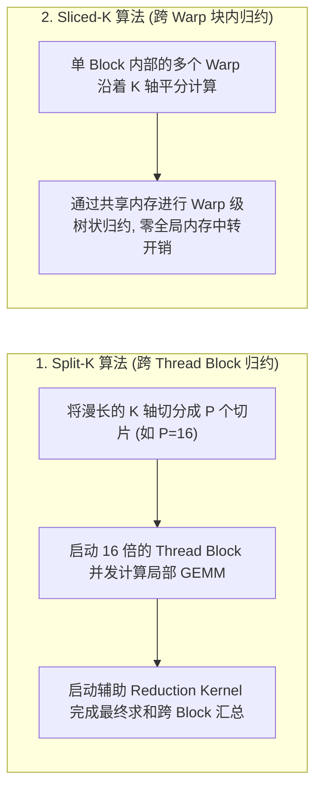
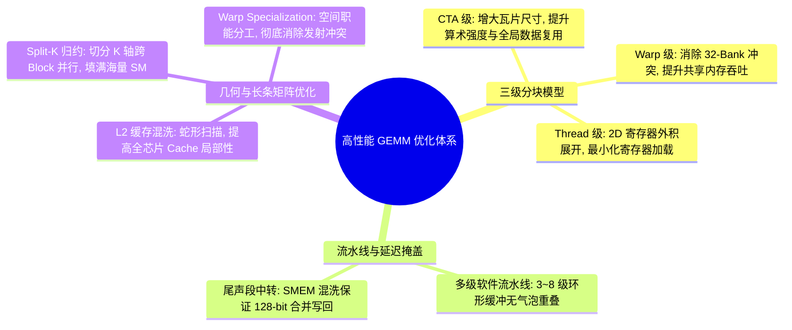

# 高性能 GEMM 硬件物理极限与微架构优化全景法则 (Efficient GEMM in CUDA)

::: warning ⚠️ 声明与免责须知
本文档由 **AI 深度辅助汉化、架构重构与长篇技术解析** 形成，**非 NVIDIA 官方技术文档**。
虽然内容力求数学严谨性、微架构精准性与工程可落地性，但不能保证 100% 毫无差错。
涉及底层硬件指令（PTX）、L2 缓存混洗参数、Split-K 算子配置及生产环境部署时，请务必以 [NVIDIA CUTLASS 官方源码库](https://github.com/NVIDIA/cutlass) 及原厂 Release 说明为最终准绳。
:::

> [!NOTE] 原文参考
> 本章对应官方核心性能优化规范文档 [`media/docs/cpp/efficient_gemm.md`](https://github.com/NVIDIA/cutlass/blob/main/media/docs/cpp/efficient_gemm.md)，并在原文档基础上补充了 Roofline 算术强度模型、2D 寄存器外积复用代数证明、L2 缓存蛇形混洗（Swizzle）几何原理、Split-K / Sliced-K 边界与 Nsight Compute (NCU) 性能调优排障清单。

在现代通用 GPU 体系结构中，矩阵乘法（GEMM）被公认为检验微架构工程设计与编译优化的终极试金石。
无论是在 NVIDIA Ampere (A100)、Hopper (H100) 还是 Blackwell (B200) 架构上，硬件工程师都赋予了计算单元极高的理论吞吐量（每秒数十至数千 TFLOPS）。

然而，**理论峰值并不等于实测性能**。
如果你写出一个朴素的 CUDA GEMM，其实测算力往往连硬件峰值的 5% 都达不到！要让一个 GEMM 算子真正突破 95% 以上的物理极限利用率，必须全面攻克三大硬件物理屏障：**内存墙带来的带宽失配、私有寄存器容量天花板、以及长达数百周期的访存停顿延迟**。

---

## 0. 物理基石：Roofline 模型与 GPU 存储金字塔



### 0.1 临界算术强度（Critical Arithmetic Intensity）
根据经典 Roofline 性能模型，算法的性能表现被严格划分为**内存受限区（Memory-Bound）** 与 **算力受限区（Compute-Bound）**。两者的临界分界点被称为**临界算术强度 $I_{\text{crit}}$**：

$$I_{\text{crit}} = \frac{\text{Peak Floating-point Operations (硬件峰值算力 FLOPs)}}{\text{Peak Memory Bandwidth (硬件峰值显存带宽 Bytes/s)}}$$

* 在 NVIDIA H100 (SXM5) 上：FP16 密集算力为 $989 \text{ TFLOPS}$，HBM3 显存带宽为 $3.35 \text{ TB/s}$；
* 临界算术强度计算：$I_{\text{crit}} \approx \frac{989 \times 10^{12}}{3.35 \times 10^{12}} \approx 295 \text{ FLOPs / Byte}$！
* **致命现实**：如果你每从全局显存读取 1 字节的数据，未能在 GPU 内部执行至少 **295 次浮点计算**，那么你的核函数就必然处于**严重的显存带宽瓶颈（Memory-Bound）**之中，昂贵的 Tensor Core 将大面积空转！

**CUTLASS 的全部优化艺术，本质上就是一套精密的数据复用与缓存置换机制，确保数据从 HBM 载入后，在 L2、SMEM 和寄存器中被疯狂复用数百次以上！**

---

## 1. 三级嵌套分块体系 (Hierarchical Blocking Structure)

为了完美匹配 CUDA 执行模型（Grid $\to$ CTA $\to$ Warp $\to$ Thread）与硬件存储层级，CUTLASS 确立了经典的三级分块范式：



---

### 1.1 第一级：Thread Block（CTA）级分块 —— 攻克 DRAM 带宽瓶颈

每个 Thread Block 负责计算输出矩阵 $C$ 的一个宏观子矩阵 $(M_{\text{tile}}, N_{\text{tile}})$。
在主循环的每一次迭代中，CTA 从全局显存拉取大小为 $M_{\text{tile}} \times K_{\text{tile}}$ 的矩阵 $A$ 瓦片，以及 $N_{\text{tile}} \times K_{\text{tile}}$ 的矩阵 $B$ 瓦片，并暂存入共享内存（SMEM）。

#### 数据复用倍率数学推导：
* 每次循环读取的物理数据量（字节数）：$(M_{\text{tile}} \cdot K_{\text{tile}} + N_{\text{tile}} \cdot K_{\text{tile}}) \times \text{sizeof}(T)$；
* 本次循环在共享内存中执行的浮点乘加操作数：$2 \times M_{\text{tile}} \times N_{\text{tile}} \times K_{\text{tile}}$；
* **CTA 级数据复用率（Reuse Factor）**为：
  $$R_{\text{CTA}} = \frac{2 \cdot M_{\text{tile}} \cdot N_{\text{tile}} \cdot K_{\text{tile}}}{(M_{\text{tile}} + N_{\text{tile}}) \cdot K_{\text{tile}}} = \frac{2 \cdot M_{\text{tile}} \cdot N_{\text{tile}}}{M_{\text{tile}} + N_{\text{tile}}}$$
* **工程启示**：当 $M_{\text{tile}} = N_{\text{tile}} = 128$ 时，$R_{\text{CTA}} = \frac{2 \times 128 \times 128}{256} = 128$！
  **这意味着瓦片越大，从全局显存读取的每个元素在共享内存中被复用的次数越多，全局带宽压力瞬间骤降两个数量级！**

---

### 1.2 第二级：Warp 级分块 —— 攻克 SMEM 32-Bank 冲突

在 CTA 内部，多个 Warp（例如 4 个或 8 个 Warp）并发读取共享内存，将其加载到私有寄存器中。
* **核心微架构矛盾**：GPU 共享内存被物理划分为 32 个 Bank（每个 Bank 宽 4 字节）。如果一个 Warp 内的 32 个线程在同一周期内访问同一个 Bank 的不同偏移行，硬件被迫将访存串行化，引发致命的 **Bank Conflict**；
* **调优法则**：
  1. 通过 CuTe 的 `Swizzle` 变换或在步长中加入 Padding（如前文 `make_stride(Int<1>{}, bM + Int<1>{})`），将空间访问打散至 32 个不同 Bank；
  2. 尽可能选择较大的 Warp 分块（如 $64 \times 64$），使得单次从 SMEM 载入的数据能够在寄存器中支撑更多的数学指令。

---

### 1.3 第三级：Thread 级 2D 寄存器外积展开 —— 终极复用艺术

CUDA 线程之间在硬件物理上**绝对无法直接互访对方的寄存器**！
如果单线程每次执行乘法都必须重新从共享内存载入数据，共享内存带宽将瞬间被打爆。

CUTLASS 采用了经典的 **2D 寄存器外积瓦片（2D Register Outer Product Tiling）**：



* **数学复杂度对比**：
  每个线程在寄存器中维护 $R_M$ 个 $A$ 的元素与 $R_N$ 个 $B$ 的元素；
  * 加载的寄存器总量仅为：$R_M + R_N$；
  * 计算出的矩阵外积元素总量为：$R_M \times R_N$！
* **工程奇迹**：通过让每个操作数在寄存器中被复用 $\min(R_M, R_N)$ 次，**指令级并行度（ILP）达到顶峰，累加器直接打满单线程 50% 以上的寄存器预算！**

---

## 2. 尾声段架构与合并写回 (Epilogue & Memory Coalescing)

主循环计算完成后，矩阵乘累加的结果 $C$ 散落在各个线程的私有累加器寄存器中。

> [!WARNING] 为什么累加器不能直接写回全局显存？
> 在 Tensor Core 的微架构设计中（参考 `0t_mma_atom.md` 中的 Volta QuadPair 与 Ampere 布局），累加器在 32 个线程中的排布是由硬件晶体管布线决定的交错形态（如 $T_0$ 负责第 0 行和第 2 行），**它在空间内存上是绝对非连续的！**
> 如果每个线程直接将寄存器写回全局显存，将导致极其散乱的单字节离散写，引发灾难性的总线非合并访问（Uncoalesced Memory Access）。

### 2.1 尾声段两阶段数据流转
CUTLASS 设计了专门的 **尾声段（Epilogue）** 处理流水线：
1. **共享内存中转混洗（SMEM Staging）**：
   各个线程首先将自己的累加器寄存器片段写入共享内存中的专用缓冲区；
2. **条带化协同写回（Coalesced Global Store）**：
   线程重新组织排布，以标准的连续行优先/列优先模式从共享内存载入数据，并使用 128 位宽指令（`st.global.v4`）**以完全合并的对齐总线事务**写回全局显存！
3. **原地算子融合（In-flight Fusions）**：
   在数据从寄存器准备写回时，原地完成 $\alpha, \beta$ 线性缩放、Bias 偏置加法以及 ReLU / GELU 激活函数计算。

---

## 3. 多级异步软件流水线 (Software Pipelining)

由于累加器占用了极多的寄存器资源，GEMM 核函数的并发活跃线程束（Occupancy）通常较低（往往只有 20%~40%）。这意味着 GPU 无法通过简单的线程调度（Context Switch）来隐藏 400 周期以上的访存延迟。

CUTLASS 采用 **多级软件流水线（Multi-Stage Software Pipelining）** 实现完全的无气泡重叠：

```text
时间轴 (Time) ------------------------------------------------------------------------->
Cycle 0~400:   [GMEM -> SMEM: Stage 0 数据拉取 (cp.async / TMA 硬件在途传输)]
Cycle 400~800: [GMEM -> SMEM: Stage 1 数据拉取] ─── (两者完美重叠，算力核心全速运转!) ───┐
               [SMEM -> RMEM -> Tensor Core: Stage 0 核心计算] ───────────────────────┴─> 零停顿！
```

* **双缓冲（Double Buffering，2 级）**：分配两组共享内存与寄存器，一组用于计算当前步，另一组用于预取下一步；
* **多级流水线（Multi-Stage，3 到 8 级）**：在 Ampere SM80 及 Hopper SM90 上，利用硬件异步能力在共享内存中开辟 4 级以上环形缓冲，让未来数个迭代的数据始终在网络中处于飞行（In-flight）状态，彻底消灭流水线停顿气泡！

---

## 4. L2 缓存几何优化：线程块混洗与空间填充曲线 (Threadblock Swizzling)

在宏观网格调度中，CUDA 默认按照行优先或列优先的线性顺序启动 Thread Block：
$$(0, 0) \to (0, 1) \to (0, 2) \to \dots \to (0, N-1) \to (1, 0) \dots$$



### 4.1 混洗因子（Swizzle Factor）几何原理
CUTLASS 在 `threadblock_swizzle.h` 中内置了智能混洗算法：
* 将 $M$ 轴方向上连续的若干个 CTA（例如每 4 个或 8 个 CTA）打包成一个**空间紧凑的二维宏观团块（Macro-Tile）**；
* 使连续启动的 CTA 在空间上同时访问相同的输入数据，将全芯片共享的 L2 Cache 命中率提升到极限，相当于凭空为 GPU 增加了 30% 以上的有效显存带宽！

---

## 5. 应对极端长条矩阵：并行归约技术 (Parallelized Reductions)

在 LLM 推理的自回归解码（Decoding）阶段，用户面临着极端不规则的输入矩阵：
$$\text{Batch} = 1 \implies M = 1, \quad N = 4096, \quad K = 32768 \text{ (超长文本上下文)}$$

* **灾难发生**：如果按照常规 $128 \times 128$ 分块，在 $M$ 轴上只能分出 $1$ 个块，在 $N$ 轴上分出 $32$ 个块。
  整个 GPU 只能启动区区 **32 个 Thread Block**！而像 H100 拥有 132 个物理 SM，意味着 **超过 75% 的计算核心被白白闲置！**

为了激活沉睡的算力，CUTLASS 提供了两大归约杀手锏：



### 5.1 Split-K 算法实战选型指南
* **适用场景**：$M \times N$ 极小，而 $K$ 极其庞大，导致全 GPU 的 CTA 总数无法填满物理 SM 时；
* **代价权衡**：Split-K 需要额外开辟一块中间临时工作区内存（Workspace）来暂存各个切片的中间结果，并引入一次归约内核发射。但相比于 75% 的 SM 闲置，其带来的性能加速往往高达 **3 倍至 5 倍**！

---

## 6. Nsight Compute (NCU) 生产级性能排障清单

在工业界调试高性能算子时，必须使用 NVIDIA Nsight Compute (NCU) 进行深度 Profiling。下表总结了最重要的性能诊断计数器与调优手段：

| NCU 监控指标 | 异常物理表象 | 根因诊断与排查方向 | CUTLASS / CuTe 调优药方 |
| :--- | :--- | :--- | :--- |
| **`sm__throughput.avg.pct_of_peak`** | 计算吞吐低于 60% | 算力未打满，处于访存受限或延迟停顿 | 增大 CTA Tile 尺寸；检查是否启用了 Tensor Core 硬件指令 |
| **`l1tex__data_bank_conflicts_pipe_lsu`** | 计数器激增（非零） | 共享内存发生严重的多路 Bank Conflict | 在 SMEM Stride 中加入 **`+1 Padding`**，或引入 **`cute::Swizzle`** 混洗 |
| **`smsp__warp_issue_stalled_long_scoreboard`** | 停顿占比高于 30% | 算力核心正在饥饿等待全局显存加载完成 | 增加流水线级数（如从 3 级提升至 5 级）；改用异步 `cp.async` 或 TMA |
| **`smsp__warp_issue_stalled_barrier`** | 屏障同步停顿高 | 线程块内发生剧烈的负载不均衡或频繁死等 | 消除核函数内的动态分支；采用 Warp Specialization 解耦搬运与计算 |
| **`dram__throughput.avg.pct_of_peak`** | 接近 100% 但计算极慢 | 陷入 Memory-Bound 泥潭 | 检查是否向量化（`UniversalCopy<uint128_t>`）；检查访存是否合并（Coalesced） |

---

## 7. 本章核心小结与调优思维导图



至此，关于现代 GPU 矩阵乘法的微架构物理理论、分块艺术与调优全景已全部铺陈完毕。
在接下来的章节中，我们将为你呈上 **全套术语与核心概念权威词典（Glossary）**，助你彻底融会贯通 CUTLASS 3.x 与 CuTe 的宏伟殿堂！
