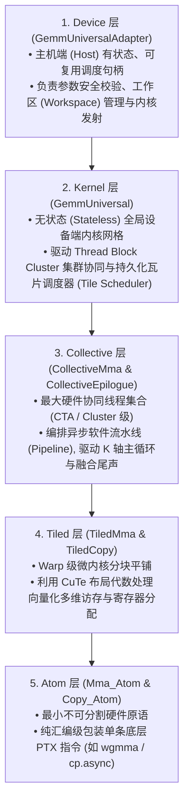
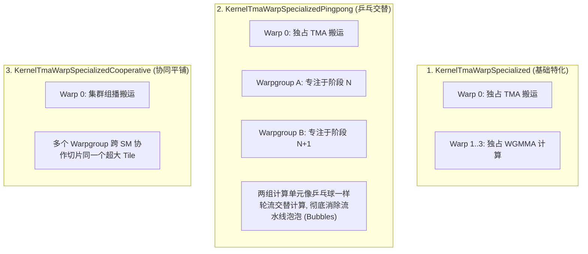
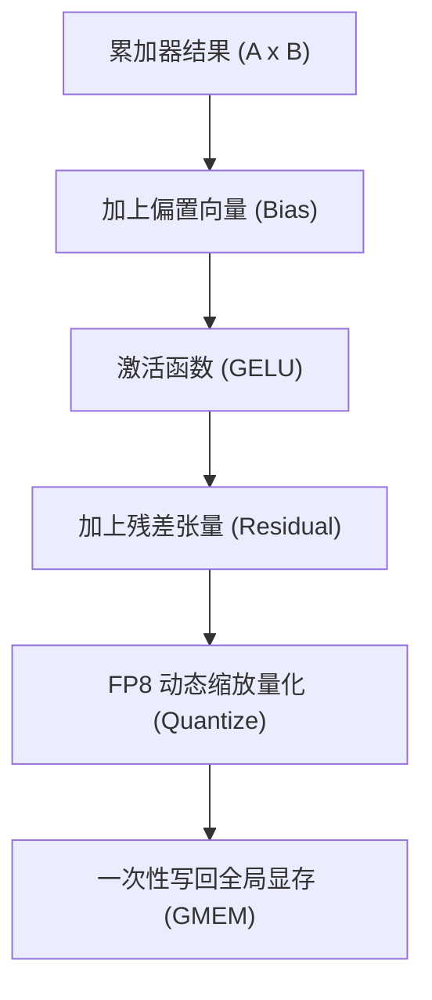
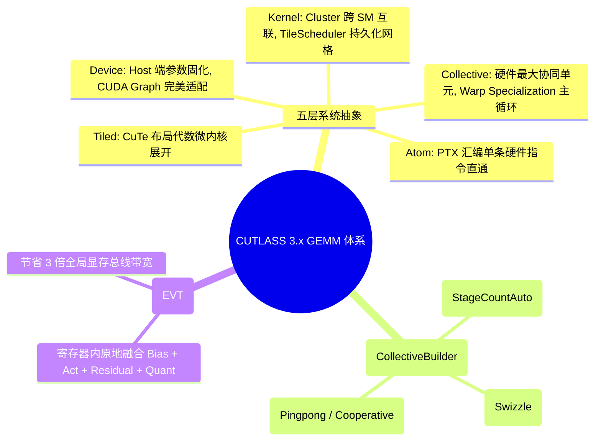

# CUTLASS 3.x GEMM API 体系与五层架构全景：从主机调度到微架构指令合成

> **重要免责声明**：本网站只是用来消耗反重力额度的，并且给有需要的人看一看，准确度极低。可用度极低，不想看的请不看，造成错误概不负责。
> 本篇由 AI 辅助汉化与深度解析，非 NVIDIA 官方技术文档。涉及 GPU 底层硬件架构参数与生产算子调优，请以 [NVIDIA CUTLASS 官方源码](https://github.com/NVIDIA/cutlass) 为准。

---
> [!NOTE] 原文参考
> 本章对应官方核心架构规范文档 [`media/docs/cpp/gemm_api_3x.md`](https://github.com/NVIDIA/cutlass/blob/main/media/docs/cpp/gemm_api_3x.md)，并在原文档基础上补充了 CUTLASS 2.x 到 3.x 的范式演进对比、持久化内核（Persistent Kernels）工作瓦片调度机理、Epilogue Visitor Tree (EVT) 算子融合以及端到端工业级生产代码实战。

在现代超大规模深度学习基础设施（如 Megatron-LM、vLLM、TensorRT-LLM）中，底层算子库的架构设计直接决定了上层框架的迭代效率与执行性能。

面对从 Ampere (SM80) 到 Hopper (SM90) 乃至 Blackwell (SM100) 硬件微架构的颠覆式变革，**CUTLASS 3.x 彻底重构了矩阵乘累加（MMA）的抽象金字塔**。
它将整个 GPU 系统的软硬件协同体系，严格凝练为自顶向下的 **5 大核心系统层级**：



---

## 0. 经典三重嵌套循环的层次化分解

任何通用矩阵乘法（$C \mathrel{+}= A \times B$）在数学本质上都可以表达为三层嵌套循环：
$$\text{for } m \in [0, M) \quad \text{for } n \in [0, N) \quad \text{for } k \in [0, K) \quad C_{mn} \mathrel{+}= A_{mk} \cdot B_{nk}$$

在传统的单线程 CPU 编程中，这三重循环仅仅是顺序执行的代码块；但在现代高度并行的 GPU 体系中，**这三重循环被巧妙地映射拆解到了上述 5 个异构层级之中**：

```cpp
// =========================================================================
// 【层级 2：Kernel 层】—— 网格级粗粒度空间并行 (ClusterTileM, ClusterTileN)
// 在传统内核中体现为 Grid 启动维度；在持久化内核 (Persistent Kernel) 中体现为对 TileScheduler 的轮询
// =========================================================================
for (int cluster_m = 0; cluster_m < GemmM; cluster_m += ClusterTileM) {
  for (int cluster_n = 0; cluster_n < GemmN; cluster_n += ClusterTileN) {

    // =====================================================================
    // 【层级 3：Collective 层】—— 主循环 K 轴深度展开 (K-Tile Mainloop)
    // 线程块 (CTA) 协作推进异步多级流水线，源源不断预取 GMEM 数据至 SMEM
    // =====================================================================
    for (int k_tile = 0; k_tile < size<2>(gmem_tensor_A); k_tile++) {

      // ===================================================================
      // 【层级 4：TiledMMA 层】—— Warp 级寄存器微内核计算 (完全静态循环展开)
      // 遍历每个线程在局部持有的微观分块模式
      // ===================================================================
      for (int tiled_mma_k = 0; tiled_mma_k < size<2>(A); tiled_mma_k++) {
        for (int tiled_mma_m = 0; tiled_mma_m < size<1>(A); tiled_mma_m++) {
          for (int tiled_mma_n = 0; tiled_mma_n < size<1>(B); tiled_mma_n++) {

            // =============================================================
            // 【层级 5：Atom 层】—— 单条底层硬件 PTX 指令物理发射
            // 映射到底层 wgmma.mma_async 或 mma.sync
            // =============================================================
            mma.call(d, a, b, c);

          } // tiled_mma_n
        } // tiled_mma_m
      } // tiled_mma_k

    } // k_tile (Collective Mainloop)
  }
}
```

---

## 1. 五大核心系统层级全景深度剖析

### 1.1 第一层：`Device` 层 —— 主机端可复用调度句柄

* **核心代表类**：`cutlass::gemm::device::GemmUniversalAdapter<GemmKernel>`。
* **职责边界**：位于 Host 端，为上层业务代码（如 PyTorch C++ 扩展、C 接口运行时）提供一个有状态、强类型、且对异常完全免疫的算子管理入口。

#### 核心设计模式：`Arguments` 与 `Params` 严格解耦
在高性能生产系统中，反复启动核函数时的参数打包开销往往是延迟杀手。CUTLASS 采用了经典的两阶段参数分离架构：
1. **`Arguments`（用户输入参数结构体）**：
   包含上层直观的配置（如动态问题规模 `problem_shape(M, N, K, L)`、输入输出内存裸指针 `ptr_A, ptr_B, ptr_C`、缩放标量 $\alpha, \beta$ 以及调度器参数）。
2. **`Params`（编译期固化硬件参数）**：
   `GemmUniversalAdapter::to_underlying_arguments` 会在 Host 端执行静态布局求值、TMA 描述符构建、步长折叠与工作区地址绑定，将其转化为可以直接拷入 GPU 常量内存的紧凑二进制镜像。

> [!TIP] CUDA Graph 零开销捕获支持
> 这种分离模式天然契合 **CUDA Graph**：一旦算子的 `Params` 构建完成，后续每次在推理流水线中重新执行时，只需调用 `gemm_handle.run(stream)`，**完全跳过一切 Host 端参数校验与分配开销，发射耗时降至 1 微秒以内！**

---

### 1.2 第二层：`Kernel` 层 —— 网格调度与持久化执行引擎

* **核心代表类**：`cutlass::gemm::kernel::GemmUniversal<ProblemShape, CollectiveMainloop, CollectiveEpilogue, TileScheduler>`。
* **职责边界**：无状态的全局 CUDA 设备内核（`__global__` 函数封装），负责宏观硬件拓扑编排。

#### 1.2.1 线程块集群协同（Thread Block Clusters）
在 Hopper SM90 及以上架构中，NVIDIA 引入了跨 SM 的硬件互联机制 —— **Cluster**。
`GemmUniversal` 允许定义 `ClusterShape`（例如 `Shape<_2, _1, _1>`）：
* 两个位于相邻物理 SM 上的 Thread Block 可以通过**分布式共享内存（DSMEM）**以超低延迟直接互访对方的 SMEM；
* TMA 具备 **集群组播（Cluster Multicast）** 能力：单条硬件指令同时向整个 Cluster 内的所有 SMEM 广播同一块权重数据，使全局总线带宽利用率直接翻倍！

#### 1.2.2 持久化内核（Persistent Kernels）与瓦片调度器 (Tile Scheduler)
传统 CUDA 编程采用“一个 CTA 处理一个 Tile”的启动模式，其缺点极其致命：
* 当问题规模较大时，启动数万个 CTA 会引发巨大的硬件上下文创建开销；
* 当尾部波次（Wave Quantization Tails）不满时，大量的 SM 会闲置等待。

CUTLASS 3.x 全面普及了 **持久化内核（Persistent Kernels）**：
* 整个 Grid 仅启动恰好填满 GPU 所有物理 SM 槽位的常驻 CTA（例如在 H100 上启动 132 个 Cluster）；
* 每个 CTA 内部维护一个 `while` 循环，动态向 **`TileScheduler`** 索取下一个待计算的瓦片坐标 $(m, n, l)$：

```mermaid
graph LR
    subgraph PersistentGrid["常驻硬件 Grid (正好铺满物理 SM)"]
        CTA0["CTA 0 (常驻)"]
        CTA1["CTA 1 (常驻)"]
        CTAn["CTA N (常驻)"]
    end

    Scheduler["TileScheduler 智能调度器<br/>(维护希尔伯特曲线 / 蛇形扫描, 保证 L2 Cache 命中率)"]

    CTA0 -->|1. fetch_next_work()| Scheduler
    CTA1 -->|1. fetch_next_work()| Scheduler
    Scheduler -->|2. 返回全局分块坐标 (m, n, l)| CTA0
    Scheduler -->|2. 返回全局分块坐标 (m, n, l)| CTA1
```

`TileScheduler` 甚至支持根据 GPU 的 L2 Cache 大小，自动规划计算瓦片的**空间遍历曲线（如希尔伯特曲线、蛇形曲线）**，让不同 CTA 尽量在同一时间复用同一块 L2 缓存中的数据，使有效内存带宽再提升 15%~30%！

---

### 1.3 第三层：`Collective` 层 —— 硬件协同最大化单元

* **核心代表类**：`cutlass::gemm::collective::CollectiveMma` 与 `cutlass::epilogue::collective::DefaultEpilogue`。
* **定义**：“能够利用硬件加速特性进行高效通信与同步的**最大协同线程集合**。”

#### 1.3.1 `CollectiveMma`（主循环中枢）
它是整个矩阵乘算子的大脑，负责：
1. **驱动异步软件流水线（`cutlass::Pipeline`）**；
2. **编排 Warp Specialization 职能分工**（分离 DMA 搬运与 Tensor Core 计算）；
3. **主循环计算融合（Mainloop Fusion）**：例如在加载权重的流水线中，直接插入在线反量化操作（如 FP8 / INT4 权重在线反量化为 FP16）。

#### 1.3.2 `CollectiveEpilogue`（尾声段中枢）
负责在累加器完成归约后，将结果从寄存器卸载至共享内存或全局显存，并支持强大的**算子融合树（Epilogue Visitor Tree, EVT）**。

---

## 2. 调度的核心大脑：Collective Dispatch Policies

在 CUTLASS 3.x 中，算法实现不再是写死的，而是采用**基于类型标签的分发策略（Tag-Based Dispatch Policy）**。

以 Hopper SM90 为例，最经典的分发策略是：

```cpp
template<
  int Stages_,                        // 显式指定流水线级数 (例如 3, 4, 5)
  class ClusterShape_ = Shape<_1,_1,_1>, // 指定 Cluster 集群拓扑
  class KernelSchedule = KernelTmaWarpSpecializedCooperative // 指定调度策略
>
struct MainloopSm90TmaGmmaWarpSpecialized {
  constexpr static int Stages = Stages_;
  using ClusterShape = ClusterShape_;
  using ArchTag      = arch::Sm90;
  using Schedule     = KernelSchedule;
};
```

### 核心调度策略（Kernel Schedules）对比：



---

## 3. 模板自动合成器：`CollectiveBuilder`

在过去，手动手写一个 `CollectiveMma` 需要填充多达 14 个极其复杂的模板参数（包括各种 `LayoutAtom`、`CopyAtom`、`SmemLayout` 等），稍有不慎就会引发数千行的模板报错信息。

CUTLASS 3.x 引入了革命性的自动化元编程引擎 —— **`CollectiveBuilder`**！
你只需提供高层业务意图，`CollectiveBuilder` 内部的专家规则系统会自动推导出一切最底层的微架构布局：

```cpp
#include <cutlass/gemm/collective/collective_builder.hpp>

// 声明业务级意图，由 CollectiveBuilder 自动生成最完美的 CollectiveMainloop！
using CollectiveMainloop = typename cutlass::gemm::collective::CollectiveBuilder<
    cutlass::arch::Sm90,                                // 目标微架构: Hopper SM90
    cutlass::arch::OpClassTensorOp,                     // 使用硬件 Tensor Core
    cutlass::half_t, cutlass::layout::RowMajor, 8,      // A: FP16, 行优先, 128位(8元素)对齐
    cutlass::half_t, cutlass::layout::ColumnMajor, 8,   // B: FP16, 列优先, 128位(8元素)对齐
    float,                                              // 累加器精度: FP32
    Shape<_128, _128, _64>,                             // CTA 分块瓦片: 128x128x64
    Shape<_2, _1, _1>,                                  // Cluster 集群尺寸: 2x1x1
    cutlass::gemm::collective::StageCountAuto,          // 🤖 自动根据 SMEM 容量计算最优流水线级数！
    cutlass::gemm::collective::KernelScheduleAuto       // 🤖 自动选择最优调度策略 (如 Pingpong 或 Cooperative)！
  >::CollectiveOp;
```

#### `CollectiveBuilder` 在幕后为你完成的精密工作：
1. **自动计算最大流水线级数**：检测目标 GPU 每一个 SM 的最大可用共享内存（如 H100 为 228 KB），扣除其他保留开销后，自动将 Stage 数拉满到物理极限；
2. **自动注入 Bank-Conflict-Free Swizzle**：针对所选的数据类型与对齐，自动在共享内存布局上应用最优的 128B 混洗算法；
3. **自动绑定硬件 TMA 描述符**：生成适配全局内存与共享内存的 `TmaCopy` 算子。

---

## 4. 工业级端到端实战：组装并执行一个完整的 H100 极速 GEMM

以下给出一个完整的、单文件可编译的 CUTLASS 3.x 端到端 GEMM 运行范例：

```cpp
#include <iostream>
#include <vector>

#include <cutlass/cutlass.h>
#include <cutlass/numeric_types.h>
#include <cutlass/gemm/device/gemm_universal_adapter.h>
#include <cutlass/gemm/collective/collective_builder.hpp>
#include <cutlass/epilogue/collective/default_epilogue.hpp>
#include <cutlass/util/device_memory.h>

using namespace cute;

// =========================================================================
// 1. 编译期元编程类型组装 (The Assembly Pipeline)
// =========================================================================

// 步骤 A: 构建主循环
using CollectiveMainloop = typename cutlass::gemm::collective::CollectiveBuilder<
    cutlass::arch::Sm90, cutlass::arch::OpClassTensorOp,
    cutlass::half_t, cutlass::layout::RowMajor, 8,
    cutlass::half_t, cutlass::layout::ColumnMajor, 8,
    float,
    Shape<_128, _128, _64>,
    Shape<_2, _1, _1>,
    cutlass::gemm::collective::StageCountAuto,
    cutlass::gemm::collective::KernelScheduleAuto
  >::CollectiveOp;

// 步骤 B: 构建尾声段 (Epilogue: C = alpha * (A * B) + beta * C)
using CollectiveEpilogue = cutlass::epilogue::collective::DefaultEpilogue<
    cutlass::half_t,
    cutlass::gemm::TagToStrideC_t<cutlass::layout::RowMajor>,
    cutlass::gemm::TagToStrideC_t<cutlass::layout::RowMajor>,
    cutlass::epilogue::thread::LinearCombination<cutlass::half_t, 1, float, float>>;

// 步骤 C: 在 Kernel 层融合成全局无状态内核
using GemmKernel = cutlass::gemm::kernel::GemmUniversal<
    cute::Shape<int, int, int, int>, // 运行时动态问题规模 [M, N, K, Batch]
    CollectiveMainloop,
    CollectiveEpilogue
>;

// 步骤 D: 包装为 Host 端通用适配器句柄
using GemmHandle = cutlass::gemm::device::GemmUniversalAdapter<GemmKernel>;

// =========================================================================
// 2. 主机端运行时调度 (Host Runtime Orchestration)
// =========================================================================

int main() {
  // 定义问题规模: M=4096, N=4096, K=4096, Batch=1
  int M = 4096, N = 4096, K = 4096, L = 1;
  auto prob_shape = make_shape(M, N, K, L);

  // 分配 GPU 内存
  cutlass::DeviceAllocation<cutlass::half_t> block_A(M * K);
  cutlass::DeviceAllocation<cutlass::half_t> block_B(K * N);
  cutlass::DeviceAllocation<cutlass::half_t> block_C(M * N);
  cutlass::DeviceAllocation<cutlass::half_t> block_D(M * N);

  // 初始化步长 (RowMajor: 跨度为列数; ColumnMajor: 跨度为行数)
  auto stride_A = cutlass::make_cute_packed_stride(cutlass::gemm::TagToStrideA_t<cutlass::layout::RowMajor>{}, make_shape(M, K, L));
  auto stride_B = cutlass::make_cute_packed_stride(cutlass::gemm::TagToStrideB_t<cutlass::layout::ColumnMajor>{}, make_shape(N, K, L));
  auto stride_C = cutlass::make_cute_packed_stride(cutlass::gemm::TagToStrideC_t<cutlass::layout::RowMajor>{}, make_shape(M, N, L));
  auto stride_D = stride_C;

  // 打包用户输入参数 (Arguments)
  typename GemmHandle::Arguments arguments{
    cutlass::gemm::GemmUniversalMode::kGemm,
    prob_shape,
    {block_A.get(), stride_A, block_B.get(), stride_B},
    {{1.0f, 0.0f}, block_C.get(), stride_C, block_D.get(), stride_D}
  };

  // 实例化算子句柄并校验合法性
  GemmHandle gemm_op;
  CUTLASS_CHECK(gemm_op.can_implement(arguments));

  // 获取并分配内核执行所需的工作区内存 (Workspace)
  size_t workspace_size = gemm_op.get_workspace_size(arguments);
  cutlass::device_memory::allocation<uint8_t> workspace(workspace_size);

  // 将 Arguments 编译固化为底层硬件参数 Params
  CUTLASS_CHECK(gemm_op.initialize(arguments, workspace.get()));

  // 极速发射核函数！
  CUTLASS_CHECK(gemm_op.run());

  cudaDeviceSynchronize();
  std::cout << "CUTLASS 3.x SM90 TMA GEMM executed successfully!" << std::endl;
  return 0;
}
```

---

## 5. 尾声融合之巅：EVT 算子融合树 (Epilogue Visitor Tree)

在现代大模型推理中，矩阵乘法几乎从不单独存在，它的下游紧跟着激活函数、残差连接或量化操作：
$$\text{Output} = \text{FP8\_Quant}(\text{GELU}(A \times B + \text{Bias}) + \text{Residual})$$

如果每次都将矩阵乘结果写回全局显存，再启动一个单独的 Element-wise Kernel 来做激活和残差，**访存带宽将被活活浪费 3 倍以上！**

CUTLASS 3.x 引入了跨时代的 **EVT（Epilogue Visitor Tree，尾声访问者树）** 架构：
* 它允许开发者像拼乐高积木一样，用纯 C++ 声明一个计算图语法树；
* 在累加器数据从寄存器准备写回时，**硬件直接在本地寄存器中串行执行完整的复合激活与归约流水线，一气呵成写回最终结果，零多余全局访存！**



---

## 6. 本章核心小结与决策矩阵



掌握了 CUTLASS 3.x 的五层架构金字塔与 `CollectiveBuilder` 自动合成心法，你便站在了现代 GPU 算子工程的最前沿。
在接下来的章节中，我们将探索 **Blackwell SM100 架构的前沿特性** 以及 **高效 GEMM 的全生命周期调优技巧**！
