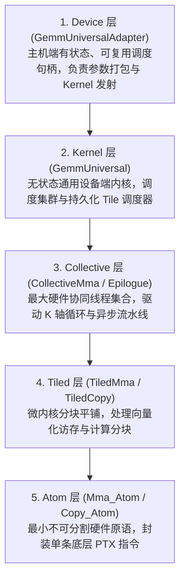

# CUTLASS 3.x GEMM API 体系与五层架构全景

> [!NOTE] 原文出处
> 本文翻译自 NVIDIA CUTLASS 官方核心规范文档 [`media/docs/cpp/gemm_api_3x.md`](https://github.com/NVIDIA/cutlass/blob/main/media/docs/cpp/gemm_api_3x.md)。

CUTLASS 3.x 在 GPU 系统层级之上构建了一套高度统一、分层解耦的矩阵乘累加（MMA）编程模型。从最顶层的主机调用，到底层的单条硬件指令，整套体系被严格划分为 **5 大核心层级**：



---

## 1. 经典三重循环的层次化映射模型

经典的密集矩阵乘法在理论上体现为“三重嵌套循环（Triply Nested Loop）”：

$$\text{for } m \dots \quad \text{for } n \dots \quad \text{for } k \dots \quad C_{mn} \mathrel{+}= A_{mk} \cdot B_{nk}$$

在 CUTLASS 3.x 中，这三重循环被映射到不同的系统层级中：

```cpp
// 1. 【Kernel 层】：遍历 Thread Block Clusters (网格级并行)
// 在持久化内核 (Persistent Kernel) 中体现为对 TileScheduler 的轮询 while 循环
for (int cluster_m = 0; cluster_m < GemmM; cluster_m += ClusterTileM) {
  for (int cluster_n = 0; cluster_n < GemmN; cluster_n += ClusterTileN) {

    // 2. 【Collective 层】：遍历全部 K-tiles 的主循环 (Mainloop)
    // 驱动异步软件流水线，将全局内存数据源源不断搬运至共享内存
    for (int k_tile = 0; k_tile < size<2>(gmem_tensor_A); k_tile++) {

      // 3. 【TiledMMA 层】：在寄存器堆中展开的微内核计算
      // 循环完全静态展开 (Fully Unrolled)
      for (int tiled_mma_k = 0; tiled_mma_k < size<2>(A); tiled_mma_k++) {
        for (int tiled_mma_m = 0; tiled_mma_m < size<1>(A); tiled_mma_m++) {
          for (int tiled_mma_n = 0; tiled_mma_n < size<1>(B); tiled_mma_n++) {

            // 4. 【Atom 层】：发射底层硬件 PTX 指令 (如 wgmma 或 mma.sync)
            mma.call(d, a, b, c);

          }
        }
      }

    } // End K-tile Mainloop
  }
}
```

---

## 2. 算子组装四部曲 (Assembly Order)

在 CUTLASS 3.x 中，组装并运行一个极速 GEMM 遵循极其清晰的**自底向上四步法则**：

```cpp
#include <cutlass/cutlass.h>
#include <cutlass/gemm/device/gemm_universal_adapter.h>
#include <cutlass/gemm/collective/collective_builder.hpp>
#include <cutlass/epilogue/collective/default_epilogue.hpp>

// 步骤 1: 使用 CollectiveBuilder 自动生成 Collective 层主循环
using CollectiveMainloop = typename cutlass::gemm::collective::CollectiveBuilder<
    cutlass::arch::Sm90, cutlass::arch::OpClassTensorOp,
    cutlass::half_t, cutlass::layout::RowMajor, 8, // A 矩阵精度、布局、对齐
    cutlass::half_t, cutlass::layout::ColumnMajor, 8, // B 矩阵精度、布局、对齐
    float,                                            // 累加器精度
    Shape<_128, _128, _64>,                           // CTA 分块大小
    Shape<_2, _1, _1>,                                // Cluster 集群分块大小
    cutlass::gemm::collective::StageCountAuto,        // 自动计算最优流水线级数
    cutlass::gemm::collective::KernelScheduleAuto     // 自动匹配最优调度策略
  >::CollectiveOp;

// 步骤 2: 声明 Collective 层尾声段 (Epilogue)
using CollectiveEpilogue = cutlass::epilogue::collective::DefaultEpilogue<
    cutlass::half_t,
    cutlass::gemm::TagToStrideC_t<cutlass::layout::RowMajor>,
    cutlass::gemm::TagToStrideC_t<cutlass::layout::RowMajor>,
    cutlass::epilogue::thread::LinearCombination<cutlass::half_t, 1, float, float>>;

// 步骤 3: 在 Kernel 层将 Mainloop 与 Epilogue 融合成无状态设备内核
using GemmKernel = cutlass::gemm::kernel::GemmUniversal<
    cute::Shape<int, int, int, int>, // 运行时动态问题规模 [M, N, K, Batch]
    CollectiveMainloop,
    CollectiveEpilogue
>;

// 步骤 4: 用 Device 层适配器包装，得到主机端可复用算子句柄
using GemmHandle = cutlass::gemm::device::GemmUniversalAdapter<GemmKernel>;
```

---

## 3. 五层核心 API 职责详解

### 3.1 Device 层：`GemmUniversalAdapter`
* **定位**：主机端（Host-side）的统一入口，扮演类似于 cuBLAS 的角色。
* **特性**：
  * **有状态（Stateful）**：内部持有并管理 `Params` 结构体的生命周期，负责将用户视角的 `Arguments` 降级解析为设备内核能识别的物理参数。
  * **可复用（Reusable）**：句柄实例化并初始化后，可以在多个 Stream 上以不同的矩阵指针反复并发调用，消除反复初始化的开销。
  * **向下兼容**：同一套适配器能够同时透明支持 2.x 和 3.x 内核。

---

### 3.2 Kernel 层：`GemmUniversal`
* **定位**：运行在 GPU 上的全局设备内核入库（Grid 级入口）。
* **四大核心职责**：
  1. 调度并串联 Collective 主循环与尾声段的执行时序；
  2. 在 **Warp-specialized（Warp 分工特化）** 架构中，将不同的 Warp 精准编队分配至搬运或计算岗位；
  3. 执行网格空间重排（Grid Swizzling），提升 L2 Cache 局部性与命中率；
  4. 支持**持久化内核调度器（TileScheduler）**，如 `KernelTmaWarpSpecializedPingpong` 或 `Cooperative` 调度。

---

### 3.3 Collective 层：`CollectiveMma`
* **定义**：**“能通过硬件专用总线进行高速协同的最大线程集合”**（在 Hopper 架构中对应一个 Thread Block Cluster）。
* **技术内涵**：
  * 封装了完整的 $K$ 轴外层主循环；
  * 协同驱动硬件级异步数据搬运（如 TMA 或 `cp.async`）；
  * 管理共享内存的多级软件流水线（Multi-stage Pipeline）；
  * 采用**标签分发策略（Tag-dispatch Policies）**，通过统一的类名挂载不同的微架构实现，彻底消除代码冗余。

---

### 3.4 Tiled 层与 Atom 层
* **`TiledMma` 与 `TiledCopy`**：针对局部数据块的平铺微内核，处理向量化访存（如 128 位对齐载入）以及多线程协同分块。
* **`Mma_Atom` 与 `Copy_Atom`**：最小不可分割的底层硬件原语，直接内联 PTX 指令，向高层暴露严谨的数学元信息。
