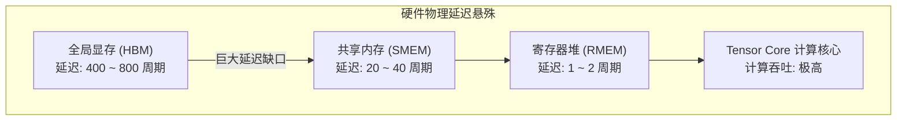
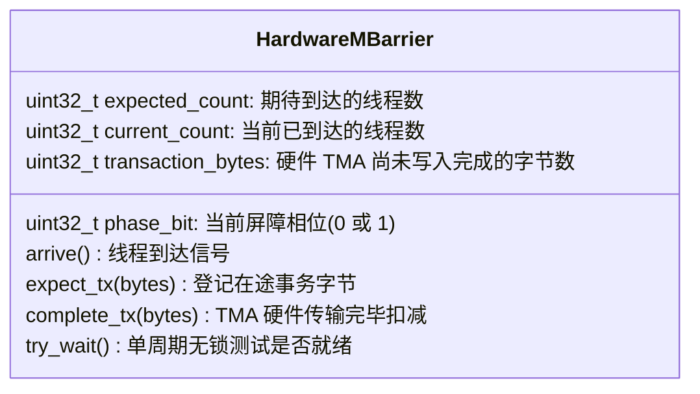
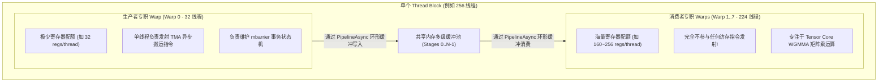
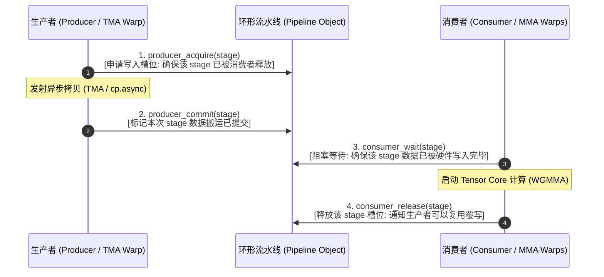
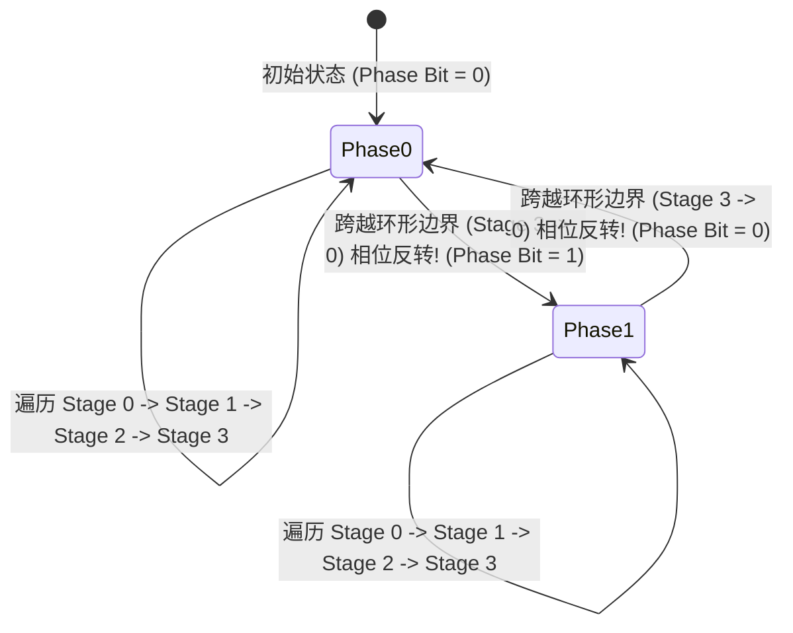

# CUTLASS 异步软件流水线与同步机制：生产者-消费者模型与硬件事务栅障深度剖析

> **重要免责声明**：本网站只是用来消耗反重力额度的，并且给有需要的人看一看，准确度极低。可用度极低，不想看的请不看，造成错误概不负责。
> 本篇由 AI 辅助汉化与深度解析，非 NVIDIA 官方技术文档。涉及 GPU 底层硬件架构参数与生产算子调优，请以 [NVIDIA CUTLASS 官方源码](https://github.com/NVIDIA/cutlass) 为准。

---
> [!NOTE] 原文参考
> 本章对应官方规范文档 [`media/docs/cpp/pipeline.md`](https://github.com/NVIDIA/cutlass/blob/main/media/docs/cpp/pipeline.md)，并在原文档基础上补充了 GPU 内存墙（Memory Wall）理论模型、Warp Specialization 角色解耦、`mbarrier` 硬件事务计数机制、相位翻转（Phase Flip）数学证明与工业级端到端流水线实战。

在现代超高吞吐 GPU 算子工程（如大模型训练推理的核心 GEMM、FlashAttention-3、MoE 门控投影）中，**访存延迟隐藏（Latency Hiding）** 是决定算子能否榨干硬件理论峰值 TFLOPS 的绝对生命线。

在 NVIDIA Hopper (SM90) 与 Blackwell (SM100) 微架构中，硬件引入了革命性的 **线程块集群（Thread Block Clusters）**、**硬件张量内存加速器（TMA）** 以及硬件加速的 **异步事务栅障（Asynchronous Transaction Barriers, `mbarrier`）**。
为了驾驭这些复杂的并发硬件机制，CUTLASS 3.x 构建了一套工业级的 **异步软件流水线抽象库（`cutlass::Pipeline`）**。

---

## 0. 物理背景：内存墙危机与多级流水线演进



### 0.1 利特尔法则（Little's Law）与流水线级数
在计算机体系结构中，利特尔法则规定了维持硬件流水线满载所需的并行度：

$$\text{Concurrency (并行在途数据量)} = \text{Latency (访存延迟)} \times \text{Throughput (硬件吞吐量)}$$

* 在 Pascal / Volta 时代，全局内存带宽较低，使用传统的**双缓冲（Double Buffering，2 级流水线）**足以掩盖部分延迟；
* 但在 Hopper / Blackwell 时代，Tensor Core 算力爆炸式增长至每秒数百甚至数千 TFLOPS，全局显存带宽与算力的相对比值持续收窄。如果依然只使用 2 级缓冲，计算核心将有超过 60% 的时间在处于“饥饿等待”停顿（Stall）状态！
* **现代高端算子必须采用 3 到 8 级多级循环缓冲（Multi-Stage Circular Buffering）**，提前让多个未来时间步的分块数据处于在途（In-flight）异步传输状态，才能彻底熨平 400 周期以上的访存鸿沟！

### 0.2 四代 GPU 软件流水线演进史

| 架构代际 | 核心搬运技术 | 流水线协同机制 | 典型级数 | 痛点与限制 |
| :--- | :--- | :--- | :---: | :--- |
| **Volta (SM70)** | 同步 `ld.global` | 寄存器与 SMEM 乒乓双缓冲 | 2 级 | 搬运严重依赖 CUDA Core，消耗大量通用寄存器 |
| **Ampere (SM80)** | 异步 `cp.async` | 软件维护的循环缓冲区 | 3 ~ 5 级 | 所有线程必须参与地址计算，手动管理 `fence/wait` 容易死锁 |
| **Hopper (SM90)** | 硬件 TMA 引擎 | **Warp Specialization + 异步硬件屏障 (`mbarrier`)** | 4 ~ 8 级 | 硬件接管地址与字节计数，单线程驱动整块数据搬运 |
| **Blackwell (SM100)** | 集群 TMA 广播 | **2-SM 协同集群流水线 + 专用张量累加器堆** | 4 ~ 16 级 | 跨 SM 分布式共享内存（DSMEM）无缝互联流水线 |

---

## 1. 硬件核心基石：异步事务栅障 (`mbarrier`)

为了彻底摆脱传统 `__syncthreads()`“一刀切”式暴力同步所带来的剧烈流水线阻塞，Hopper 引入了专用的硬件同步原语 —— **`mbarrier`（Memory Barrier）**。

### 1.1 `mbarrier` 的物理本质
* 它是直接分配在**共享内存（SMEM）中的一个 64 位特殊物理对象**；
* 每一个 `mbarrier` 内部集成了两个核心硬件字段：
  1. **参与线程计数器（Arrival Count）**：记录当前已有多少个线程到达了该屏障；
  2. **在途事务字节计数器（Transaction Bytes Counter）**：记录当前硬件 TMA 传输中，还有多少个字节的数据尚未写入完成。



### 1.2 硬件事务计数机制的工作流程
在传统异步编程中，软件很难精确知道一条异步拷贝到底什么时候真正写完，往往只能插入粗暴的等待组（Wait Group）。
而在 `mbarrier` 中，软硬件协同达到了极致：
1. **软件登记（Software Expect）**：
   单线程向屏障登记本次搬运的物理字节量（例如 $128 \times 64 \times 2 = 16384$ 字节）：
   ```cpp
   mbarrier.arrive.expect_tx.shared.b64 [%mbar], 16384;
   ```
2. **硬件倒数（Hardware Decrement）**：
   TMA 硬件在执行全局内存到共享内存的搬运时，每将一部分数据写入 SMEM，硬件控制器就**自动扣减该屏障中的事务字节计数器**，这一过程完全不需要 CPU 或 GPU 内核唤醒任何线程！
3. **硬件自动翻转（Phase Inversion）**：
   当剩余字节数归零且所有期待线程均已到达时，硬件在单个时钟周期内**自动翻转该屏障的相位位（Phase Bit）**，瞬间唤醒正在等待的消费者线程！

---

## 2. 线程角色大解耦：Warp 职能特化 (Warp Specialization)

在传统 CUDA 编程中，一个 Thread Block 内的所有 128 或 256 个线程都是“均质”的：每个线程既要负责算地址读显存，又要负责算矩阵乘，还要负责处理同步。这种均质模型导致了极大的资源冲突与指令发射停顿。

Hopper 架构确立了全新的编程范式 —— **Warp 职能特化（Warp Specialization）**：



### 2.1 生产者与消费者彻底解耦的红利
1. **寄存器动态非均匀分配（Dynamic Register Allocation）**：
   生产者 Warp 只负责搬运，不需要庞大的累加器，因此只需分配 32 个寄存器；而计算 Warp 则能分到高达 224 个以上的寄存器，彻底杜绝了寄存器溢出（Spill to Local Memory）！
2. **指令发射零冲突**：
   数据加载指令流（Memory Pipe）与张量计算指令流（Tensor Pipe）在微架构层面上由不同的 Warp 独立发射，两者物理并行，互不抢占硬件发射端口。

---

## 3. CUTLASS 四步协议：`cutlass::Pipeline` 状态机数学解析

为了让开发者能够轻便地编排这种高度复杂的异步生产者-消费者系统，CUTLASS 3.x 提炼出了著名的**四步状态机协议**：



---

### 3.1 四大核心 API 语义与行为契约

#### 1. 生产者获取：`producer_acquire(stage_state)`
* **语义**：**阻塞式（Blocking）**。生产者在向共享内存某一个阶段（Stage）写入数据之前调用。
* **物理意义**：检查该阶段的共享内存槽位是否已经被消费者消费完毕。如果消费者尚未处理完该槽位，生产者必须挂起等待，严防写后读（WAR）数据损坏。
* **冷启动优化**：在流水线启动初期的前 $N$ 个阶段，所有槽位天然为空，此时调用 `make_producer_start_state` 可以让前 $N$ 次 `acquire` 瞬间放行，零延迟启动！

#### 2. 生产者提交：`producer_commit(stage_state)`
* **语义**：**非阻塞式（Non-blocking）**。当异步指令发射完毕后调用。
* **物理意义**：递增生产者到达计数，通知流水线“该阶段的数据已经发起传输”。对于 Hopper TMA 管道，硬件会在传输完成后自动满足条件，此 API 在编译后直接成为 No-Op（零指令损耗）。

#### 3. 消费者等待：`consumer_wait(stage_state)`
* **语义**：**阻塞式（Blocking）**。消费者在从特定 Stage 读取共享内存前调用。
* **物理意义**：轮询或挂起在对应的硬件 `mbarrier` 上，直到事务字节数归零且生产者提交完成。

#### 4. 消费者释放：`consumer_release(stage_state)`
* **语义**：**非阻塞式（Non-blocking）**。当矩阵乘计算（MMA）完成、该阶段的数据已完全进入累加器后调用。
* **物理意义**：释放该阶段的共享内存所有权，向生产者发送信号“该槽位已空闲，可以写入下一轮数据”。

---

### 3.2 环形缓冲防伪机制：相位反转（Phase Flip）数学证明

流水线通常只有固定大小的阶段（例如 $S = 4$ 级缓冲），而主循环迭代次数 $K$ 往往有成百上千次。
当槽位 $0$ 被重复使用时，如何区分当前是“第 0 轮迭代的 Stage 0”还是“第 1 轮迭代的 Stage 0”？



CUTLASS 在 `PipelineState<NumStages>` 中引入了优雅的**双状态元组：`(StageIndex, PhaseBit)`**：
* 阶段索引：$\text{Stage} \in [0, S - 1]$；
* 相位位：$\text{Phase} \in \{0, 1\}$。

#### 步进推进公理：
每次对流水线状态执行递增运算 `++smem_pipe_state` 时：

$$\text{Stage}_{\text{next}} = (\text{Stage} + 1) \bmod S$$

$$\text{Phase}_{\text{next}} = \begin{cases} 1 - \text{Phase}, & \text{若 } \text{Stage} + 1 = S \\ \text{Phase}, & \text{其它} \end{cases}$$

#### 为什么相位位能够彻底消除死锁与竞态？
在硬件底层，`mbarrier` 内部记录了当前等待的目标相位值。
当消费者等待一个处于 Phase 0 的阶段时，即使跑得过快的生产者已经跨越一整轮开始准备 Phase 1 的同一槽位，两者的屏障目标完全正交，**绝对不会发生旧数据被错误视作新数据而提前放行的致命时序竞态！**

---

## 4. CUTLASS 异步流水线类族谱速查

CUTLASS 在 `include/cutlass/pipeline/` 目录下提供了一整套高度专业化的流水线模板类：

| 流水线类名 | 适用微架构 | 核心数据源与硬件单元 | 典型使用场景 |
| :--- | :--- | :--- | :--- |
| **`PipelineSync`** | 通用 CUDA (SM70+) | 传统同步内存拷贝 (`ld.global` / `st.shared`) | 基础软硬件调试、非连续内存散列访问 |
| **`PipelineAsync`** | Ampere (SM80+) | 硬件异步拷贝指令 (`cp.async`) | A100 / RTX 30/40 上的高性能 GEMM |
| **`PipelineTmaAsync`** | Hopper (SM90+) | **TMA 异步读取 + `mbarrier` 硬件事务计数** | H100 极限吞吐 GEMM、FlashAttention-3 |
| **`PipelineTmaStore`** | Hopper (SM90+) | **TMA 异步写回全局显存** | 尾声段（Epilogue）零寄存器异步写回 |
| **`PipelineCLAsync`** | Blackwell (SM100) | **Cluster 跨 SM 协同分布式流水线 (DSMEM)** | 2-SM 协同计算、跨节点无锁流转 |

---

## 5. 工业级生产实战：4 阶段 TMA 异步流水线 GEMM 主循环

以下是一段严格遵循 CUTLASS 3.x 工业级规范编写的设备端核心主循环片段，展示了 Warp Specialization 模式下，生产者与消费者如何通过 `PipelineTmaAsync` 完美交织运转：

```cpp
#include <cute/tensor.hpp>
#include <cutlass/pipeline/pipeline.hpp>

using namespace cute;

template <class MainloopPipeline, class PipelineState, class SmemStorage,
          class TMA_Load_A, class TMA_Load_B,
          class TensorTmaA, class TensorTmaB,
          class TensorSmemA, class TensorSmemB,
          class TiledMMA, class AccFragment>
__device__ void run_specialized_gemm_mainloop(
    MainloopPipeline& pipeline,
    SmemStorage& shared_storage,
    TMA_Load_A const& tma_load_a,
    TMA_Load_B const& tma_load_b,
    TensorTmaA gA, TensorTmaB gB,
    TensorSmemA sA, TensorSmemB sB,
    TiledMMA& tiled_mma,
    AccFragment& accumulators,
    int const num_k_tiles)
{
  // -------------------------------------------------------------
  // 角色判定：根据 Warp 编号划分生产者与消费者
  // Warp 0 (线程 0~31) 作为生产者 (DMA Agent)
  // Warp 1~3 (线程 32~127) 作为消费者 (Math Agents)
  // -------------------------------------------------------------
  int const warp_id = threadIdx.x / 32;

  // =============================================================
  // 分支 A: 生产者专职逻辑 (Warp 0)
  // =============================================================
  if (warp_id == 0) {
    // 仅由 Warp 0 的 Thread 0 发射单线程 TMA 指令
    if (threadIdx.x == 0) {
      // 1. 初始化生产者状态 (利用冷启动优化, 前 N-1 个 stage 豁免等待)
      PipelineState smem_pipe_write = cutlass::make_producer_start_state<MainloopPipeline>();

      for (int k_tile = 0; k_tile < num_k_tiles; ++k_tile) {
        // 步骤 1: 申请当前 stage 写入权 (阻塞直至消费者释放该槽位)
        pipeline.producer_acquire(smem_pipe_write);

        // 获取当前 stage 对应的共享内存缓冲区切片
        int const write_stage = smem_pipe_write.index();
        auto sA_stage = sA(_, _, write_stage);
        auto sB_stage = sB(_, _, write_stage);

        // 获取当前 stage 的硬件屏障指针
        auto barrier_ptr = pipeline.producer_get_barrier(smem_pipe_write);

        // 步骤 2: 发射 TMA 硬件级异步数据拉取 (绑定硬件事务屏障)
        copy(tma_load_a.with(*barrier_ptr), gA(_, _, k_tile), sA_stage);
        copy(tma_load_b.with(*barrier_ptr), gB(_, _, k_tile), sB_stage);

        // 步骤 3: 生产者提交阶段状态
        pipeline.producer_commit(smem_pipe_write);

        // 推进内部 stage 与 phase 状态
        ++smem_pipe_write;
      }
    }
  }
  // =============================================================
  // 分支 B: 消费者专职逻辑 (Warp 1..3 - Warpgroup)
  // =============================================================
  else {
    // 1. 初始化消费者状态 (起始在 stage 0, phase 0)
    PipelineState smem_pipe_read;

    // 获取当前线程在 TiledMMA 中的分片视图
    auto thr_mma = tiled_mma.get_slice(threadIdx.x - 32);

    for (int k_tile = 0; k_tile < num_k_tiles; ++k_tile) {
      // 步骤 1: 阻塞等待生产者与 TMA 硬件完成当前 stage 的数据搬运
      pipeline.consumer_wait(smem_pipe_read);

      // 获取当前就绪 stage 的共享内存切片
      int const read_stage = smem_pipe_read.index();
      Tensor tCsA = thr_mma.partition_A(sA(_, _, read_stage));
      Tensor tCsB = thr_mma.partition_B(sB(_, _, read_stage));

      // 步骤 2: 全速发射 Tensor Core 矩阵乘累加 (WGMMA)
      // 注意: 在 WGMMA 异步模式下，算力核心全速运转，完全掩盖后续数据的加载延迟！
      cute::gemm(tiled_mma, tCsA, tCsB, accumulators);

      // 步骤 3: 释放当前 stage 槽位所有权，通知生产者覆写
      pipeline.consumer_release(smem_pipe_read);

      // 推进消费者 stage 与 phase 状态
      ++smem_pipe_read;
    }
  }
}
```

---

## 6. 本章核心小结与架构全景图

| 流水线维度 | 理论基石与硬件机制 | 协议与状态机模型 |
| :--- | :--- | :--- |
| **理论与硬件基石** | • **利特尔法则**：Concurrency = Latency x Throughput<br/>• **延迟掩盖**：从双缓冲 (2级) 跨越至多级环形缓冲 (4~8级)<br/>• **mbarrier 硬件对象**：64 位共享内存异步屏障与事务计数 | 硬件自动扣减传输字节，归零单周期翻转相位。 |
| **Warp Specialization** | • **生产者 Warp**：32 个寄存器轻量常驻，单线程异步发射 TMA<br/>• **消费者 Warps**：224+ 满血寄存器分配，专职矩阵乘累加计算 | 生产者与消费者在空间上彻底物理隔离，零指令抢占。 |
| **四步协议状态机** | • `producer_acquire`：检查槽位空闲，杜绝覆盖数据<br/>• `producer_commit`：提交传输任务<br/>• `consumer_wait`：阻塞等待数据就绪，安全开始计算<br/>• `consumer_release`：释放槽位通知生产者 | 无锁、无忙等待的高性能循环流转闭环。 |

掌握了 `cutlass::Pipeline` 的四步状态机协议与硬件事务屏障机制，你就已经吃透了现代高性能算子流水线编排的最底层心法。
在下一章 [`gemm_api_3x.md`](./gemm_api_3x.md) 中，我们将站在更高维度，全面剖析 CUTLASS 3.x 工业级 GEMM API 的五层金字塔设计与模板组装流水线！
