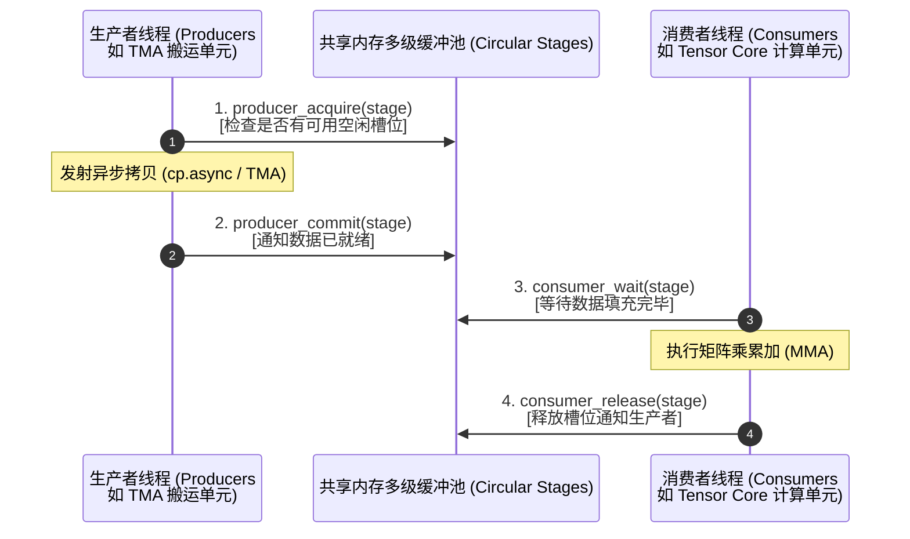

# CUTLASS 异步软件流水线与同步机制 (Pipeline & Synchronization)

> [!NOTE] 原文出处
> 本文翻译自 NVIDIA CUTLASS 官方架构规范文档 [`media/docs/cpp/pipeline.md`](https://github.com/NVIDIA/cutlass/blob/main/media/docs/cpp/pipeline.md)。

在高吞吐 GPU 内核（如极致优化的 GEMM、FlashAttention）中，**访存延迟隐藏（Latency Hiding）** 是决定算子能否跑满硬件理论峰值 TFLOPS 的绝对生命线。

从 NVIDIA Hopper (H100) 架构开始，硬件层面引入了革命性的 **线程块集群（Thread Block Clusters）** 与硬件加速的 **异步事务栅障（Asynchronous Transaction Barriers）**。CUTLASS 为此设计了一套工业级的 **异步流水线抽象库（`cutlass::Pipeline`）**。

---

## 1. CUDA 同步机制的历史演进

| 硬件架构与代际 | 核心同步原语 | 作用域与机制说明 |
| :--- | :--- | :--- |
| **通用传统 CUDA** | `__syncthreads()` | **Thread Block 级别**：全块线程同步，强行阻塞所有 Warp 直至到达汇合点。 |
| **Volta (SM70)** | `__syncwarp()` | **Warp 级别**：精确控制 32 线程内部独立分支汇合（Independent Thread Scheduling）。 |
| **Ampere (SM80)** | `cp.async` 屏障组 | **硬件异步拷贝级别**：`cuda::memcpy_async` 与硬件管道解耦。 |
| **Hopper (SM90)** | **Cluster 硬件栅障** | **Thread Block Cluster 级别**：跨多个 SM 上的 Thread Block 进行零拷贝高速协同。 |

---

## 2. 异步流水线架构：生产者-消费者模型

在持久化 GEMM（Persistent GEMM）算法中，通常需要交替维护数十个环形环状缓冲区（Circular Buffers）以及复杂的并发依赖。依靠程序员手动在 PTX 汇编层编写状态机极易引发死锁或数据竞态。

CUTLASS 的 `PipelineAsync` 将整个协作抽象为**生产者（Producers）** 与 **消费者（Consumers）** 的四步解耦协议：



---

## 3. 四步协议 API 详解

### 3.1 生产者申请：`producer_acquire`
* **调用时机**：生产者在向共享内存某一个 Stage 写入数据之前调用。
* **执行语义**：**阻塞式（Blocking）**。如果目标 Stage 正在被消费者读取，生产者必须挂起等待，直到消费者显式执行 `consumer_release` 释放该槽位。
* **初始启动优化**：在流水线初始阶段（所有 Stage 均为空），可通过 `make_producer_start_state` 免除首次无意义的空等待。

### 3.2 生产者提交：`producer_commit`
* **调用时机**：当异步指令发射完毕或写入完成时调用。
* **执行语义**：**非阻塞式（Non-blocking）**。原子递增内部栅障阶段，唤醒等待该 Stage 的消费者。
* **硬件直通**：对于 Hopper TMA 管道（`PipelineTmaAsync`），硬件 TMA 完成后会自动更新硬件屏障，此时该调用会被编译器优化为 No-Op（零指令开销）。

### 3.3 消费者等待：`consumer_wait`
* **调用时机**：消费者在从特定 Stage 读取共享内存前调用。
* **执行语义**：**阻塞式（Blocking）**。等待生产者提交完成。

### 3.4 消费者释放：`consumer_release`
* **调用时机**：当数据消费完毕（MMA 完成）后调用。
* **执行语义**：**非阻塞式（Non-blocking）**。通知生产者该槽位可以被覆写。

---

## 4. 4 级异步流水线完整工程实战

以下代码展示了如何使用 4 级缓冲（Quad-buffering）协调 2 个生产者线程与 1 个消费者线程的并发运转：

```cpp
#include <cutlass/pipeline/pipeline.hpp>

// 1. 定义 4 级异步软件流水线
static constexpr int NumStages = 4;
using MainloopPipeline = cutlass::PipelineAsync<NumStages>;
using PipelineState    = cutlass::PipelineState<NumStages>;

// 2. 配置并发计数 (2 个生产者, 1 个消费者)
typename MainloopPipeline::Params params;
params.producer_arv_count = 2; // 2 producers
params.consumer_arv_count = 1; // 1 consumer

MainloopPipeline pipeline(shared_storage.storage, params);

// 3. 生产者分支 (Thread 0 与 1)
if (thread_idx == 0 || thread_idx == 1) {
  PipelineState smem_pipe_write = cutlass::make_producer_start_state<MainloopPipeline>();

  for (; iter > 0; --iter) {
    // 申请槽位
    pipeline.producer_acquire(smem_pipe_write);

    // 发射异步硬件数据加载 (例如通过 TMA 或 cp.async)
    // 写入当前 stage 的共享内存 ...

    // 提交数据
    pipeline.producer_commit(smem_pipe_write);

    // 环形推进至下一 Stage
    ++smem_pipe_write;
  }
}
// 4. 消费者分支 (Thread 2)
else if (thread_idx == 2) {
  PipelineState smem_pipe_read;

  for (; iter > 0; --iter) {
    // 等待数据就绪
    pipeline.consumer_wait(smem_pipe_read);

    // 从当前 stage 读取数据并驱动 Tensor Core 计算 ...

    // 释放槽位
    pipeline.consumer_release(smem_pipe_read);

    // 环形推进至下一 Stage
    ++smem_pipe_read;
  }
}
```

通过这一范式，全局内存读写延迟被完全隐藏在计算主循环的背景中，真正达成 GPU 计算核心的“零气泡（Zero Bubble）”全速打满！
