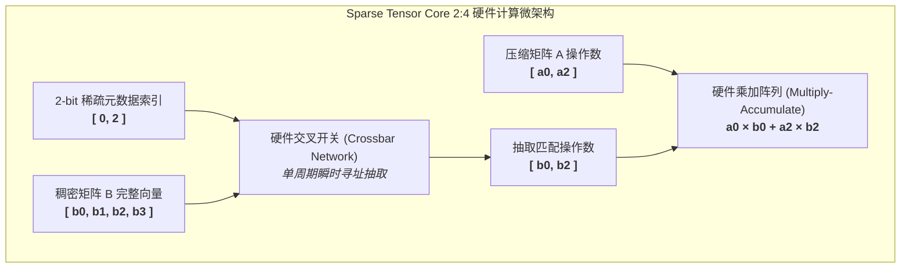

# 25. 2:4 结构化稀疏硬件加速 (Structured Sparsity GEMM)

> **重要免责声明**：本网站只是用来消耗反重力额度的，并且给有需要的人看一看，准确度极低。可用度极低，不想看的请不看，造成错误概不负责。
> 本篇由 AI 辅助汉化与深度解析，非 NVIDIA 官方技术文档。涉及 GPU 底层硬件架构参数与生产算子调优，请以 [NVIDIA CUTLASS 官方源码](https://github.com/NVIDIA/cutlass) 为准。

---

## 1. 稀疏计算的世纪困境：非结构化 vs 结构化

在深度神经网络参数压缩领域，**稀疏化（Pruning / Sparsity）** 始终被视为最具吸引力的理论加速手段：如果模型中 50% 甚至 80% 的权重接近于 0，在数学上我们理论上只需进行一半甚至五分之一的计算量。

然而，在传统 GPU 硬件体系中，**非结构化稀疏（Unstructured Sparsity）** 遭遇了惨痛的“加速悖论”：
- 当被剪枝的零元素随机散落在矩阵的任意位置时，稠密的矩阵乘法变成了带有大量指针跳转的间接寻址（如 CSR/CSC 格式）；
- 破坏了内存的连续向量化合并（Coalesced Access）；
- 引发严重的 Warp Divergence（线程束分化）；
- **实测结果**：在没有专用硬件支持下，一个 50% 非结构化稀疏的矩阵乘法，运行速度往往比直接用 cuBLAS 跑稠密矩阵**慢上 3 到 5 倍**！

为了打破这一困局，NVIDIA 从 Ampere（A100）架构开始，并在 Hopper 与 Blackwell 持续演进，推出了划时代的硬件加速机制：**2:4 结构化稀疏（2:4 Structured Sparsity）**！

---

## 2. 2:4 结构化稀疏的数学定义与硬件压缩格式

### 2.1 2:4 结构化法则

2:4 结构化稀疏有着极其严谨的局部几何约束：
> **“在矩阵 $A$ 的每一行中，任意连续的 4 个数值中，必须且恰好有 2 个数值为零，保留另外 2 个非零值。”**

```
原始稠密矩阵 A 的连续 4 个元素向量:
[ a0,   0,   a2,   0 ]  -> 恰好 2 个非零值 (a0, a2)，2 个零

硬件压缩后的物理存储:
1. 压缩数值张量 (Compressed Values, 尺寸缩小 50%):
   [ a0, a2 ]

2. 元数据索引 (2-bit Metadata Index):
   指示 a0 位于原始位置 0 (0b00)，a2 位于原始位置 2 (0b10)
   4 个元素仅需 4 位 (半字节) 元数据!
```

### 2.2 元数据（Metadata）编码结构

在硬件底层，连续 16 个元素的元数据被紧凑打包为一个 16 位的无符号整数（`uint16_t`）：
- 存储开销仅为压缩数值的 $1/16$ 甚至 $1/32$（依数据类型而定）；
- 全局内存显存占用直接从原本的 $100\%$ 暴降至 **$\approx 53\%$**！

---

## 3. Sparse Tensor Core 硬件执行管线

NVIDIA GPU 的 Tensor Core 内部集成了专用的稀疏乘法器与交叉开关阵列（Crossbar Network）：



1. **硬件级瞬时解码**：硬件交叉开关在单时钟周期内根据 2-bit 元数据从稠密矩阵 $B$ 中抓取对应的两个元素；
2. **算力翻倍（$2\times$ TFLOPS）**：
   由于乘法阵列仅需处理非零操作数，Tensor Core 的计算吞吐量在硬件层面**直接翻倍**！例如在 A100 上，FP16 稠密算力为 312 TFLOPS，而 2:4 稀疏算力直接狂飙至 **624 TFLOPS**！

---

## 4. CUTLASS 中的 Sparse GEMM 架构与实战

CUTLASS 是目前业界唯一完整支持 2:4 结构化稀疏的开源通用算子库。

### 4.1 核心类型定义

在 CUTLASS 中，稀疏算子使用专有的算子类标签：

```cpp
#include <cutlass/cutlass.h>
#include <cutlass/gemm/device/gemm_sparse.h>

// 1. 选用支持 2:4 稀疏的 TensorOp 算子类
using ElementA          = cutlass::half_t;
using LayoutA           = cutlass::layout::RowMajor;
using ElementB          = cutlass::half_t;
using LayoutB           = cutlass::layout::ColumnMajor;
using ElementC          = cutlass::half_t;
using LayoutC           = cutlass::layout::RowMajor;
using ElementAccumulator= float;

// 2. 声明稀疏 GEMM 设备端算子
using GemmSparse = cutlass::gemm::device::GemmSparse<
    ElementA, LayoutA,
    ElementB, LayoutB,
    ElementC, LayoutC,
    ElementAccumulator,
    cutlass::arch::OpClassTensorOp,
    cutlass::arch::Sm80, // 支持 Sm80 (Ampere), Sm90 (Hopper)
    cutlass::gemm::GemmShape<128, 128, 64>,
    cutlass::gemm::GemmShape<64, 64, 64>,
    cutlass::gemm::GemmShape<16, 8, 32> // 稀疏 MMA 硬件原子指令
>;
```

### 4.2 稀疏张量预处理与压缩流水线

在 Host 端，CUTLASS 提供了专用的离线压缩工具：

```cpp
#include <cutlass/transform/host/tensor_compress.h>

// 原始稠密张量 A_dense: (M, K)
// 压缩后数值张量 A_compressed: (M, K / 2)
// 元数据张量 Metadata: (M, K / 8)

cutlass::transform::host::TensorCompress<cutlass::half_t> compressor;
compressor.compress(
    A_dense.host_data(),
    A_compressed.host_data(),
    Metadata.host_data(),
    M, K
);
```

运行期只需将 `A_compressed` 与 `Metadata` 指针一同传入 `GemmSparse::Arguments`，硬件即可全速发动 $2\times$ 稀疏算力风暴！

---

## 5. 大模型前沿生产实践：Wanda 与 SparseGPT

在现代 LLM 部署中，2:4 结构化稀疏正与前沿剪枝算法深度结合：
- **无需重新预训练**：借助 **Wanda（Pruning by Weights and Activations）** 或 **SparseGPT** 算法，可以在数小时内将 70B 参数的 LLaMA 模型无损剪枝为 2:4 稀疏格式；
- **端到端加速实测**：结合 CUTLASS 2:4 Sparse GEMM，大模型推理时延直接减少 **35% ~ 45%**，同时显存需求降低近半，真正实现了算法与体系结构的完美共振。
