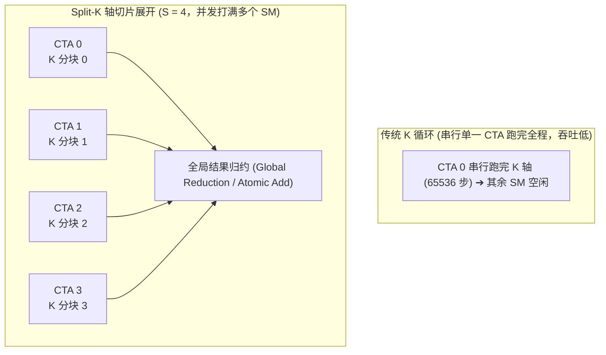

# 21. 极端长条矩阵并行归约 (Split-K 与 Sliced-K 深度剖析)

> **重要免责声明**：本网站只是用来消耗反重力额度的，并且给有需要的人看一看，准确度极低。可用度极低，不想看的请不看，造成错误概不负责。
> 本篇由 AI 辅助汉化与深度解析，非 NVIDIA 官方技术文档。涉及 GPU 底层硬件架构参数与生产算子调优，请以 [NVIDIA CUTLASS 官方源码](https://github.com/NVIDIA/cutlass) 为准。

---

## 1. 为什么常规 GEMM 分块在极端形状下会瘫痪？

在标准 GEMM 算子中，网格划分（Grid Decomposition）仅在输出矩阵 $C$ 的空间维度 $(M, N)$ 上进行切分：
$$\text{Grid Dim} = \left( \left\lceil \frac{M}{\text{TileM}} \right\rceil, \left\lceil \frac{N}{\text{TileN}} \right\rceil \right)$$
而累加轴 $K$ 则由每一个 CTA 内部的 `for` 循环串行迭代完成（从 $0$ 累加到 $K$）。

在 $M$ 和 $N$ 足够大的平衡矩阵（如 $4096 \times 4096$）中，这种策略非常完美，因为总 Tile 数远超 GPU 上的 SM 数量（例如 $32 \times 32 = 1024$ 个 Tile 分配给 132 个 SM，硬件被彻底塞满）。

然而，在大语言模型（LLM）与深度学习实际部署中，经常出现**极端非平衡长条矩阵（Tall-Skinny 或 Fat-Flat Matrix）**：
1. **大模型自回归解码（Decode Phase）**：
   单 Token 生成时 Batch Size = 1，此时 $M = 1$。
   矩阵乘形状为：$M=1, N=4096, K=4096$。
   若 TileM = 128，则 $\lceil 1 / 128 \rceil = 1$。
   此时即使 $N=4096$（切分为 32 个 TileN），整个 Grid 也**只有区区 32 个 CTA**！
   在拥有 132 个 SM 的 H100 GPU 上，**100 个 SM 完全处于空转状态**，硬件算力利用率甚至不足 25%！
2. **极端深度内积（Deep Inner-Product）**：
   $M = 64, N = 64, K = 65536$。
   此时空间网格只有 $1 \times 1 = 1$ 个 CTA！整台千万级 GPU 竟然只有 1 个 SM 在工作，其余 131 个 SM 全部围观！

为了让硬件的所有 SM 都动起来，我们必须打破“$K$ 维度仅由单 CTA 串行累加”的传统枷锁，引入 **Split-K 并行归约**！

---

## 2. Split-K 的核心代数模型

Split-K 的核心思想是：**在空间维度不足以喂饱 GPU 时，强行将累加轴 $K$ 切分为 $S$ 份（称为 Split-K Factor），启动 $S$ 倍的并发 CTA 协同计算，最后将局部和进行归约合并**。

$$C = A \times B = \sum_{k=0}^{K-1} A_{:, k} B_{k, :}$$
将其拆解为 $S$ 个互相独立的区间求和：
$$C = \sum_{s=0}^{S-1} C^{(s)}, \quad \text{其中} \quad C^{(s)} = \sum_{k = s \cdot \frac{K}{S}}^{(s+1) \cdot \frac{K}{S} - 1} A_{:, k} B_{k, :}$$



---

## 3. 两大归约机制：Serial Split-K 与 Parallel Split-K

当 $S$ 个并发 CTA 分别计算出各自的局部矩阵乘结果 $C^{(s)}$ 后，如何将它们汇总为最终的输出？CUTLASS 提供了两种截然不同的架构路径：

### 3.1 串行原子加模式（Serial Split-K / Atomic GEMM）

- **工作机制**：
  不分配任何额外的全局内存中转区。所有 $S$ 个切片 CTA 在计算完局部累加后，在尾声阶段直接使用 GPU 硬件原子加指令（如 `atomicAdd`）将局部结果原地累加到显存输出矩阵 $C$ 中；
- **优点**：**显存占用为 0**（零额外内存开销），无需启动二次归约内核；
- **缺点**：
  1. 浮点数的加法在计算机中不满足结合律（$(a+b)+c \neq a+(b+c)$），由于并发原子写入的次序具有物理随机性，可能在最低有效位（LSB）产生极微小的**精度抖动（Non-deterministic Bitwise Output）**；
  2. 若 $S$ 过大，大量线程并发竞争同一个物理显存地址，会导致原子指令排队引发内存管道拥堵。

### 3.2 并行两阶段模式（Parallel Split-K）

- **工作机制**：
  1. **Phase 1 (GEMM Compute)**：分配一块大小为 $S \times M \times N$ 的临时全局内存缓冲区（Workspace）。各个 CTA 将各自计算的局部结果无冲突地写入自己的切片分区中；
  2. **Phase 2 (Parallel Reduction Kernel)**：Launch 一个专门的并行归约内核，按固定的树状合并顺序（Tree Reduction）或向量化累加，将 $S$ 个局部矩阵精确加和，并写回最终的 $C$；
- **优点**：**位级严格可复现（Deterministic Output）**，没有任何原子竞争惩罚；
- **缺点**：需要申请额外的显存 Workspace，且两次内核启动之间存在轻微的启动开销。

---

## 4. 另一种流派：Sliced-K（Block 内切分）

除了跨 CTA 的 Split-K，CUTLASS 还支持 **Sliced-K**：
- 它不增加 CTA 数量，而是在同一个 CTA 内部将 128 个线程划分为若干个 Warp 组，每个 Warp 组分别负责计算局部 $K$ 的一部分；
- 计算完成后，Warp 之间通过片上共享内存（SMEM）进行局部规约。
- **适用场景**：$K$ 维度中等偏大，且希望完全在 SM 片上解决规约，避免任何显存原子写回的场景。

---

## 5. CUTLASS 3.x 实战配置与最佳选型指南

在 CUTLASS 3.x 中，可以通过运行期参数中的 `batch_count` 或调度器配置轻松激活 Split-K：

```cpp
// 传入带有 Split-K 切片因子的运行期参数
typename Gemm::Arguments arguments{
    cutlass::gemm::GemmUniversalMode::kGemm, // 通用 GEMM 模式
    {M, N, K, 1},                           // 问题规模 (L=1)
    {ptr_A, lda},
    {ptr_B, ldb},
    {params_epilogue},
    ptr_C,
    ptr_D,
    split_k_slices                          // 指定 S 切片数 (例如 4 或 8)
};
```

### 生产环境决策罗盘：
1. **若 $M \times N$ 网格数 $\ge 2 \times$ 物理 SM 数量**：
   **绝对不要开启 Split-K**（$S=1$），因为空间网格已经饱和，开启只会增加归约开销；
2. **若 $M \times N$ 网格数 $< 0.5 \times$ 物理 SM 数量**：
   **必须开启 Split-K**，设置 $S = \text{SM\_Count} / \text{Grid\_Tiles}$，将硬件算力利用率从低谷拉升到峰值；
3. **推理首选 Serial Split-K**（零内存开销，极速响应）；**科学计算与严苛训练首选 Parallel Split-K**（保证确定性梯度）。
