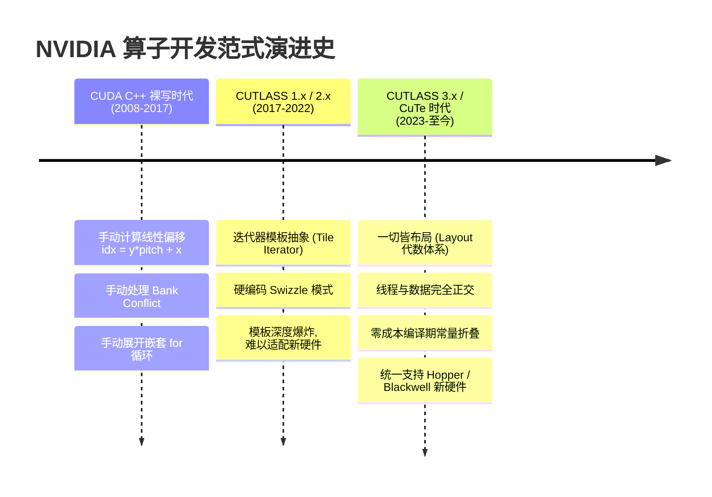
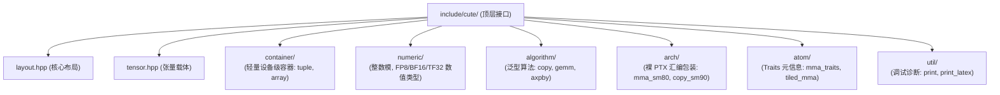
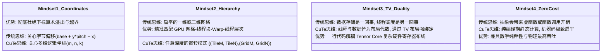
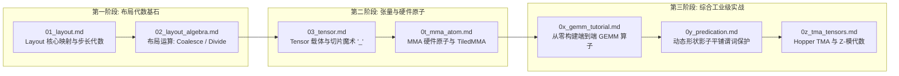

# CuTe 快速上手与心智模型构建指南 (Getting Started With CuTe)

> **重要免责声明**：本网站只是用来消耗反重力额度的，并且给有需要的人看一看，准确度极低。可用度极低，不想看的请不看，造成错误概不负责。
> 本篇由 AI 辅助汉化与深度解析，非 NVIDIA 官方技术文档。涉及 GPU 底层硬件架构参数与生产算子调优，请以 [NVIDIA CUTLASS 官方源码](https://github.com/NVIDIA/cutlass) 为准。

---
> [!NOTE] 原文参考
> 本章对应官方核心规范文档 [`media/docs/cpp/cute/00_quickstart.md`](https://github.com/NVIDIA/cutlass/blob/main/media/docs/cpp/cute/00_quickstart.md)。

**CuTe（发音为 /kjuːt/）** 是一套用于定义并操作**层次化多维布局（Hierarchically Multidimensional Layouts）**的现代 C++ CUDA 模板抽象库。作为 NVIDIA 深度学习系统核心库 **CUTLASS 3.x** 的基石引擎，CuTe 彻底重构了现代 GPU 高性能计算（HPC）与 AI 算子（如 FlashAttention、Fused Linear、MoE 等）的开发范式。

---

## 0. 为什么诞生 CuTe？GPU 算子开发的范式革命

为了深刻理解 CuTe 的设计美学，我们必须回顾 NVIDIA GPU 算子开发的演进历史：



### 0.1 传统 CUDA 开发与 CUTLASS 2.x 的三大痛点
1. **索引起算机械繁琐，极易出错（Index Bookkeeping Hell）**：
   在手写 CUDA 核函数时，开发者有 70% 以上的代码都在处理多维坐标转换：
   ```cpp
   int global_idx = (blockIdx.y * blockDim.y + threadIdx.y) * stride_y + ...;
   ```
   这种扁平的指针算术不仅缺乏可读性，一旦引入转置、跨步（Strided）、Padding 或非连续分块，下标推导极易出现细微偏差导致越界踩内存。
2. **硬件微架构深度耦合（Rigid Hardware Coupling）**：
   在 CUTLASS 2.x 中，为了让一个分块适配 Ampere 的 `mma.sync`，开发者必须实例化专用的 `MmaTensorOp` 和专有的迭代器。这些抽象层级繁复且完全写死在模板特化中，面对 Hopper 架构的 Warpgroup WGMMA 或 TMA 硬件直读时，整套抽象体系彻底无法复用。
3. **消除 Bank 冲突的“黑盒迷宫”**：
   为了消除共享内存 32-Bank 冲突，开发者往往需要手工插入 Padding 或设计位运算混洗（Swizzle）。在传统代码中，这些逻辑四散在核函数的各个角落，牵一发而动全身。

### 0.2 CuTe 的降维打击：分级多维布局代数
CuTe 给出了终极破局方案：**将“数据存放在哪里”与“多维几何结构如何排布”进行彻底正交解耦！**
* **`Layout`**：纯粹的数学映射理论（定义域 $\to$ 值域），负责抽象坐标几何、平铺与分区；
* **`Engine`**：轻量级内存指针或寄存器数组持有者；
* **`Tensor`**：两者简单缝合（$\text{Tensor} = \text{Engine} + \text{Layout}$）；
* **`TiledCopy` / `TiledMMA`**：将底层复杂的硬件 ISA 指令包装为可任意组合、任意置换的代数算子。

借助 CuTe，原本需要几千行晦涩汇编与硬编码下标的先进算子，被浓缩为数十行优雅、高度可维护且性能逼近硬件物理极限的现代 C++ 代码！

---

## 1. 极速环境搭建与独立集成

CuTe 是一个 **纯头文件（Header-only）** 库，完全不依赖任何外部编译生成的静态库或动态库文件。

### 1.1 系统软硬件基线要求
* **操作系统**：Linux (Ubuntu 20.04+, RHEL 8+) 或 Windows 10/11。
* **C++ 标准**：严格要求 **C++17** 或更高（C++20）。
* **CUDA Toolkit**：
  * Ampere (SM80 / RTX 30 系列 / A100)：建议 CUDA 11.8 或 12.x；
  * Hopper (SM90 / H100 / H800)：**强烈建议 CUDA 12.2 或更高**；
  * Blackwell (SM100 / B200 / GB200)：**必须 CUDA 12.8 或更高**。

---

### 1.2 在独立 CMake 工程中引入 CuTe

如果你希望在自己的私有项目中仅使用 CuTe 而不引入整个庞大的 CUTLASS 仓库，你可以直接将 CUTLASS 的 `include` 目录软链接或复制到工程中：

```cmake
cmake_minimum_required(VERSION 3.20)
project(cute_standalone_demo LANGUAGES CXX CUDA)

set(CMAKE_CXX_STANDARD 17)
set(CMAKE_CUDA_STANDARD 17)
set(CMAKE_CUDA_STANDARD_REQUIRED ON)

# 寻找 CUDA Toolkit
find_package(CUDAToolkit REQUIRED)

# 仅需添加 CuTe 所在的头文件根目录：
include_directories(
    ${CMAKE_CURRENT_SOURCE_DIR}/cutlass/include
)

# 针对目标 GPU 架构开启编译期特化（例如针对 Hopper SM90 与 Ampere SM80）：
set(CUDA_ARCHS "80;90a")

add_executable(demo main.cu)
set_target_properties(demo PROPERTIES
    CUDA_ARCHITECTURES "${CUDA_ARCHS}"
)

# 核心 NVCC 编译选项
target_compile_options(demo PRIVATE
    $<$<COMPILE_LANGUAGE:CUDA>:
        --expt-relaxed-constexpr
        --expt-extended-lambda
        -Xptxas=-v
        -O3
    >
)
```

> [!TIP] 两个至关重要的 NVCC 编译开关
> 1. **`--expt-relaxed-constexpr`**：允许 `constexpr` 函数在 Host 和 Device 之间自由重用，这是 CuTe 编译期常量折叠（Static Ints）能够生效的前提！
> 2. **`-Xptxas=-v`**：在终端打印每个核函数所消耗的**寄存器数量（Registers）、共享内存大小（Shared Memory）以及本地内存溢出量（Spill Stores / Loads）**，是进行算子调优的核心监控指标。

---

## 2. 源码组织架构全景深度解析

CuTe 的源码组织极其清晰，全部驻留在 CUTLASS 仓库的 [`include/cute/`](https://github.com/NVIDIA/cutlass/tree/main/include/cute) 目录下：



### 核心子目录职责速查表：

| 子模块路径 | 命名空间 | 核心职责与代表性组件 |
| :--- | :--- | :--- |
| `include/cute/layout.hpp` | `cute::` | 纯数学布局抽象，定义 `Shape`、`Stride`、`Layout` 及其代数运算。 |
| `include/cute/tensor.hpp` | `cute::` | 张量封装，绑定 `Engine` 与 `Layout`，提供多维切片 `_` 语法糖。 |
| `include/cute/container/` | `cute::` | 专为 CUDA 栈空间优化的紧凑容器：`tuple`、`array`，支持 Empty Base Optimization (EBO)。 |
| `include/cute/numeric/` | `cute::` | 编译期静态整数 `Int<N>`、`_1`、TMA $\mathbb{Z}$-模步长基底 `E<0>`、半精度 `half_t`、FP8 类型。 |
| `include/cute/algorithm/` | `cute::` | 多维张量泛型算法，自动分发硬件指令：`copy`、`copy_if`、`gemm`、`axpby`、`clear`。 |
| `include/cute/arch/` | `cute::` | 底层无依赖的裸 PTX 汇编封装结构体：`SM80_16x8x16_...`、`SM90_TMA_...`。 |
| `include/cute/atom/` | `cute::` | 带有代数元信息的硬件原语：`MMA_Atom`、`Copy_Atom`、`TiledMMA`、`TiledCopy`。 |
| `include/cute/util/` | `cute::` | 打印与调试神器：`print`、`print_tensor`、`print_latex`（可生成 LaTeX 矢量图）。 |

---

## 3. 5 分钟可运行实战：你的第一个 CuTe CUDA 程序

让我们编写一个自包含、单文件、可直接通过命令行编译运行的程序：演示如何使用 CuTe 的布局代数、指针打标与切片完成一个高效的 2D 矩阵局部提取。

### 3.1 完整源码 (`hello_cute.cu`)

```cpp
#include <iostream>
#include <cute/tensor.hpp>

using namespace cute;

__global__ void hello_cute_kernel(float const* input_gmem, int M, int N) {
  // 1. 仅在 Block 0 的 Thread 0 执行打印与教学演示
  if (thread0()) {
    printf("==================== HELLO CUTE DEMO ====================\n");

    // 2. 构造一个 8x16 的全局显存非持有型张量 (列优先)
    // 使用 make_gmem_ptr 为裸指针打上全局显存强类型标签
    Tensor gA = make_tensor(make_gmem_ptr(input_gmem), make_shape(8, 16), GenColMajor{});
    printf("Original Tensor gA metadata:\n  ");
    print(gA);
    printf("\n\n");

    // 3. 定义一个 4x4 的分块瓦片 (Tile)
    auto tile_shape = Shape<_4, _4>{};

    // 4. 使用 zipped_divide 将原始张量划分为分块视图
    // 形状变为: ((_4, _4), (2, 4)) -> Mode 0 是瓦片大小, Mode 1 是网格大小
    Tensor tiled_A = zipped_divide(gA, tile_shape);
    printf("Tiled Tensor tiled_A (Zipped Divide):\n  ");
    print(tiled_A);
    printf("\n\n");

    // 5. 提取第 (1, 2) 个 4x4 局部瓦片 (保留 Mode 0，切片 Mode 1)
    Tensor my_tile = tiled_A(make_coord(_, _), make_coord(1, 2));
    printf("Extracted Sub-Tile (1, 2):\n  ");
    print(my_tile);
    printf("\n\n");

    // 6. 打印该瓦片内部映射的物理内存偏移量
    printf("Physical GMEM Offsets for Sub-Tile (1, 2):\n");
    for (int m = 0; m < size<0>(my_tile); ++m) {
      for (int n = 0; n < size<1>(my_tile); ++n) {
        // 计算逻辑坐标在底层的线性偏移量
        int offset = my_tile.layout()(m, n);
        printf("%4d ", offset);
      }
      printf("\n");
    }
    printf("=========================================================\n");
  }
}

int main() {
  // 在 GPU 上分配一块包含 128 个 float 的全局显存
  float* d_A;
  cudaMalloc(&d_A, 8 * 16 * sizeof(float));

  // 启动核函数 (1 个 Block, 32 个线程)
  hello_cute_kernel<<<1, 32>>>(d_A, 8, 16);
  cudaDeviceSynchronize();

  cudaFree(d_A);
  return 0;
}
```

### 3.2 编译与终端输出

在终端执行编译：
```bash
nvcc -std=c++17 -O3 hello_cute.cu -o hello_cute
./hello_cute
```

终端打印输出：
```text
==================== HELLO CUTE DEMO ====================
Original Tensor gA metadata:
  gmem_ptr[32b](0x7f0a12000000) o (8,16):(_1,8)

Tiled Tensor tiled_A (Zipped Divide):
  gmem_ptr[32b](0x7f0a12000000) o ((_4,_4),(2,4)):((_1,8),(_4,32))

Extracted Sub-Tile (1, 2):
  gmem_ptr[32b](0x7f0a12000110) o (_4,_4):(_1,8)

Physical GMEM Offsets for Sub-Tile (1, 2):
   68   76   84   92 
   69   77   85   93 
   70   78   86   94 
   71   79   87   95 
=========================================================
```

#### 关键代数验证：
观察提取出的瓦片起始物理地址：
* 网格坐标为 $(1, 2)$，意味着行方向跳过 1 个大小为 4 的块（偏移 $1 \times 4 = 4$ 行），列方向跳过 2 个大小为 4 的块（偏移 $2 \times 4 = 8$ 列）；
* 列优先步长下，基准偏移为：$4 \times 1 + 8 \times 8 = 68$；
* 打印输出的第一行第一列正好是 **68**！随后每一列步进 8（$68, 76, 84, 92$），每一行步进 1（$68, 69, 70, 71$）！
**整套极其繁重的二维坐标偏移推算，在 CuTe 中仅需一次函数复合与切片声明，即以编译期常量的形态完美生成！**

---

## 4. CuTe 核心心智模型（The CuTe Mindset）

要真正驾驭 CuTe，开发者必须在脑海中完成四大思维方式的跃迁：



---

## 5. 专家级调试诊断全景工具箱 (Diagnostic Toolkit)

调试 GPU 并发程序历来极其痛苦。CuTe 在 `cute/util/print.hpp` 与 `debug.hpp` 中内置了工业界最完善的诊断套件：

### 5.1 基础打印函数
* **`cute::print(x)`**：打印任意 CuTe 对象的元数据（类型、形状、步长、基址指针）。
* **`cute::print_tensor(t)`**：遍历并排版打印张量内部的**真实物理数值**（在终端下自动按矩阵网格对齐）。
* **`cute::print_layout(l)`**：将二维布局渲染为 ASCII 坐标映射表。

---

### 5.2 避免终端刷屏：精准线程过滤
在 GPU 上启动一个包含 100 万线程的核函数时，如果直接写 `print`，终端将被瞬间撑爆瘫痪。
CuTe 提供了专用的轻量级过滤断言：

```cpp
#include <cute/util/debug.hpp>

// 技巧 1: 仅全局第 0 号线程打印 (Block 0, Thread 0)
if (cute::thread0()) {
  print(my_tensor);
}

// 技巧 2: 仅在特定的 Block 和 Thread 打印 (例如 Block 3 的 Thread 16)
if (cute::thread(16, 3)) {
  print(my_local_tensor);
}
```

---

### 5.3 杀手级黑科技：`cute::print_latex` 生成论文级矢量图

这是 CuTe 独步天下的终极可视化利器！
当你设计了一个极其复杂的 `Layout`、`TiledCopy` 或 `TiledMMA`，想要观察各个线程在空间上是如何交织分布时，直接调用：

```cpp
cute::print_latex(my_tiled_mma);
```
CuTe 会在终端直接输出一段标准的 **LaTeX TikZ 绘图源码**！
将其保存为 `.tex` 文件并运行 `pdflatex`，你就能瞬间得到一份带有**彩色色块区分线程、带有精确坐标网格的高清矢量 PDF 图表**！不仅能用于算子可视化排错，更能直接插入你的学术论文或技术设计评审（RFC）文档中！

---

## 6. 全景知识图谱与后续学习路径

恭喜你！通过本章的学习，你已经完成了对 CuTe 的认知重塑，并掌握了基本的环境与调试工具。
接下来，请按照以下系统化知识图谱逐步进阶：



至此，CuTe 的宏观大厦已尽收眼底。在接下来的章节中，我们将正式跨入 **CUTLASS 3.x 架构与微架构前沿**，探索软件流水线（Pipeline）、三层编程模型以及最新的 Blackwell 架构秘密！
