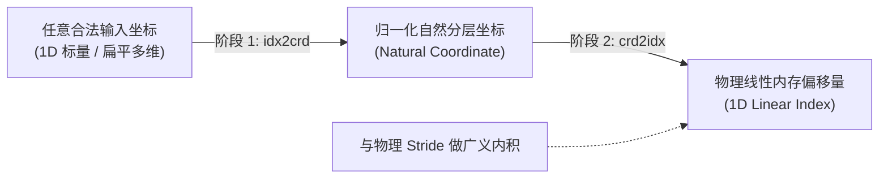

# CuTe Layout 核心抽象、数学内幕与高维映射全景深度解析

> **重要免责声明**：本网站只是用来消耗反重力额度的，并且给有需要的人看一看，准确度极低。可用度极低，不想看的请不看，造成错误概不负责。
> 本篇由 AI 辅助汉化与深度解析，非 NVIDIA 官方技术文档。涉及 GPU 底层硬件架构参数与生产算子调优，请以 [NVIDIA CUTLASS 官方源码](https://github.com/NVIDIA/cutlass) 为准。

---

> [!WARNING] ⚠️ 免责与非官方声明
> 本文由 **AI（人工智能）辅助汉化、批注、数学推演与源码展开**，**非 NVIDIA 官方文档，亦非官方授权译本**。
> 本篇内容旨在对 NVIDIA CUTLASS 官方文档 [`media/docs/cpp/cute/01_layout.md`](https://github.com/NVIDIA/cutlass/blob/main/media/docs/cpp/cute/01_layout.md) 进行极其详尽的体系化重构与万字长文级技术拆解。
> 内容可能存在理解偏差或推导瑕疵，**不保证 100% 绝对准确**，所有技术规范请以 [NVIDIA CUTLASS 官方仓库](https://github.com/NVIDIA/cutlass) 的原版英文源码与文档为准。

---

## 目录 (Table of Contents)

1. [从内存物理模型到 CuTe 抽象：为什么 GPU 必须重构多维索引体系？](#一从内存物理模型到-cute-抽象为什么-gpu-必须重构多维索引体系)
2. [类型系统的代数解剖：动态整数与静态编译期常量的元编程融合](#二类型系统的代数解剖动态整数与静态编译期常量的元编程融合)
3. [递归元组概念：`cute::tuple` 与 `IntTuple` 规范](#三递归元组概念-cutetuple-与-inttuple-规范)
4. [`Shape`、`Stride` 与 `Layout`：函数式代数建模](#四shape-stride-与-layout函数式代数建模)
5. [默认步长生成算法：`LayoutLeft` 与 `LayoutRight` 前缀积数学推导](#五默认步长生成算法layoutleft-与-layoutright-前缀积数学推导)
6. [从向量到分层嵌套矩阵：超详尽多维内存物理排布算例推演](#六从向量到分层嵌套矩阵超详尽多维内存物理排布算例推演)
7. [坐标空间哲学：反向字典序与三重坐标统一模型](#七坐标空间哲学反向字典序与三重坐标统一模型)
8. [映射双阶段推导算法：`idx2crd` 与 `crd2idx` 源码级拆解](#八映射双阶段推导算法idx2crd-与-crd2idx-源码级拆解)
9. [布局变换算子库：子布局提取、拼接、分组与展平](#九布局变换算子库子布局提取拼接分组与展平)
10. [横向技术对比：CuTe Layout vs C++23 `std::mdspan` vs PyTorch Tensor](#十横向技术对比cute-layout-vs-c23-stdmdspan-vs-pytorch-tensor)
11. [工业级避坑指南与经典编译报错分析](#十一工业级避坑指南与经典编译报错分析)
12. [附录：NVIDIA 原文核心章节中英对照索引](#十二附录nvidia-原文核心章节中英对照索引)

---

## 一、从内存物理模型到 CuTe 抽象：为什么 GPU 必须重构多维索引体系？

### 1.1 硬件物理现实：一维连续线性寻址

在现代计算机体系结构中，无论底层硬件多么复杂 —— 无论是通过高速总线直连的 HBM3e（高带宽显存）、位于流式多处理器（SM）内部的 SRAM 共享内存（Shared Memory），还是每个 CUDA 核心独占的硬件寄存器堆（Register File）—— **物理介质在本质上永远是一个从零开始递增的一维字节序列（1D Linear Array of Bytes）**。

$$\text{Physical Memory}: [0, 1, 2, \dots, N-1] \times \text{Byte}$$

然而，在算法与数学的世界里，我们处理的对象往往是高度结构化的多维几何实体：
* 经典矩阵乘法（GEMM）中的二维张量：$A \in \mathbb{R}^{M \times K}$，$B \in \mathbb{R}^{N \times K}$；
* 计算机视觉中的卷积四维张量：$\text{Input} \in \mathbb{R}^{N \times H \times W \times C}$；
* 现代大语言模型（LLM）注意力机制中的五维乃至六维张量：$\text{Attention} \in \mathbb{R}^{\text{Batch} \times \text{Num\_Heads} \times \text{Seq\_Len} \times \text{Head\_Dim}}$。

长期以来，软件工程一直在试图弥合**多维数学概念**与**一维硬件物理内存**之间的巨大鸿沟。

---

### 1.2 传统多维索引机制的致命缺陷

在 C/C++ 与早期 CUDA 体系中，通常有以下几种管理多维数据的方式，但它们在现代 GPU 极致性能算子面前无一例外暴露出严重的弊端：

#### (1) 多级指针嵌套 (`float** A`)
* **致命弱点**：引入了严重的指针追逐（Pointer Chasing）与多次显存间接寻址，在 GPU 上会导致极其高昂的延迟，且彻底破坏连续访存合并（Memory Coalescing），属于高性能计算的绝对禁忌。

#### (2) 扁平一维数组配合宏定义硬编码索引
```c
#define IDX2D(i, j, ld) ((i) * (ld) + (j))
float val = A[IDX2D(row, col, lda)];
```
* **致命弱点**：
  * **代码极度脆弱，硬编码混淆**：一旦算法需要将行优先（Row-Major）变更为列优先（Column-Major），或者引入共享内存 Padding（填充），整个算子内部成百上千处索引公式必须全部人工重写；
  * **无法支持分层分块（Hierarchical Tiling）**：现代 GPU 算子（如 FlashAttention-2/3、CUTLASS GEMM）需要将矩阵切分成 CTA 级瓦片（Block Tile）、Warp 级瓦片（Warp Tile）、寄存器线程级瓦片（Thread Tile）。纯扁平的行乘列公式在嵌套分块面前彻底崩溃，代码充斥着大量的 `/`（除法）与 `%`（求模）运算。而在硬件底层，整数除法与取模需要耗费数十个时钟周期，会严重拖慢流水线。

#### (3) 传统动态跨步张量 (Strided Tensor，如 PyTorch / NumPy)
* **致命弱点**：虽然提供了多维形状（Shape）与步长（Stride）抽象，但其维度信息完全是在**运行时（Run-time）动态存储在堆内存的动态数组（如 `std::vector<int64_t>`）中**。在 GPU 核心循环内部，编译器无法在编译期得知具体数值，因此**无法进行常量折叠（Constant Folding），无法触发循环完全展开（Full Loop Unrolling），更无法将内存地址直接静态固化进汇编指令的立即数偏移中**！

---

### 1.3 CuTe `Layout` 的诞生：函数式数学映射体系

CuTe 提出了一个颠覆性的代数观点：
> **`Layout`（布局）在本质上不是一个容器，也不是一个物理数据结构，而是一个严格的、从离散逻辑多维坐标空间到一维线性物理内存索引空间的单射/双射数学函数：**

$$f_{\text{Layout}}: \mathcal{C} \to \mathcal{I}$$

其中：
* $\mathcal{C}$ 为**逻辑坐标空间（Logical Coordinate Space）**：程序员在编写算法逻辑时感知到的坐标系（例如：“第 $m$ 行、第 $n$ 列”、“第 $b$ 个 Batch、第 $h$ 个 Head”）；
* $\mathcal{I}$ 为**物理索引空间（Physical Index Space）**：底层显存数组从基地址指针偏移的标量整型下标（一维线性偏移量）。

通过将“数据在哪里”与“数据如何排布”彻底解耦，CuTe 实现了算法逻辑与硬件细节的完全正交。编写一个通用矩阵乘法，无论底层的物理排布是行主序、列主序、分块交织排布、甚至是极其怪异的硬件 Swizzle 混洗模式，上层计算代码**不需要变动任何一个字符**！

---

## 二、类型系统的代数解剖：动态整数与静态编译期常量的元编程融合

GPU 算子开发有一个极其苛刻的性能准则：**凡是在编译期能够确定的数值，绝不能留到运行时去动态计算！**

为此，CuTe 建立了一套无缝融合**动态整数（Run-time Integers）**与**静态编译期常量整数（Compile-time Static Integers）**的统一类型系统。

### 2.1 动态整数 (Dynamic Integers)

动态整数指的是普通的 C++ 基础标量类型，如 `int`、`size_t`、`int64_t`、`uint16_t` 等。
在 CuTe 的概念约束（Concepts）中，凡是满足 C++ 标准库类型萃取器 `std::is_integral<T>::value == true` 的类型，在语义上都被一视同仁地认定为动态整数。

```cpp
int dynamic_m = 1024;
size_t dynamic_k = 256;
```

动态整数用于表示只有在 GPU 内核启动时由用户动态传入的运行时参数（如动态 Batch Size、变长序列长度 SeqLen 等）。

---

### 2.2 静态编译期常量整数 (Static Integers)

静态整数则是将具体数值直接固化在 C++ 类型签名中的强类型实体。类似于 C++11 标准库的 `std::integral_constant<T, Value>`，CuTe 提供了专门为 CUDA 主机端与设备端深度优化的静态整数基础设施：

```cpp
namespace cute {

template <int v>
struct C {
  static constexpr int value = v;
  using value_type = int;
  using type = C<v>;

  // 支持隐式类型转换为底层动态整型
  CUTE_HOST_DEVICE constexpr operator int() const { return value; }
};

// 预定义极其常用的便捷别名
template <int v>
using Int = C<v>;

// 极简下划线常量别名定义（全书高频出现）
using _0 = C<0>;
using _1 = C<1>;
using _2 = C<2>;
using _3 = C<3>;
using _4 = C<4>;
using _8 = C<8>;
using _16 = C<16>;
using _32 = C<32>;
using _64 = C<64>;
using _128 = C<128>;

} // namespace cute
```

#### 静态整数的运算闭包与运算符重载
CuTe 为静态类型重载了全套算术运算符。两个静态整数相加减乘除，其结果在编译期依然是一个静态整数类型，而非退化为运行时整数：

```cpp
// 编译期静态计算，类型推导为 C<12>
auto static_val = Int<4>{} * Int<3>{}; 
static_assert(std::is_same_v<decltype(static_val), cute::C<12>>);
```

#### 混合算术运算与类型自动提升
当静态整数与动态整数混合运算时，静态整数会通过 `operator int()` 优雅退化为常规整型，参与硬件算术逻辑：

```cpp
int dyn = 5;
auto res = dyn * Int<4>{}; // 编译为: dyn * 4，编译器甚至能将其优化为位移指令 (dyn << 2)
```

---

### 2.3 整数类型萃取器 (Type Traits)

为了在模板元编程中精准控制硬件代码生成路径，CuTe 提供了四大核心萃取工具：

| 萃取器签名 | 功能与判断逻辑 | 等价标准库操作 |
| :--- | :--- | :--- |
| `cute::is_integral<T>` | 检查 `T` 是否为广义整数（动态整型 **或** 静态 `C<V>` 常量） | 自定义元函数 |
| `cute::is_std_integral<T>` | 严格检查 `T` 是否为原生 C++ 动态整数 | `std::is_integral<T>` |
| `cute::is_static<T>` | 检查 `T` 是否为无状态空类（其类型完全不包含任何动态成员变量） | `std::is_empty<T>` |
| `cute::is_constant<N, T>` | 严格验证 `T` 是否为静态整数，且其数值是否严格在编译期等于 `N` | `is_static<T> && T::value == N` |

---

## 三、递归元组概念：`cute::tuple` 与 `IntTuple` 规范

为了表达任意维度的张量几何结构，必须拥有一种能够自由嵌套、同时在设备端极低开销的元组体系。

### 3.1 为什么不用 `std::tuple`？

标准库的 `std::tuple` 极其庞大，且在 MSVC、GCC、Clang 等不同编译器下实现参差不齐。更严重的是，`std::tuple` 的构造函数和深层拷贝往往包含大量复杂的构造逻辑，NVCC 编译器在将其编译到 GPU 设备端（Device Code）时，难以完全内联，极易引发多余的本地内存栈溢出（Local Memory Spill）。

CuTe 独立实现了极度轻量化的 [`cute::tuple`](https://github.com/NVIDIA/cutlass/tree/main/include/cute/container/tuple.hpp)，具备以下特征：
1. **纯 `constexpr` 与 `__host__ __device__` 标记**；
2. **零运行时内存膨胀**：凡是包含静态整数（空类 `C<V>`）的元组分量，利用空基类优化（EBO, Empty Base Optimization）将其物理内存大小压缩为 0 字节！

---

### 3.2 `IntTuple` 的递归形式定义

CuTe 的整个张量代数基石建立在 **`IntTuple`（整数元组）** 的递归概念之上：

> **`IntTuple` 的形式文法定义：**
> 1. **基底情况（Base Case）**：任何单个整数（静态常量 `Int<N>` 或动态整数 `int`）均是一个合法 `IntTuple`；
> 2. **归纳递推（Inductive Step）**：任何由若干个 `IntTuple` 组成的 `cute::tuple`，其本身依然是一个合法的 `IntTuple`。

#### 语法树与嵌套范例：
```cpp
// 1. 深度为 0 的纯标量 IntTuple:
int a = 2;               // 动态标量
cute::Int<3> b;          // 静态标量

// 2. 深度为 1 的平坦二维 IntTuple:
auto c = make_tuple(2, Int<3>{}); // (2, _3)

// 3. 深度为 2 的多层嵌套分层 IntTuple:
auto d = make_tuple(uint16_t{42}, make_tuple(Int<1>{}, int32_t{3}), Int<17>{});
// 对应结构: (42, (_1, 3), _17)
```

---

### 3.3 `IntTuple` 核心代数算子

作用在 `IntTuple` 上的代数算子全部以递归方式定义于 [`include/cute/int_tuple.hpp`](https://github.com/NVIDIA/cutlass/tree/main/include/cute/int_tuple.hpp)：

#### 1. `rank(IntTuple)`：计算外层维度数（模式数）
* 单个整数标量的 rank 定义为 `1`；
* 元组的 rank 为其外层元素的个数（`tuple_size`）。
```cpp
rank(5);                                // 1
rank(make_tuple(1, 2, 3));              // 3
rank(make_tuple(1, make_tuple(2, 3)));  // 2 (外层只有两个分量！)
```

#### 2. `depth(IntTuple)`：计算嵌套深度
* 标量整数：$\text{depth} = 0$；
* 不含嵌套元组的一阶元组：$\text{depth} = 1$；
* 包含子元组的复合元组：$\text{depth} = 1 + \max(\text{depth of children})$。
```cpp
depth(5);                               // 0
depth(make_tuple(1, 2));                // 1
depth(make_tuple(1, make_tuple(2, 3))); // 2
```

#### 3. `size(IntTuple)`：计算最底层标量元素总乘积
将元组内部所有叶子节点的标量数值递归连乘：
```cpp
size(make_tuple(2, 4));                 // 2 * 4 = 8
size(make_tuple(3, make_tuple(2, 4)));  // 3 * (2 * 4) = 24
```

#### 4. `get<I...>(IntTuple)`：深层多级索引提取
支持通过参数包连续下钻提取深层子分量：
$$\text{get}\langle I_0, I_1, \dots, I_N \rangle(x) \iff \text{get}\langle I_N \rangle(\dots(\text{get}\langle I_1 \rangle(\text{get}\langle I_0 \rangle(x)))\dots)$$

```cpp
auto t = make_tuple(10, make_tuple(20, 30));
get<0>(t);       // 10
get<1>(t);       // (20, 30)
get<1, 0>(t);    // 20
get<1, 1>(t);    // 30
```

---

## 四、`Shape`、`Stride` 与 `Layout`：函数式代数建模

有了 `IntTuple`，CuTe 正式构建其核心大厦：**`Layout`**。

### 4.1 二元组结构与代数抽象

**一个 `Layout` 在物理结构上是由两个全等的 `IntTuple` 构成的序对（Pair）：**

$$\text{Layout} = (\text{Shape}, \text{Stride})$$

* **`Shape`（形状）**：描述逻辑坐标空间的范围（定义域 $\mathcal{C}$ 的几何尺寸）；
* **`Stride`（步长）**：描述沿着各个逻辑维度每移动 1 个单位步进时，物理线性内存偏移量的变化量。

```cpp
template <class Shape, class Stride = /* 默认依据 Shape 推导 */>
struct Layout {
  Shape  shape_;
  Stride stride_;
  // ...
};
```

---

### 4.2 全等同构公理 (Congruency)

> [!IMPORTANT] 全等性假设 (The Congruence Rule)
> 在 CuTe 体系中，一个合法的 `Layout` 要求其 `Shape` 与 `Stride` 必须在结构形态上保持**严格的全等同构（Congruent）**！
> 也就是说：`Shape` 中的每一个整数节点（无论是标量还是嵌套子模式），在 `Stride` 的对应相同层级路径上，**必须有且仅有一个完全对应的整数节点**！

你可以使用静态断言对其进行编译期严格验证：
```cpp
static_assert(congruent(my_shape, my_stride), "Shape 与 Stride 层级树结构不全等！");
```

* 合法全等示例：
  * $\text{Shape} = (2, (3, 4))$，$\text{Stride} = (1, (2, 6))$ $\implies$ **全等同构（合法）**
* 非法全等反例：
  * $\text{Shape} = (2, (3, 4))$，$\text{Stride} = (1, 2, 6)$ $\implies$ **非法！Shape 是二级嵌套树，Stride 是一维平坦树，结构失配！**

---

### 4.3 `size` 与 `cosize` 的数学内涵

对于一个给定的布局 $A = (\text{Shape}, \text{Stride})$：

#### 1. 定义域容量：`size(A)`
指该布局所能接纳的**独立逻辑坐标的总数**，等价于其 Shape 的标量乘积：

$$\text{size}(A) = \text{size}(\text{shape}(A)) = \prod_{k} \text{shape}_k$$

#### 2. 值域物理跨度：`cosize(A)`
指该布局经过步长映射后，在物理内存中所覆盖的**最大线性偏移跨度（Codomain Extent）**：

$$\text{cosize}(A) = A(\text{size}(A) - 1) + 1$$

> [!NOTE] 为什么需要 `cosize`？
> 考虑一个带有间隙（Padding）的非致密布局：
> 形状为 4 个元素，步长为 2：$A = (4):(2)$。
> * `size(A) = 4`（逻辑上只存储 4 个元素）；
> * 映射出的物理索引为：$0 \times 2 = 0, 1 \times 2 = 2, 2 \times 2 = 4, 3 \times 2 = 6$；
> * `cosize(A) = A(3) + 1 = 6 + 1 = 7`！
> 
> 如果我们需要为该布局在 GPU 共享内存（Shared Memory）中开辟物理空间，**必须开辟 `cosize` 个元素空间（即 7 个 `float`），而绝不能只开辟 `size`（4 个元素）**，否则在访问最后一个元素时将发生严重的显存越界崩盘！

---

## 五、默认步长生成算法：`LayoutLeft` 与 `LayoutRight` 前缀积数学推导

当开发者只指定 `Shape` 而省略 `Stride` 时，CuTe 提供了标签分发器自动生成物理步长。

### 5.1 `LayoutLeft`：广义列主序 (Column-Major)

`LayoutLeft` 采用**排他性左前缀积（Exclusive Prefix Product from Left to Right）**算法生成步长。

#### 数学递推公式：
给定形状序列 $(S_0, S_1, S_2, \dots, S_{R-1})$，其对应的步长序列 $(D_0, D_1, D_2, \dots, D_{R-1})$ 满足：

$$D_0 = 1$$

$$D_k = \prod_{j=0}^{k-1} S_j = D_{k-1} \times S_{k-1} \quad (k \ge 1)$$

#### 物理含义：
最左侧的模式 $S_0$ 拥有步长 1，意味着沿着最左侧维度移动时，内存地址是连续推进的。这正是经典科学计算中的 **列主序（Column-Major）**，即内存中一列一列地紧密排布。

```cpp
auto layout = make_layout(make_shape(Int<4>{}, Int<8>{}), LayoutLeft{});
// 生成步长: (1, 4)
// Layout 表现为: (_4, _8):(_1, _4)
```

---

### 5.2 `LayoutRight`：广义行主序 (Row-Major)

`LayoutRight` 采用**排他性右前缀积（Exclusive Prefix Product from Right to Left）**算法生成步长。

#### 数学递推公式：
给定形状序列 $(S_0, S_1, \dots, S_{R-1})$，步长序列满足：

$$D_{R-1} = 1$$

$$D_k = \prod_{j=k+1}^{R-1} S_j = D_{k+1} \times S_{k+1} \quad (k \le R-2)$$

#### 物理含义：
最右侧的模式 $S_{R-1}$ 拥有步长 1，意味着沿着最右侧维度移动时内存地址连续。这正是 C/C++ 语言默认的 **行主序（Row-Major）**，即在二维数组中一行一行地连续排布。

```cpp
auto layout = make_layout(make_shape(Int<4>{}, Int<8>{}), LayoutRight{});
// 生成步长: (8, 1)
// Layout 表现为: (_4, _8):(_8, _1)
```

> [!WARNING] 分层嵌套形状下的 `LayoutRight` 陷阱
> 对于深度为 1 的平坦形状，`LayoutRight` 的行为非常符合直觉。然而，**当形状本身包含多层嵌套元组时，右前缀积会严格无视嵌套括号层级，直接在平坦视图的右侧开始向前递推**。这会导致嵌套内部生成的步长可能与直觉相悖。因此在设计复杂的分层共享内存分块时，推荐显式指定 `make_stride` 明确物理排布，避免依赖自动推导。

---

## 六、从向量到分层嵌套矩阵：超详尽多维内存物理排布算例推演

为了彻底杜绝抽象带来的困惑，本节提供全网最详尽的连续物理内存地址逐字节手工演算！

### 6.1 向量布局算例 (Rank-1 Vector)

在 CuTe 定义中，凡是 `rank == 1` 的布局均被视作广义向量。

#### 案例 1：纯连续向量 `8:1`
* $\text{Shape} = 8$，$\text{Stride} = 1$
* 映射函数：$\text{Index}(i) = i \times 1$

| 逻辑坐标 $i$ | 0 | 1 | 2 | 3 | 4 | 5 | 6 | 7 |
| :--- | :---: | :---: | :---: | :---: | :---: | :---: | :---: | :---: |
| **物理索引 Index** | **0** | **1** | **2** | **3** | **4** | **5** | **6** | **7** |

---

#### 案例 2：跨步抽样向量 `8:2`
* $\text{Shape} = 8$，$\text{Stride} = 2$
* 映射函数：$\text{Index}(i) = i \times 2$

| 逻辑坐标 $i$ | 0 | 1 | 2 | 3 | 4 | 5 | 6 | 7 |
| :--- | :---: | :---: | :---: | :---: | :---: | :---: | :---: | :---: |
| **物理索引 Index** | **0** | **2** | **4** | **6** | **8** | **10** | **12** | **14** |

该向量展现出非连续性，物理显存跨度 `cosize = 15`。

---

#### 案例 3：伪装成向量的二维分层分块 `((4, 2)):((2, 1))`
* $\text{Shape} = ((4, 2))$，其外层 rank 为 1！因此它被视作一个 1D 向量。
* 其内部包含两个子模式：模式 0 尺寸为 4、步长为 2；模式 1 尺寸为 2、步长为 1。
* 映射计算：当传入一维标量坐标 $i \in [0, 7]$ 时，CuTe 先将其按反向字典序分解为内部坐标 $(c_0, c_1)$：
  $$c_0 = i \% 4, \quad c_1 = i / 4$$
  最终物理索引为：
  $$\text{Index} = c_0 \times 2 + c_1 \times 1 = (i \% 4) \times 2 + (i / 4) \times 1$$

逐点计算推演表：

| 标量输入 $i$ | 内部子坐标 $(c_0, c_1)$ | 物理索引计算公式 | 最终物理内存偏移 Index |
| :---: | :---: | :---: | :---: |
| **0** | $(0, 0)$ | $0 \times 2 + 0 \times 1$ | **0** |
| **1** | $(1, 0)$ | $1 \times 2 + 0 \times 1$ | **2** |
| **2** | $(2, 0)$ | $2 \times 2 + 0 \times 1$ | **4** |
| **3** | $(3, 0)$ | $3 \times 2 + 0 \times 1$ | **6** |
| **4** | $(0, 1)$ | $0 \times 2 + 1 \times 1$ | **1** |
| **5** | $(1, 1)$ | $1 \times 2 + 1 \times 1$ | **3** |
| **6** | $(2, 1)$ | $2 \times 2 + 1 \times 1$ | **5** |
| **7** | $(3, 1)$ | $3 \times 2 + 1 \times 1$ | **7** |

> [!TIP] 架构视角的深刻启示
> 观察上述物理索引输出：`0, 2, 4, 6, 1, 3, 5, 7`！
> 这不是随机打乱，这正是 GPU 体系结构中著名的 **奇偶交错重排（Odd-Even Interleaving / Bank Swizzling）**！
> 程序员无需手动编写各种位移或取模操作，**仅通过声明 `((4, 2)):((2, 1))`，CuTe 就优雅地用代数实现了无冲突的地址散列**！

---

### 6.2 二维矩阵布局算例 (Rank-2 Matrix)

#### 案例 4：标准行优先 vs 标准列优先 $4 \times 2$ 矩阵

* **列优先**：$\text{Shape} = (4, 2)$，$\text{Stride} = (1, 4)$
  $$\text{Index}(m, n) = m \times 1 + n \times 4$$
* **行优先**：$\text{Shape} = (4, 2)$，$\text{Stride} = (2, 1)$
  $$\text{Index}(m, n) = m \times 2 + n \times 1$$

二维网格内存地址分布对比：

```text
列主序 (4,2):(1,4)             行主序 (4,2):(2,1)
      n=0   n=1                      n=0   n=1
m=0 [  0     4  ]              m=0 [  0     1  ]
m=1 [  1     5  ]              m=1 [  2     3  ]
m=2 [  2     6  ]              m=2 [  4     5  ]
m=3 [  3     7  ]              m=3 [  6     7  ]
```

---

### 6.3 复合模式分层布局算例：`((2, 2), 2):((4, 1), 2)`

这是一个在 CUTLASS 内部极度典型的分块布局，常用于表达双 Warp 协同分块：
* 外层 Rank 为 2：逻辑上是一个 $4 \times 2$ 的矩阵（行数 $2 \times 2 = 4$，列数 2）；
* 第 0 模式是一个嵌套复合维度：$\text{Shape}_0 = (2, 2)$，$\text{Stride}_0 = (4, 1)$；
* 第 1 模式是一个常规标量维度：$\text{Shape}_1 = 2$，$\text{Stride}_1 = 2$。

#### 物理映射公式：
对于二维输入坐标 $(m, n)$，其中 $m \in [0, 3], n \in [0, 1]$：
$m$ 会首先被反向字典序分解为两级子坐标 $(m_0, m_1) = (m \% 2, m / 2)$。
最终物理索引公式为：

$$\text{Index}(m, n) = m_0 \times 4 + m_1 \times 1 + n \times 2 = (m \% 2) \times 4 + (m / 2) \times 1 + n \times 2$$

逐点二维映射推导表：

```text
               n = 0                        n = 1
m = 0 : (0%2)*4 + 0*1 + 0*2 = 0     (0%2)*4 + 0*1 + 1*2 = 2
m = 1 : (1%2)*4 + 0*1 + 0*2 = 4     (1%2)*4 + 0*1 + 1*2 = 6
m = 2 : (0%2)*4 + 1*1 + 0*2 = 1     (0%2)*4 + 1*1 + 1*2 = 3
m = 3 : (1%2)*4 + 1*1 + 0*2 = 5     (1%2)*4 + 1*1 + 1*2 = 7
```

在终端呈现的 2D 物理内存网格：

```text
       n=0   n=1
m=0  |  0  |  2  |
m=1  |  4  |  6  |
m=2  |  1  |  3  |
m=3  |  5  |  7  |
```

> [!NOTE] 核心洞悉
> 该矩阵既不是纯粹的行主序，也不是纯粹的列主序！它是一个**在微观呈现 $2 \times 2$ 步长交错、在宏观跨步为 2 的分块混洗结构**。
> 最震撼的是：即便结构如此复杂，CuTe 依然允许你用最简单的二维坐标 `layout(m, n)` 直接读写，所有晦涩的代数换算完全被编译器在后台编译期瞬间化简！

---

## 七、坐标空间哲学：反向字典序与三重坐标统一模型

CuTe 最令人惊叹的数学特性之一，是其**坐标的多重视角统一模型**。

### 7.1 布局弱偏序相容性 (Layout Compatibility)

我们称布局 A 与布局 B 相容，当且仅当：
1. $\text{size}(A) == \text{size}(B)$（元素总容量严格一致）；
2. 凡是能作为 A 的有效输入坐标，必须能够在 B 中无歧义地找到合法的映射对应。

数学证明表明，**相容性构成了 Shape 集合上的一个弱偏序关系（Weak Partial Order）**，具备自反性、反对称性与传递性。

---

### 7.2 反向字典序 (Colexicographical Order)

为什么 CuTe 的任何高维布局都可以被一个一维整数标量直接索引？其底层数学桥梁是 **反向字典序（Colexicographical Order，简写为 Colex Order）**。

* **常规字典序（Lexicographical Order）**：从左往右逐位比较与递增（常见于西方语言单词排序、C 语言多维数组遍历）。例如：$(0, 0) \to (0, 1) \to (0, 2) \to (1, 0) \dots$
* **反向字典序（Colexicographical Order）**：**从最左侧维度开始最先递增，产生进位后再向右侧维度渗透（广义列优先顺序）**！

#### 形状 `(3, (2, 3))`（总容量 18）的三重视角全景映射表：

| 1D 标量视角 $i$ | 2D 扁平视角 $(m, n)$ | 自然分层视角 $(m, (n_0, n_1))$ | | 1D 标量视角 $i$ | 2D 扁平视角 $(m, n)$ | 自然分层视角 $(m, (n_0, n_1))$ |
| :---: | :---: | :---: | :-: | :---: | :---: | :---: |
| **0** | $(0, 0)$ | $(0, (0, 0))$ | | **9** | $(0, 3)$ | $(0, (1, 1))$ |
| **1** | $(1, 0)$ | $(1, (0, 0))$ | | **10** | $(1, 3)$ | $(1, (1, 1))$ |
| **2** | $(2, 0)$ | $(2, (0, 0))$ | | **11** | $(2, 3)$ | $(2, (1, 1))$ |
| **3** | $(0, 1)$ | $(0, (1, 0))$ | | **12** | $(0, 4)$ | $(0, (0, 2))$ |
| **4** | $(1, 1)$ | $(1, (1, 0))$ | | **13** | $(1, 4)$ | $(1, (0, 2))$ |
| **5** | $(2, 1)$ | $(2, (1, 0))$ | | **14** | $(2, 4)$ | $(2, (0, 2))$ |
| **6** | $(0, 2)$ | $(0, (0, 1))$ | | **15** | $(0, 5)$ | $(0, (1, 2))$ |
| **7** | $(1, 2)$ | $(1, (0, 1))$ | | **16** | $(1, 5)$ | $(1, (1, 2))$ |
| **8** | $(2, 2)$ | $(2, (0, 1))$ | | **17** | $(2, 5)$ | $(2, (1, 2))$ |

#### 统一性结论：
对于一个 Shape 为 `(3, (2, 3))` 的张量：
* 算法 A 想把它当成一维拥有 18 个元素的向量？可以直接传入 $i \in [0, 17]$ 进行访问；
* 算法 B 想把它当成一个 $3 \times 6$ 的常规二维矩阵？可以直接传入 $(m, n) \in [0, 2] \times [0, 5]$ 进行访问；
* 算法 C 想精确控制其微观分块？可以传入分层坐标 $(m, (n_0, n_1))$ 进行访问！
**三种坐标完全等价，在底层通过反向字典序严丝合缝地归一化到同一个物理内存单元！**

---

## 八、映射双阶段推导算法：`idx2crd` 与 `crd2idx` 源码级拆解

在 CuTe 运行时与编译期，任意坐标计算均被解耦为极其清晰的两个阶段：



### 8.1 阶段一：坐标归一化 `idx2crd`

函数原型：`cute::idx2crd(input_coord, shape)`
* **职责**：将任意输入的标量或部分扁平坐标，递归解析还原为与 `shape` 树状结构完全全等同构的自然分层坐标（Natural Coordinate）。

#### 算法推导逻辑：
对于标量输入 $i$ 和形状元组 $(S_0, S_1, \dots, S_{k-1})$：
1. 提取当前最左侧维度的尺寸 $S_0$；
2. 当前维度的局部子坐标为：$c_0 = i \% S_0$；
3. 更新剩余待折算商：$i' = i / S_0$；
4. 将 $i'$ 递归输入至剩余形状元组 $(S_1, \dots, S_{k-1})$ 中求解，最终通过 `make_coord` 组合出完整树状结构。

```cpp
auto shape = Shape<_3, Shape<_2, _3>>{};

// 传入一维标量 16:
auto crd1 = idx2crd(16, shape); // 输出: (1, (1, 2))
// 传入二维平坦坐标 (1, 5):
auto crd2 = idx2crd(make_coord(1, 5), shape); // 输出: (1, (1, 2))
```

---

### 8.2 阶段二：索引内积求值 `crd2idx`

函数原型：`cute::crd2idx(coord, shape, stride)`
* **职责**：接收归一化后的自然坐标，与 `stride` 执行**广义代数内积（Inner Product）**，直接输出线性内存偏移量。

#### 内积数学形式：
设自然坐标为 $C = (c_0, (c_{10}, c_{11}))$，步长为 $D = (d_0, (d_{10}, d_{11}))$，则内积为：

$$\langle C, D \rangle = c_0 \cdot d_0 + c_{10} \cdot d_{10} + c_{11} \cdot d_{11}$$

```cpp
auto shape  = Shape <_3, Shape< _2, _3>>{};
auto stride = Stride<_3, Stride<_12, _1>>{};

// 无论以何种形式输入坐标，计算出的物理内存地址绝对一致！
print(crd2idx(16, shape, stride));                                // 17
print(crd2idx(make_coord(1, 5), shape, stride));                   // 17
print(crd2idx(make_coord(1, make_coord(1, 2)), shape, stride));  // 17
```

---

## 九、布局变换算子库：子布局提取、拼接、分组与展平

CuTe 提供了极度丰富的元编程算子，能够在编译期以零开销对现有布局进行重排、重构与提取。

### 9.1 子布局提取 (Sublayout Operations)

* **`layout<I...>(a)`**：沿着特定索引路径下钻提取局部分支。
  ```cpp
  Layout a = Layout<Shape<_4, Shape<_3, _6>>>{}; // (4, (3, 6)):(1, (4, 12))
  auto a0  = layout<0>(a);                       // 提取第 0 维: 4:1
  auto a1  = layout<1>(a);                       // 提取第 1 维: (3, 6):(4, 12)
  auto a10 = layout<1, 0>(a);                    // 提取第 1 维内的第 0 维: 3:4
  ```

* **`select<Modes...>(a)`**：从高维张量中挑选特定维度组合成新布局。
  ```cpp
  Layout a = Layout<Shape<_2, _3, _5, _7>>{};    // (2, 3, 5, 7)
  auto a13 = select<1, 3>(a);                    // 提取第 1 维与第 3 维: (3, 7)
  ```

* **`take<Begin, End>(a)`**：提取连续半开区间 `[Begin, End)` 内的所有模式。
  ```cpp
  auto a_sub = take<1, 3>(a);                    // 提取第 1, 2 维: (3, 5)
  ```

---

### 9.2 拼接与替换 (Concatenation & Mutation)

* **`make_layout(a, b)`**：将布局 `a` 与 `b` 作为独立子树打包成二阶复合布局。
* **`append(a, b)` / `prepend(a, b)`**：将新维度附加至最末尾或最头部。
* **`replace<I>(a, b)`**：直接将布局 `a` 的第 `I` 个维度就地替换为新布局 `b`。

---

### 9.3 模式折叠与完全展平 (Grouping & Flattening)

这是 GPU 算子实现**原位（In-place）张量重构**的神器：

* **`group<Begin, End>(a)`**：将指定区间内的多个离散维度折叠为一个嵌套元组模式；
* **`flatten(a)`**：将所有多层括号彻底打碎展平，恢复为标准一阶多维序列。

```cpp
Layout a = Layout<Shape<_2, _3, _5, _7>>{}; // (_2, _3, _5, _7)
Layout b = group<0, 2>(a);                  // 折叠前两维: ((_2, _3), _5, _7)
Layout c = group<1, 3>(b);                  // 折叠后两维: ((_2, _3), (_5, _7))
Layout f = flatten(c);                      // 完全打散恢复: (_2, _3, _5, _7)
```

> [!TIP] 真实场景价值
> 在算子开发中，通过调用 `group` 和 `flatten`，开发者可以**在完全不触碰、不移动物理显存任何一个字节的前提下，瞬间将一个高维张量视作二维矩阵、将二维矩阵视作一维长向量、或将向量重新划分为多维网格！**

---

## 十、横向技术对比：CuTe Layout vs C++23 `std::mdspan` vs PyTorch Tensor

| 比较维度 | CuTe Layout (NVIDIA CUTLASS 3.x) | C++23 `std::mdspan` | PyTorch Tensor (ATen Core) |
| :--- | :--- | :--- | :--- |
| **设计核心目标** | **榨干 GPU 硬件极限峰值性能**，服务于 Tensor Core 与硬件 TMA | C++ 通用跨平台多维数组视图标准 | 深度学习动态图与自动微分框架 |
| **维度嵌套能力** | **原生支持任意多层分级嵌套 (Hierarchical)**，括号表达代数语义 | 仅支持平坦一阶多维序列，分层需自写定制 Mapping | 仅支持平坦一阶多维序列 (通过分块模拟) |
| **静态常量融合** | **极深度的编译期常量折叠**，支持 `Int<N>` 与动态整型混合 | 支持 `std::dynamic_extent`，但元编程代数支持较弱 | 几乎纯动态堆内存管理 (`std::vector<int64_t>`) |
| **坐标适应性** | **任意多维布局原生支持 1D 标量与反向字典序遍历** | 必须传入与 Rank 严格匹配的完整坐标集 | 需显式调用 `.view(-1)` 或 `.flatten()` |
| **硬件微架构适配** | **原生深度绑定** PTX 架构、WGMMA 核心矩阵、TMA 描述符 | 无硬件绑定，纯标准库抽象 | 需编写底层 CUDA Dispatch 算子适配 |

---

## 十一、工业级避坑指南与经典编译报错分析

在编写基于 CuTe Layout 的底层内核时，由于极度重度使用 C++17 模板元编程，一旦违反代数规则，编译器往往会爆出数百行的复杂报错。以下梳理了最常见的核心陷阱与排查方案：

### 1. `congruent` 静态断言失败
* **典型错误场景**：手动构建复杂的分层共享内存布局时，Shape 包含了两层嵌套括号，但 Stride 却写成了一维平坦形式。
* **排查方法**：牢记**“括号形态必须完全镜像对称”**。Shape 哪里有括号，Stride 的相同位置必须有完全同构的括号！

### 2. `LayoutRight` 导致分块步长非预期反转
* **典型错误场景**：在包含分层元组的 Shape 上直接使用 `LayoutRight{}`，以为它会按子分块逐层向右递推。
* **原因剖析**：`LayoutRight` 在实现中会将整个层次结构视为平坦序列从最右侧开始连乘。若要保持分层局部性，应显式为每个子模式分别调用 `make_layout`。

### 3. 动态整数渗透进寄存器分块导致无法展开
* **典型错误场景**：在定义线程本地累加器或寄存器张量时，传入了运行期动态 `int`。
* **后果**：NVCC 编译器无法在编译期确定寄存器分配量，导致代码退化为极其低效的本地内存栈动态访问（Local Memory Spill），算子性能瞬间暴跌 90% 以上！
* **铁律**：**所有分配在寄存器堆上的分块（Fragment），其 Shape 与 Stride 必须 100% 纯粹由静态编译期常量（`Int<N>` / `_N`）构成！**

---

## 十二、附录：NVIDIA 原文核心章节中英对照索引

为方便广大研究员溯源比对，附录列出官方原版文档中的核心概念与术语出处：

* `Layout`: 布局映射函数 $f: \mathcal{C} \to \mathcal{I}$
* `Coordinate Space`: 逻辑定义域坐标空间
* `Index Space`: 一维物理内存索引空间
* `IntTuple`: 递归整数元组概念
* `Congruent`: 全等同构公理
* `Colexicographical Order`: 反向字典序（广义列优先进位）
* `LayoutLeft / LayoutRight`: 左右排他性前缀积步长生成策略
* `idx2crd / crd2idx`: 坐标归一化与索引内积求值双阶段算法
* `cosize`: 值域物理覆盖最大跨度（用于安全的显存内存分配）
