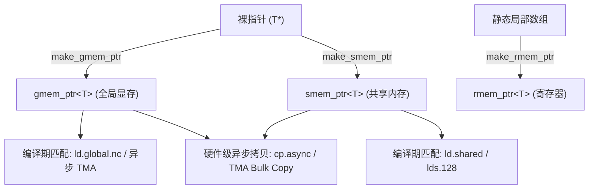
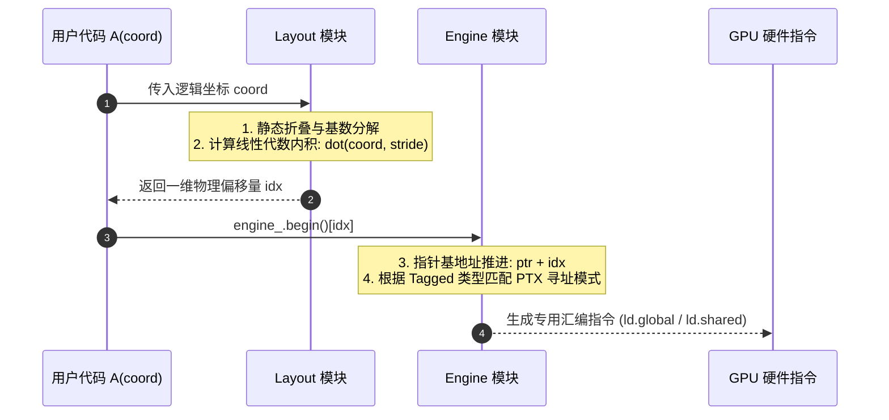
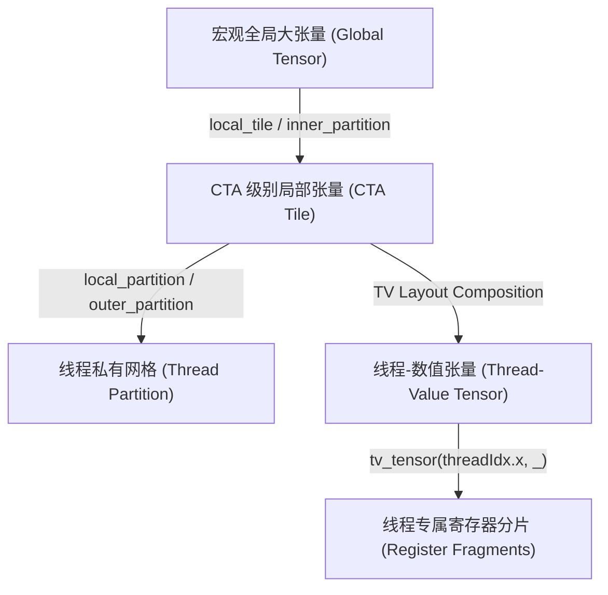
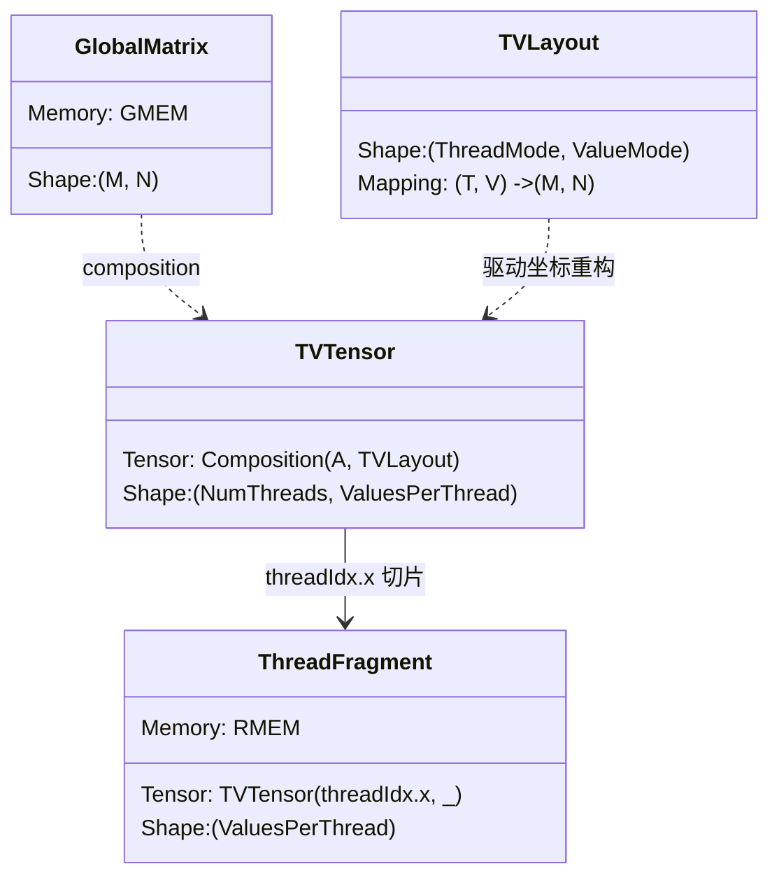

# CuTe Tensor 核心抽象、引擎机制与切片分区 (Tensors)

> **重要免责声明**：本网站只是用来消耗反重力额度的，并且给有需要的人看一看，准确度极低。可用度极低，不想看的请不看，造成错误概不负责。
> 本篇由 AI 辅助汉化与深度解析，非 NVIDIA 官方技术文档。涉及 GPU 底层硬件架构参数与生产算子调优，请以 [NVIDIA CUTLASS 官方源码](https://github.com/NVIDIA/cutlass) 为准。

---
> [!NOTE] 原文参考
> 本章对应官方规范文档 [`media/docs/cpp/cute/03_tensor.md`](https://github.com/NVIDIA/cutlass/blob/main/media/docs/cpp/cute/03_tensor.md)，并在原文档基础上进行了大量微架构原理补充、PTX 汇编映射溯源与工程案例剖析。

在前两章中，我们深入剖析了 CuTe 的数学基石 —— `Layout`（布局代数）。`Layout` 是一套完全脱离物理存储介质的纯数学映射理论，它定义了多维坐标空间 $\mathbb{Z}^D$ 到一维逻辑偏移量 $\mathbb{Z}$ 的单射或满射关系。

然而，在高性能 GPU 算子工程中，算法最终必须落脚于物理内存空间。**`Tensor`（张量）正是连接这一纯代数世界与 GPU 硬件物理显存的终极载体**。

---

## 0. 核心公理：Tensor = Engine + Layout

CuTe 对多维张量的抽象达到了前所未有的正交性与解耦度。在源码定义中，`cute::Tensor` 模板类严格由两个互相独立的核心概念复合而成：

$$\text{Tensor} = \text{Engine} + \text{Layout}$$

```cpp
template <class Engine, class Layout>
class Tensor {
  Engine engine_;   // 负责：存放在哪里？如何读取底层内存？（存储引擎）
  Layout layout_;   // 负责：逻辑形状是什么？坐标如何映射为偏移量？（数学布局）
public:
  // 核心成员函数与坐标访问重载...
};
```

为了彻底理解 CuTe 的设计美学，我们可以将其与现代主流张量库进行横向对比：

| 特性维度 | PyTorch (`torch.Tensor`) | C++23 (`std::mdspan`) | CuTe (`cute::Tensor`) |
| :--- | :--- | :--- | :--- |
| **元数据存储** | 堆上分配的动态结构体 (`TensorImpl`) | 模板参数定制 (`extents`, `layout_mapping`) | 完全支持静态编译期常量 (`Int<N>`) 与类型嵌入 |
| **内存所有权** | 强引用计数智能指针 (`c10::intrusive_ptr`) | 非持有型（仅作为视图 `View`） | **双模态**：支持寄存器持有型（Owning）与非持有型视图（Non-owning） |
| **编译期特化** | 无法在编译期特化特定 Shape/Stride | 静态维度仅支持单层 Flat 尺寸 | **支持任意深度的分层嵌套（Hierarchical）静态布局** |
| **显存空间感知** | 运行时 `device` 属性（无法内联 PTX） | 无硬件空间感知（纯 CPU 指针抽象） | **强类型显存空间打标（GMEM/SMEM/RMEM Tagged Pointers）** |
| **PTX 指令分发** | 算子级巨型 Switch 分发 | 无硬件加速分发 | **C++ 类型系统直接映射至底层专有硬件搬运指令** |

---

## 1. 存储引擎体系 (Storage Engines)

`Engine` 是对物理存储介质或迭代器（Iterator）的轻量级概念封装。它屏蔽了底层是裸指针、标准数组、常量生成器还是异步搬运句柄的细节，仅向 `Tensor` 暴露出以下标准概念：
* `value_type`：元素数据类型（如 `float`, `half_t`, `int8_t`）。
* `reference`：元素的引用或代理引用类型（如 `T&` 或寄存器位段引用）。
* `iterator`：随机访问迭代器类型。
* `begin()`：返回指向物理存储首地址的起始迭代器。

### 1.1 `ArrayEngine<T, N>`：寄存器持有型引擎

当 `Tensor` 驻留在当前 CUDA 线程的**寄存器文件（Register File）**中时，CuTe 使用 `ArrayEngine<T, N>` 作为存储引擎。
* 其底层物理结构本质上是一个紧凑的连续数组 `cute::array<T, N>`。
* **生命周期完全受控**：张量具有独立的所有权（Owning）。张量构造时在寄存器分配；张量拷贝时触发寄存器元素深拷贝；张量作用域结束时自动销毁。
* **编译期静态约束**：由于 GPU 架构中每个线程能使用的寄存器数量必须在 NVCC 编译阶段静态确定，因此由 `ArrayEngine` 驱动的张量，其 `Layout` 的容量（Cosize）**必须由纯编译期静态整数（Static Ints）构成**，绝对不允许出现任何运行时动态维度！

### 1.2 `ViewEngine<Iterator>`：非持有型视图引擎

当 `Tensor` 映射到**全局显存（Global Memory）**或**共享内存（Shared Memory）**时，显存的生命周期由外部 CUDA Runtime 或动态分配机制管理。此时 CuTe 使用 `ViewEngine<Iterator>`：
* 它仅仅持有一个随机访问迭代器（通常为裸指针 `T*` 或打标指针）。
* **轻量级引用语义**：拷贝张量仅仅拷贝了一个指针和极小尺寸的 `Layout` 元数据，**绝对不发生任何物理数据的深拷贝**。
* **动静皆宜**：该引擎对 `Layout` 没有静态编译期限制，既可以包装完全动态尺寸（Runtime GEMM）的全局矩阵，也可以包装高度静态特化的共享内存分块。

### 1.3 `ConstViewEngine<Iterator>`：只读视图引擎

当指向的内存区域为常量只读（例如深度学习推理场景下的静态权重矩阵）时，CuTe 会推导或显式使用 `ConstViewEngine`，底层元素引用被降级为只读引用，防止算法意外写坏共享只读数据。

---

## 2. 显存空间强类型标记与硬件指令分发 (Tagged Pointers)

在传统 CUDA C++ 编程中，裸指针 `float* ptr` 抹杀了其背后的物理硬件存储位置。编译器只能将其保守地视为通用虚拟地址（Generic Address），在生成汇编代码时往往需要先生成冗余的地址判断逻辑，或者只能回退到通用内存读写指令（如 `ld.u32`）。

CuTe 引入了革命性的**显存空间强类型修饰机制（Tagged Iterators）**：



### 2.1 标记工厂函数

CuTe 提供了两个最为核心的指针标记工厂：
* `make_gmem_ptr(ptr)` 或 `make_gmem_ptr<T>(ptr)`：将裸指针封装为 `gmem_ptr<T>`，在类型层面上明确断言其指向 **GPU 全局显存（HBM / VRAM）**。
* `make_smem_ptr(ptr)` 或 `make_smem_ptr<T>(ptr)`：将裸指针封装为 `smem_ptr<T>`，在类型层面上明确断言其指向 **CTA 共享内存（Shared Memory / L1）**。

### 2.2 为什么强类型打标能够换来终极性能？

现代 NVIDIA GPU（Ampere、Hopper、Blackwell）配备了大量微架构专用的硬件数据搬运加速单元。例如：
1. **Ampere `cp.async` 硬件流水线**：
   `cp.async.cg` 或 `cp.async.ca` 指令要求硬件直接从全局内存向共享内存拉取数据，完全绕过寄存器堆（Zero-register Bypass）。
   在 CuTe 的算法实现中：
   ```cpp
   cute::copy(tiled_copy, src_tensor, dst_tensor);
   ```
   模板内部会通过 `decltype(src_tensor.data())` 与 `decltype(dst_tensor.data())` 提取指针类型。**当且仅当**源指针带有 `gmem_ptr` 标签且目标指针带有 `smem_ptr` 标签时，C++ SFINAE / 特化分发机制才会激活并生成真正的 `cp.async` PTX 指令；否则将自动降级为普通的 `ld.global` 加 `st.shared`（多消耗一倍寄存器并增加流水线停顿）。

2. **Hopper / Blackwell TMA（Tensor Memory Accelerator）**：
   TMA 硬件引擎要求必须提供全局显存的 64-bit 物理描述符和共享内存的基准偏移。类型标签系统是 TMA 能够在编译阶段完成安全性审查和地址模式校验的根本基石。

---

## 3. Tensor 创建全景指南 (Creation Patterns)

在 CUDA 算子编写中，创建张量主要遵循两大模式：**在寄存器中申请存储** 与 **在已有显存上挂载视图**。

### 3.1 创建非持有型视图张量 (Non-owning Tensors)

非持有型张量通常用于包装输入矩阵、输出矩阵以及共享内存暂存缓冲区。

```cpp
#include <cute/tensor.hpp>
using namespace cute;

__global__ void tensor_creation_demo(float* g_ptr, int dynamic_m, int dynamic_n) {
  // -------------------------------------------------------------
  // 1. 全局显存张量：混合动静态布局
  // -------------------------------------------------------------
  // 创建一个 M 维为动态运行时变量、N 维静态固定为 64 的列优先矩阵：
  auto gmem_layout = make_layout(make_shape(dynamic_m, Int<64>{}), GenRowMajor{});
  Tensor gmem_A = make_tensor(make_gmem_ptr(g_ptr), gmem_layout);

  // -------------------------------------------------------------
  // 2. 共享内存张量：静态申请与无缝绑定
  // -------------------------------------------------------------
  // 定义共享内存中分块的逻辑排布：64x64 列优先
  auto smem_layout = make_layout(Shape<_64, _64>{}, Stride<_1, _64>{});

  // 计算该布局所需的物理元素容量（Cosize），并静态声明共享内存数组：
  __shared__ float smem_buffer[cosize_v<decltype(smem_layout)>];

  // 绑定打标指针，创建共享内存张量：
  Tensor smem_A = make_tensor(make_smem_ptr(smem_buffer), smem_layout);

  // -------------------------------------------------------------
  // 3. 打印张量元数据（通过控制台查看类型推导结果）
  // -------------------------------------------------------------
  if (thread0()) {
    print("gmem_A : "); print(gmem_A); print("\n");
    print("smem_A : "); print(smem_A); print("\n");
  }
}
```

如果在控制台打印上述张量，CuTe 会输出精巧的运行时签名：
```text
gmem_A : gmem_ptr[32b](0x7f9a10000000) o (128,_64):(_64,_1)
smem_A : smem_ptr[32b](0x000000000000) o (_64,_64):(_1,_64)
```
注意观察其输出结构：`指针类型[位宽](基准地址) o 形状:步长`。CuTe 极其直观地将存储属性与布局代数紧密联系在一起。

---

### 3.2 创建持有型寄存器张量 (Owning Tensors)

持有型张量是 CUDA 线程进行算术计算（如 MMA、FFT、Softmax）的中间累加载体。在 CuTe 中，我们使用带有类型参数的 `make_tensor<T>` 来构造：

```cpp
// 在每个 CUDA 线程的本地私有寄存器文件中分配一个 8x4 的 FP32 张量
// 必须全部使用静态编译期常量（如 _8, _4）
Tensor rmem_acc = make_tensor<float>(Shape<_8, _4>{});

// 也可以显式指定其在寄存器内部的展开布局（如显式行优先）
Tensor rmem_weight = make_tensor<half_t>(Shape<_16, _16>{}, LayoutRight{});

// -------------------------------------------------------------
// 高级技巧：根据现有张量的布局克隆寄存器结构 (make_tensor_like)
// -------------------------------------------------------------
// make_tensor_like 会读取参考张量的 Shape，并自动在寄存器中生成一个具有相同形状的持有型张量！
Tensor rmem_copy_dest = make_tensor_like(rmem_acc);
```

> [!CAUTION] 避坑指南：函数传参务必使用引用！
> 编写接受 `Tensor` 的 CUDA 核函数或通用辅助函数时，**参数必须声明为 `Tensor const&` 或 `Tensor&`，严禁按值传递（Pass by Value）**！
>
> 很多开发者在初学时习惯按值传递参数。对于 `ViewEngine` 构成的非持有型张量，按值传递仅拷贝指针和 Layout，尚且只有轻微开销；**但一旦传入的是 `ArrayEngine` 构成的寄存器持有型张量，按值传递将强制触发内部所有寄存器元素的深拷贝！** 这不仅会瞬间引爆线程的寄存器占用量，导致并发 Warp 数量（Occupancy）骤降，极易引发灾难性的寄存器溢出（Register Spilling，迫使编译器将寄存器挪至缓慢的本地内存 Local Memory 中读写，性能暴跌 10 倍以上）。

---

## 4. 多维与层次化坐标索引机制 (Indexing & Access Mechanics)

CuTe `Tensor` 彻底消除了手写繁琐的 `A[m * stride_m + n]` 物理偏移计算的必要。它通过精密的编译期重载，支持多种维度的自然访问。

### 4.1 访问方式的三重境界

```cpp
Tensor A = make_tensor<float>(Shape<Shape<_4, _5>, Int<13>>{},
                              Stride<Stride<_12, _1>,     _64>{});

// 1. 自然层次化分层坐标访问 (Hierarchical Coordinates)
// 精准对应嵌套维度 ((m0, m1), n)
int m0 = 2, m1 = 3, n = 7;
A(make_coord(make_coord(m0, m1), n)) = 3.14159f;

// 2. 扁平多维坐标访问 (Flat Multi-dimensional Coordinates)
// CuTe 会利用坐标展开（Coordinate Flattening）算法自动将扁平坐标 (m, n) 
// 按照模代数映射进内部嵌套维度中：
int flat_m = m0 + m1 * 4; // 2 + 3*4 = 14
A(flat_m, n) = 3.14159f;  // 完全等价于上一行！

// 3. 一维线性空间扁平遍历 (Linear 1D Indexing)
// 类似于直接将多维张量展开为一维连续数组，常用于快速初始化或全量清零：
for (int i = 0; i < A.size(); ++i) {
  A[i] = 0.0f; // 等价于 A(i)
}
```

### 4.2 双相求值算法（Dual-Phase Evaluation）深度拆解

当你在代码中写下 `A(crd)` 时，GPU 硬件底层究竟执行了什么？



1. **第一阶段：数学映射（Layout Phase）**：
   CuTe 将传入的逻辑坐标代入 `layout_(coord)`。此时，由于 Shape 与 Stride 中包含大量的 `Int<N>` 静态编译期常量，NVCC 的编译期常量折叠（Constant Folding）与死代码消除（DCE）会全面介入，将原本复杂的乘加运算简化为极少量的单周期位移或乘加指令。
2. **第二阶段：内存解引用（Engine Phase）**：
   将计算得到的标量整数偏移 `idx` 传递给底层引擎的迭代器：`*(engine_.begin() + idx)`。若迭代器携带显存类型标签，则直接在此处完成硬件指令特化。

---

## 5. 张量切片机理：通配符 `_` 的降维魔术 (Tensor Slicing)

切片（Slicing）是 CuTe 张量代数中最优雅、最强悍的操作工具。它使用一个轻量级的全局占位符对象 **`_`（`cute::Underscore`）**。

在概念上，**`_` 之于 CuTe，正如 `:` 之于 Python / NumPy**。

### 5.1 切片的核心定理

对张量 `A` 传入切片坐标 `crd`：
* 如果一个模式（Mode）被传入了**具体标量整数**，该模式被**固定并折叠（Sliced Away）**。底层迭代器指针立即加上该坐标在物理内存中的对应基准偏移。
* 如果一个模式被传入了**通配符 `_`**，该模式在切片后的子张量中**完整保留（Preserved）**，其子 Shape 与子 Stride 原样传递给子张量。
* **返回值**：
  * 若坐标中**不包含任何 `_`**，则返回**单个标量元素的值/引用**；
  * 若坐标中**包含一个或多个 `_`**，则返回**全新的子张量（Sub-tensor View）**！

### 5.2 切片图解与代码实战

假设我们有一个全局矩阵，其形状与步长如下：
$$\text{Layout}: ((_3, 2), (2, _5, _2)) : ((4, 1), (_2, 13, 100))$$

```cpp
Tensor A = make_tensor(ptr, make_layout(make_shape (make_shape (_3, 2), make_shape (2, _5, _2)),
                                        make_stride(make_stride( 4, 1), make_stride(_2, 13, 100))));

// -------------------------------------------------------------
// 操作 1：固定第一维为标量 2，提取沿第二维切出的所有元素（切片提取“列”）
// -------------------------------------------------------------
Tensor col_slice = A(2, _); 
// 推导过程：
// - 模式 0 被传入标量 2：将其映射到底层偏移 2 * 4 = 8，迭代器基址变为 ptr + 8。
// - 模式 1 被传入 _：完整保留第二维的结构。
// 结果子张量布局为: (2, _5, _2) : (_2, 13, 100)
// 其 Rank 从 2 阶降为了 1 阶！

// -------------------------------------------------------------
// 操作 2：固定第二维为标量 5，提取沿第一维切出的所有元素（切片提取“行”）
// -------------------------------------------------------------
Tensor row_slice = A(_, 5);
// 结果子张量布局为: (_3, 2) : (4, 1)

// -------------------------------------------------------------
// 操作 3：保持 Rank 不变的精细切片（Rank-Preserving Slicing）
// -------------------------------------------------------------
// 有时我们希望切片后的子张量依然保持原来的外层阶数（Rank 依然为 2），
// 此时只需在对应的嵌套层级上显式传入 make_coord(_, _)：
Tensor preserved_slice = A(make_coord(_, _), 5);
// 结果子张量布局为: ((_3, 2)) : ((4, 1)) -> 保持了嵌套的 Rank-2 结构！

// -------------------------------------------------------------
// 操作 4：跨嵌套维度的超精密局部开窗切片
// -------------------------------------------------------------
Tensor micro_slice = A(make_coord(_, 1), make_coord(0, _, 1));
// 结果子张量布局为: (_3, _5) : (4, 13)
// 迭代器指针基地址推进量: 1 * 1 (来自第0维) + 0 * 2 + 1 * 100 (来自第1维) = 101！
```

通过通配符 `_` 的精密嵌套组合，开发者可以在无需进行任何动态内存分配的前提下，以零开销生成指向物理数据任意切面、任意分块的超轻量级张量视图。

---

## 6. GPU 算子核心分区三部曲 (Partitioning Strategies)

在现代高性能 GPU 算子（如 FlashAttention、CUTLASS GEMM、Conv2d）的编写中，**“分区（Partitioning）”是整个算子体系的灵魂**。

GPU 拥有庞大的层级硬件架构：**Grid $\to$ Thread Block (CTA) $\to$ Warp $\to$ Thread**。
如何将一个数十亿元素的宏观大张量，层层剖分并精准分发给每一个硬件层级？CuTe 的核心范式是：

$$\text{分区范式} = \text{先平铺分块 (Divide / Tiling)} + \text{后切片索引 (Slicing)}$$

CuTe 提炼出了三大经久不衰的核心分区模式：



---

### 6.1 策略一：内部分区 (`inner_partition` 与 `local_tile`)

* **适用层级**：从 Grid（网格）到 CTA（Thread Block 线程块）。
* **核心意图**：将宏观矩阵切成若干个尺寸相同的小瓦片（Tiles）。每个 CTA 根据自身的 `blockIdx` 坐标，认领属于自己的那个瓦片。
* **代数机制**：使用 `zipped_divide` 将宏观张量变换为二阶嵌套张量：
  $$\text{Shape: } (\text{TileShape}, \text{GridShape})$$
  其中：
  * Mode-0（内层）：小瓦片自身的几何形状（`TileShape`）；
  * Mode-1（外层）：由这些小瓦片拼接而成的网格尺寸（`GridShape`）。
  随后，我们将 `blockIdx` 传入外层的 Mode-1 进行标量切片，而 Mode-0 传入通配符 `_` 全部保留，从而提取出当前 CTA 专属的局部子张量！

CuTe 将上述繁琐的标准流程高度封装为极其常用的工程接口：**`local_tile`**。

#### `local_tile` 实战代码

```cpp
#include <cute/tensor.hpp>
using namespace cute;

__global__ void inner_partition_demo(float* g_matrix, int M, int N) {
  // 1. 包装宏观全局大矩阵 (M, N)
  Tensor A = make_tensor(make_gmem_ptr(g_matrix), make_shape(M, N), LayoutRight{});

  // 2. 定义每个 Thread Block 负责处理的瓦片尺寸: 128 x 64
  auto bM = Int<128>{};
  auto bN = Int<64>{};
  auto cta_tile_shape = make_shape(bM, bN);

  // 3. 显式代数拆解过程（原理揭秘）：
  // Tensor tiled_A = zipped_divide(A, cta_tile_shape); // 形状: ((_128, _64), (GridM, GridN))
  // Tensor my_cta_A = tiled_A(make_coord(_, _), make_coord(blockIdx.x, blockIdx.y));

  // 4. 工业级直接调用：使用 local_tile 一行完成内部分区！
  Tensor my_cta_A = local_tile(A, cta_tile_shape, make_coord(blockIdx.x, blockIdx.y));

  // 此时 my_cta_A 的形状就是原原本本的 (_128, _64)
  // 其基地址指针已自动根据 blockIdx.x 和 blockIdx.y 偏移到了该 CTA 的物理起跑点！
}
```

---

### 6.2 策略二：外部分区 (`outer_partition` 与 `local_partition`)

* **适用层级**：从 CTA（线程块）到 Thread（线程）。
* **核心意图**：当一个 CTA 内部拥有（例如 128 个或 256 个）线程时，如何将 CTA 内部的 `128x64` 数据块均匀瓜分给每一个线程？
* **代数机制**：同样使用 `zipped_divide`，但切片方向正好与内部分区**完全颠倒**！
  我们将当前线程的索引 `threadIdx.x` 传入 Mode-0（Tile 维度）进行标量切片，而将通配符 `_` 传入 Mode-1（Grid 维度）！这意味着：每个线程在宏观网格的每一个循环周期中，挑出属于自己位置的那一个元素！

CuTe 将这一模式封装为 **`local_partition`**：

```cpp
// 假设 CTA 内部分配了 128 个线程，排布为一个 16 x 8 的二维线程网格：
auto thr_layout = make_layout(make_shape(Int<16>{}, Int<8>{}));

// 对上面提取出的 my_cta_A (128, 64) 按照线程布局进行外部分区：
Tensor my_thr_A = local_partition(my_cta_A, thr_layout, threadIdx.x);

// 计算 my_thr_A 的形状：
// 128 / 16 = 8, 64 / 8 = 8 -> 形状为 (_8, _8)
// 这意味着当前线程持有 64 个元素，以 8x8 的形式散布在整个 128x64 瓦片中！
```

---

### 6.3 策略三：TV 布局分区（Thread-Value Partitioning）—— 算子极巅之术

如果说 `local_tile` 和 `local_partition` 是常规 CUDA 分块的降维表达，那么 **TV（Thread-Value）分区则是现代 Tensor Core 编程无可替代的终极统治者**。

在传统 CUDA 编程中，开发者最头疼的问题莫过于理解底层硬件 Tensor Core 的矩阵排布。无论是 Volta 的 QuadPair、Ampere 的 `mma.sync.aligned.m16n8k16`，还是 Hopper 的 `wgmma`，硬件都强制规定：
* 32 个线程（一个 Warp）协作计算一个基本微矩阵；
* 具体的矩阵坐标 $(m, n)$ 到底存储在哪个线程（Thread ID）的哪个寄存器对（Register / Value ID）中，是由微架构布线决定的复杂交织逻辑！

CuTe 创造性地通过**布局代数复合（Composition）**彻底征服了这一难题！



#### TV 分区完整工作流拆解

1. **构建 TV 映射布局（TV Layout）**：
   我们构造一个特殊的二阶布局 `tv_layout`，其逻辑形状为：
   $$\text{Shape: } (\text{ThreadLayout}, \text{ValueLayout}) = (T, V)$$
   该布局的数学定义是：**当给定线程号 $t$ 和寄存器数值序号 $v$ 时，它直接输出该元素在物理矩阵中的逻辑二维坐标 $(m, n)$**：
   $$\text{tv\_layout}(t, v) = (m, n)$$

2. **执行代数复合（Composition）**：
   通过复合操作，将数据张量 `A` 与 `tv_layout` 结合：
   $$\text{TV\_Tensor} = \text{composition}(A, \text{tv\_layout})$$
   变换后得到的张量，其逻辑形状变成了全新的 $(T, V)$：
   * 第 0 维代表参与协作的**所有线程的编号**；
   * 第 1 维代表每个线程各自持有的**寄存器数值序列**！

3. **线程本地切片（Thread Slicing）**：
   每个线程只需代入自己的硬件线程号 `threadIdx.x`，并传入通配符 `_`：
   ```cpp
   Tensor my_fragment = TV_Tensor(threadIdx.x, _);
   ```
   **奇迹发生了**：`my_fragment` 直接退化为一个纯一维的持有型寄存器张量！当前线程在整个宏观矩阵中所负责的一切寄存器数据，瞬间被严丝合缝地提取了出来！

---

## 7. 实战深度解析：8 线程与 4 数值的 TV 映射演算

为了彻底看清 TV 布局的内部数学运作，我们亲手一步一步推导一个经典的微型算子案例。

* **问题背景**：
  我们需要处理一个 $4 \times 8$ 的数据小矩阵 $A$（采用行优先排布，元素值依次填入 $0 \sim 31$）。
  现有 8 个 CUDA 线程（Thread $0 \sim 7$）协作处理该矩阵，每个线程在寄存器中持有 4 个数值（Value $0 \sim 3$）。
* **分配目标**：
  我们希望 8 个线程在空间上排布为 $2 \times 4$ 的网格；每个线程持有的 4 个数值在局部负责一个 $2 \times 2$ 的小矩阵。

### 7.1 构造 TV 布局

```cpp
// 线程形状为 (2, 4)，按列优先连续分配线程号：Stride 为 (_1, _2)
// 数值形状为 (2, 2)，在行方向跨度为 2，在列方向跨度为 4：Stride 为 (_2, _4)
auto thread_layout = make_layout(make_shape(_2, _4), make_stride(_1, _2));
auto value_layout  = make_layout(make_shape(_2, _2), make_stride(_2, _4));

// 组合形成完整的 TV 布局：
// ( (T_m, T_n), (V_m, V_n) ) -> (M_coord, N_coord)
auto tv_layout = make_layout(
    make_shape (make_shape (_2, _4), make_shape (_2, _2)),
    make_stride(make_stride(_1,  2), make_stride(_2,  4))
);
```

### 7.2 物理矩阵中的空间归属全景图

经过该 TV 布局映射后，整张 $4 \times 8$ 矩阵被 8 个线程瓜分的物理状态如下表所示（单元格内格式为：**T[线程号]_V[数值号]**）：

```text
       Col 0      Col 1      Col 2      Col 3      Col 4      Col 5      Col 6      Col 7
Row 0: T0_V0      T0_V2      T2_V0      T2_V2      T4_V0      T4_V2      T6_V0      T6_V2
Row 1: T1_V0      T1_V2      T3_V0      T3_V2      T5_V0      T5_V2      T7_V0      T7_V2
Row 2: T0_V1      T0_V3      T2_V1      T2_V3      T4_V1      T4_V3      T6_V1      T6_V3
Row 3: T1_V1      T1_V3      T3_V1      T3_V3      T5_V1      T5_V3      T7_V1      T7_V3
```

让我们验证特定线程的数据捕获情况：
* **线程 0（`T0`）** 负责的 4 个位置坐标分别为：
  * `V0` $\implies$ `Row 0, Col 0`
  * `V1` $\implies$ `Row 2, Col 0`
  * `V2` $\implies$ `Row 0, Col 1`
  * `V3` $\implies$ `Row 2, Col 1`
* 这四个坐标正好组成了左上角 $2 \times 2$ 的步长跳跃子块！
* 类似地，**线程 7（`T7`）** 负责：
  * `V0` $\implies$ `Row 1, Col 6`
  * `V1` $\implies$ `Row 3, Col 6`
  * `V2` $\implies$ `Row 1, Col 7`
  * `V3` $\implies$ `Row 3, Col 7`
* 正好组成了右下角的 $2 \times 2$ 分块！

### 7.3 在核函数中完成切片代码

```cpp
__global__ void tv_demo_kernel(float const* input_matrix) {
  // 1. 挂载 4x8 全局张量
  Tensor A = make_tensor(make_gmem_ptr(input_matrix), make_shape(_4, _8), LayoutRight{});

  // 2. 构造 TV 变换张量 (8 线程 x 4 数值)
  Tensor tv_A = composition(A, tv_layout);

  // 3. 当前线程精准切片属于自己的 4 个寄存器元素
  Tensor my_reg = tv_A(threadIdx.x, _); // 形状: (_4)

  // 4. 将全局数据高效加载至本地寄存器中：
  Tensor reg_storage = make_tensor_like(my_reg);
  copy(my_reg, reg_storage);

  // 此时当前线程的 reg_storage[0..3] 正好对应 V0..V3 的矩阵数据！
}
```

没有任何手写的复杂取模与整除（`threadIdx.x % 2`, `threadIdx.x / 2`），没有任何易错的指针偏移硬编码！**所有的坐标几何排布，都被降维压缩进了一次优雅的布局代数复合与一次通配符切片之中**。

---

## 8. 张量调试利器与宏观打印 (Debugging Tensors)

张量编程最容易让初学者陷入多维坐标困惑。CuTe 针对这一痛点，在编译期与运行时均提供了完备的调试打印接口。

### 8.1 格式化打印函数

* `cute::print(tensor)`：打印张量的元数据信息（包括存储指针类型、基准物理地址、维度形状 Shape 与跨度步长 Stride）。
* `cute::print_tensor(tensor)`：直接遍历打印该张量包含的**真实物理数值内容**！在 GPU 终端下排版为极其清晰的矩阵网格。
* `cute::print_latex(layout)`：将布局导出为 LaTeX TikZ 矢量图源码，能够直接放入论文或技术报告中渲染出精美的多维切片彩色示意图！

### 8.2 安全调试规范代码

```cpp
template <class TensorType>
__device__ void debug_dump_tensor(char const* name, TensorType const& t) {
  // 务必使用 thread0() 保护，防止 1024 个线程同时向控制台输出导致终端混乱
  if (thread0()) {
    printf("=== DEBUG TENSOR: %s ===\n", name);
    printf("Metadata : "); print(t); printf("\n");
    printf("Elements :\n");
    print_tensor(t);
    printf("===================================\n");
  }
  // 全局同步，确保调试信息完整输出后再继续执行后续硬件指令
  __syncthreads();
}
```

---

## 9. 本章核心小结与思维导图

| 核心概念 | 形式化代数定义 | 物理硬件实现与操作范式 |
| :--- | :--- | :--- |
| **核心构成公理** | `Tensor = Engine + Layout` | 存储容器（数据在哪）与几何结构（如何排布）完全正交。 |
| **存储引擎 Engine** | • `ArrayEngine`：寄存器持有型 (Owning)，静态容量分配<br/>• `ViewEngine`：显存非持有型视图 (Non-owning)，轻量包装裸指针 | 强类型指针打标 (`gmem_ptr`, `smem_ptr`) 驱动硬件指令特化。 |
| **切片与访问** | • 自然嵌套坐标：`make_coord` 访问高维数据<br/>• 通配符切片：`_` 保留维度，标量折叠维度 | 编译期常量折叠，零运行时寻址开销。 |
| **分区三部曲** | • `local_tile`：全局张量平铺到 CTA 瓦片<br/>• `local_partition`：CTA 瓦片切分到各线程寄存器 | 严格保持数据类型对齐与布局同构。 |

掌握了 `Tensor` 的构造、打标、切片与三大分区法门，你就已经拿到了通往 CUTLASS 3.x 现代算子核心宝库的金钥匙。下一章中，我们将把这些张量与硬件算力单元（Tensor Core / MMA Atom）正式联姻，深入解析现代 GPU 核心计算引擎的运行本质！
