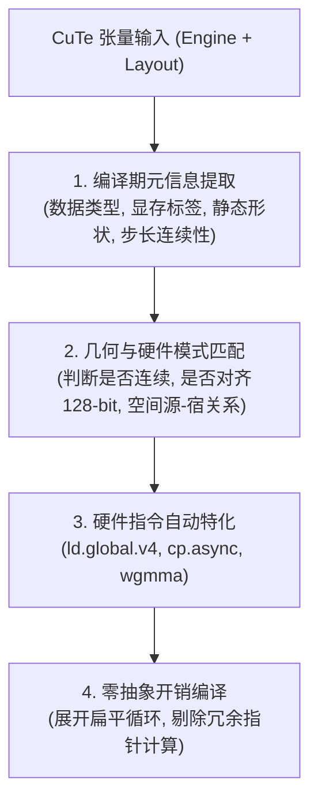
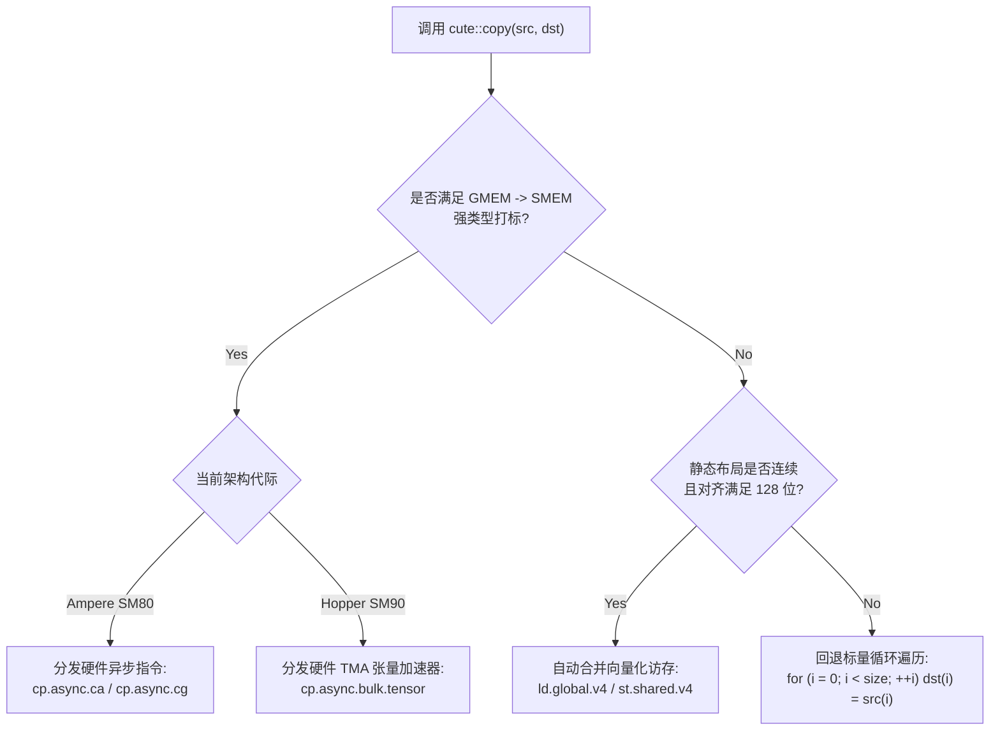
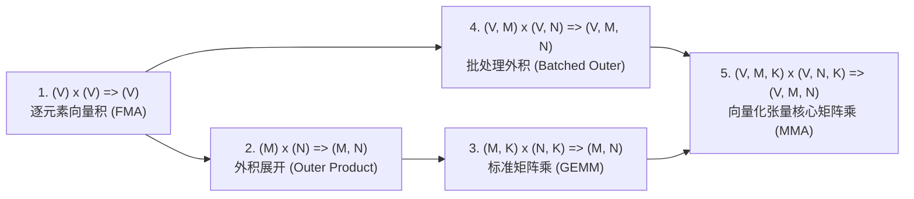

# CuTe 泛型张量算法体系：数据搬运、代数缩并与微架构分发 (Algorithms)

::: warning ⚠️ 声明与免责须知
本文档由 **AI 深度辅助汉化、架构重构与长篇技术解析** 形成，**非 NVIDIA 官方技术文档**。
虽然内容力求数学严谨性、微架构精准性与工程可落地性，但不能保证 100% 毫无差错。
涉及底层硬件指令（PTX）、显存对齐约束、并发同步屏障及生产环境部署时，请务必以 [NVIDIA CUTLASS 官方源码库](https://github.com/NVIDIA/cutlass) 及原厂 Release 说明为最终准绳。
:::

> [!NOTE] 原文参考
> 本章对应官方核心规范文档 [`media/docs/cpp/cute/04_algorithms.md`](https://github.com/NVIDIA/cutlass/blob/main/media/docs/cpp/cute/04_algorithms.md)。所有算法源码均可在官方头文件目录 [`include/cute/algorithm/`](https://github.com/NVIDIA/cutlass/tree/main/include/cute/algorithm/) 中查阅。

在传统的 C++ 标准库（STL）中，算法（如 `std::copy`, `std::transform`, `std::accumulate`）以一维迭代器（Iterator）为操作基石。然而在现代高性能 GPU 算子工程中，数据天然是多维的、分块的、具有跨代异构硬件加速指令支持的。

CuTe 构建了一套**专为多维张量（Tensors）量身定制的泛型数值算法体系**。
这一体系最大的颠覆性在于：**它在维持高级声明式语法的同时，依托 C++ 编译期元编程，能够将高层代数调用直接特化分发为 GPU 最底层的微架构硬件指令（如 128 位向量化访存、Ampere `cp.async`、Hopper TMA、Tensor Core MMA 等）！**

---

## 0. CuTe 泛型算法的四大设计公理



1. **类型驱动的分发（Type-Driven Dispatch）**：
   算法不只关心传入的数据值，更关心参数的**类型标签（Type Traits）**。指针是否带有 `gmem_ptr` 或 `smem_ptr` 标签？布局是否为静态步长？这些类型信息直接决定了硬件指令的分发路线。
2. **正交的 Atom 覆盖（Orthogonal Atom Override）**：
   每个核心算法都提供两种重载：
   * **默认双参数重载**：由 CuTe 自动根据参数类型推导最优策略；
   * **显式 Atom 重载**：允许开发者显式传入 `Copy_Atom` 或 `MMA_Atom`，强制覆写硬件行为。
3. **零成本抽象（Zero-Cost Abstraction）**：
   所有的模式匹配与维度推演均在 C++ 编译期完成（Compile-time Constant Folding）。生成最终二进制机器码（SASS）时，不产生任何多余的动态分支、动态函数指针查找或间接跳转开销。
4. **统一的多维坐标契约**：
   算法内部严格遵循代数投影与单射规则，彻底消除了手写多层嵌套 `for` 循环与易错的数组下标计算。

---

## 1. 数据搬运算法：`copy` (Tensor Copy)

`copy` 是 GPU 算子中使用频率最高的绝对基石。它负责在全局显存（GMEM）、共享内存（SMEM）与寄存器堆（RMEM）之间高速搬运数据。

源码位置：[`include/cute/algorithm/copy.hpp`](https://github.com/NVIDIA/cutlass/tree/main/include/cute/algorithm/copy.hpp)。

### 1.1 核心调用重载

```cpp
// 重载 1: 默认自动推导重载
template <class SrcEngine, class SrcLayout,
          class DstEngine, class DstLayout>
CUTE_HOST_DEVICE void
copy(Tensor<SrcEngine, SrcLayout> const& src,
     Tensor<DstEngine, DstLayout>      & dst);

// 重载 2: 显式 Copy_Atom 强行指定硬件指令
template <class... CopyArgs,
          class SrcEngine, class SrcLayout,
          class DstEngine, class DstLayout>
CUTE_HOST_DEVICE void
copy(Copy_Atom<CopyArgs...>       const& copy_atom,
     Tensor<SrcEngine, SrcLayout> const& src,
     Tensor<DstEngine, DstLayout>      & dst);
```

---

### 1.2 三级渐进式硬件特化全景图

当你在代码中写下 `cute::copy(src, dst)` 时，CuTe 编译器内部会触发三级递进的特化匹配：



#### 特化级别 1：基础标量一维遍历（Fallback）
在最通用的情况下，如果布局动态不可知或内存散乱，CuTe 将张量视为一维逻辑序列展开：
```cpp
for (int i = 0; i < size(dst); ++i) {
  dst(i) = src(i);
}
```

#### 特化级别 2：自动 128 位向量化合并（Vectorized Coalescing）
如果源张量与目标张量具有静态布局，且内部元素连续且地址对齐到 16 字节，CuTe 会在编译期自动将连续的 4 个 32 位数据合并：
* 汇编层直接生成 `ld.global.v4.u32` 与 `st.shared.v4.u32`；
* 内存请求数量减少 75%，最大化打满 GPU 显存总线带宽！

#### 特化级别 3：专用异步硬件指令直通（Hardware Async Bypassing）
当源指针带有 `gmem_ptr`、目标指针带有 `smem_ptr` 时：
* **Ampere SM80**：自动分发到 `cp.async.cg`（绕过 L1 直接写入 SMEM）或 `cp.async.ca`；
* **Hopper SM90 / Blackwell SM100**：自动分发到 `cp.async.bulk.tensor`（TMA 硬件直接写入，完全不需要 CUDA Core 参与！）。

---

### 1.3 并发粒度与同步契约 (Synchronization Contracts)

这是高性能编程中最容易引发踩内存 BUG 的关键细节。`copy` 的并发粒度与同步需求完全由其参数类型决定：

| 执行主体粒度 | 典型应用场景 | 同步要求与契约 |
| :--- | :--- | :--- |
| **单线程串行 (Per-thread Sequential)** | 寄存器到寄存器、或私有栈数据复制 | **无需任何外部同步**，单线程内部保证数据依赖顺序。 |
| **线程块协同 (CTA-wide Parallel)** | 整个 Thread Block 协作将 GMEM 搬运至 SMEM | 读取 SMEM 前必须调用 **`__syncthreads()`**，确保所有线程写完。 |
| **硬件异步流水线 (cp.async Pipeline)** | Ampere 异步预取 | 必须插入 **`cp_async_fence()`** 标记边界，并在消费前调用 **`cp_async_wait<N>()`**。 |
| **TMA 硬件事务 (TMA Transaction)** | Hopper Warpgroup 异步数据拉取 | 必须与 **`mbarrier` 硬件屏障** 协同，等待硬件 DMA 控制器完成事务字节翻转。 |

---

## 2. 边界保护拷贝：`copy_if` (Predicated Copy)

源码位置：[`include/cute/algorithm/copy.hpp`](https://github.com/NVIDIA/cutlass/tree/main/include/cute/algorithm/copy.hpp)。

在工业级算子中，当矩阵尺寸无法被瓦片整除时，边界线程会读写到非法显存地址。
`copy_if` 在 `copy` 的基础上引入了一个与数据张量完全同构的**布尔谓词张量（Predication Tensor）**：

```cpp
template <class PredEngine, class PredLayout,
          class SrcEngine, class SrcLayout,
          class DstEngine, class DstLayout>
CUTE_HOST_DEVICE void
copy_if(Tensor<PredEngine, PredLayout> const& pred, // 布尔谓词掩码
        Tensor<SrcEngine,  SrcLayout>  const& src,  // 源数据张量
        Tensor<DstEngine,  DstLayout>       & dst); // 目标张量
```

### 2.1 硬件生成机制
* 仅当 `pred(coord)` 为真（非零）时，对应的元素才会被物理读取和写入；
* 在汇编层，NVCC 将其编译为**硬件单周期谓词指令（`@p0 ld.global`）**，零控制流分支跳转，彻底消除 Warp Divergence！
* 配合前文介绍的 **Stride-0 广播技术**，可在 GEMM 主循环中以零计算开销实现多维边界防护。

---

## 3. 核心计算算子：`gemm` (Matrix Multiply-Accumulate)

`gemm` 算法执行广义的矩阵乘累加运算：
$$C \leftarrow \alpha (A \times B) + \beta C \quad \text{或} \quad C \mathrel{+}= A \times B$$

源码位置：[`include/cute/algorithm/gemm.hpp`](https://github.com/NVIDIA/cutlass/tree/main/include/cute/algorithm/gemm.hpp)。

### 3.1 模式表示法与五大经典代数收缩模式

CuTe 使用统一的模式收缩标记法：
$$(A\text{ 的模式}) \times (B\text{ 的模式}) \implies (C\text{ 的模式})$$
其中各字母定义为：
* **$V$**：向量模式（Vector mode，彼此独立的并行元素）；
* **$M, N$**：输出矩阵的行与列维度；
* **$K$**：**归约收缩轴（Reduction mode）**，即求和累加轴。



#### 模式详解与微架构映射：

1. **`(V) x (V) => (V)`**：
   * **数学语义**：逐元素内积累加：$C_v \mathrel{+}= A_v \times B_v$；
   * **硬件映射**：单线程标量 `FMA` 指令。
2. **`(M) x (N) => (M, N)`**：
   * **数学语义**：两个一维向量的外积（Outer Product）：$C_{m, n} \mathrel{+}= A_m \times B_n$；
   * **硬件映射**：分发到外积循环展开，最大化利用寄存器复用。
3. **`(M, K) x (N, K) => (M, N)`**：
   * **数学语义**：标准的二维矩阵乘。**注意：矩阵 $B$ 的语义是 $(N, K)$ 而非传统的 $(K, N)$！归约轴 $K$ 永远是两个输入矩阵的第 2 维！**
   * **硬件映射**：沿着 $K$ 轴遍历，每次迭代调用模式 2 执行外积累加。
4. **`(V, M) x (V, N) => (V, M, N)`**：
   * **数学语义**：批处理向量外积：$C_{v, m, n} \mathrel{+}= A_{v, m} \times B_{v, n}$；
   * **硬件映射**：将向量维度 $V$ 放在最内层，直接映射到 SIMD 寄存器内部！
5. **`(V, M, K) x (V, N, K) => (V, M, N)`**：
   * **数学语义**：这是现代 Tensor Core 编程的终极形式！
   * **硬件映射**：直接对应于硬件张量核心指令（如 Ampere `mma.sync` 或 Hopper `wgmma`）。

---

### 3.2 显式 `MMA_Atom` 硬件调度

与 `copy` 类似，`gemm` 同样支持显式传入硬件原子原语：

```cpp
auto mma_atom = MMA_Atom<SM80_16x8x16_F32F16F16F32_TN>{};

// 执行硬件级矩阵乘累加
cute::gemm(mma_atom, tCrA, tCrB, tCrC);
```
CuTe 会自动校验三个张量分片在各维度的模式匹配性，并在编译期将高阶张量解包为寄存器元组，发射最极致的硬件汇编！

---

## 4. 辅助张量算术与尾声算子 (Tensor Epilogue & Utilities)

除了核心的搬运与乘法，CuTe 在 `include/cute/algorithm/` 下还提供了一整套轻量级线性代数原语。

### 4.1 缩放累加：`axpby`
源码位置：[`include/cute/algorithm/axpby.hpp`](https://github.com/NVIDIA/cutlass/tree/main/include/cute/algorithm/axpby.hpp)。

$$Y \leftarrow \alpha X + \beta Y$$

* 这是经典 BLAS `AXPY`（$Y = \alpha X + Y$）的直接泛化；
* 在 GEMM 算子的尾声段（Epilogue）中极为常用：负责将寄存器中的未缩放累加结果乘以 $\alpha$，并加上乘以 $\beta$ 后的原始矩阵 $C$，最后写回显存。

```cpp
// 尾声段缩放写回
cute::axpby(alpha, tCrC, beta, tCgC);
```

---

### 4.2 张量清零与常量填充：`clear` 与 `fill`
源码位置：[`include/cute/algorithm/clear.hpp`](https://github.com/NVIDIA/cutlass/tree/main/include/cute/algorithm/clear.hpp) 与 [`fill.hpp`](https://github.com/NVIDIA/cutlass/tree/main/include/cute/algorithm/fill.hpp)。

* **`clear(Tensor& t)`**：将张量内部的所有元素快速置零。
  * 对于寄存器张量，编译器自动将其折叠为极速的 `xor r, r, r` 异或清零指令；
  * 对于共享内存张量，自动向量化为 128 位零填充。
* **`fill(Tensor& t, Value const& val)`**：将张量全量填充为指定的常量数值。

---

## 5. 综合工程实战：四大核心算法协同编排

为了向读者展示 CuTe 泛型算法的优雅威力，以下给出一个真实的 CUDA 设备端计算片段，演示 `clear`、`copy`、`gemm` 与 `axpby` 如何无缝协同工作：

```cpp
#include <cute/tensor.hpp>
using namespace cute;

template <class TiledCopyA, class TiledCopyB, class TiledMma,
          class TensorGA, class TensorGB, class TensorGC,
          class SmemA, class SmemB, class Alpha, class Beta>
__device__ void complete_cute_gemm_step(
    TiledCopyA const& copy_a, TiledCopyB const& copy_b, TiledMma const& mma,
    TensorGA gA, TensorGB gB, TensorGC gC,
    SmemA sA, SmemB sB, Alpha alpha, Beta beta)
{
  // 1. 获取当前线程的搬运与计算切片
  auto thr_copy_a = copy_a.get_slice(threadIdx.x);
  auto thr_copy_b = copy_b.get_slice(threadIdx.x);
  auto thr_mma    = mma.get_slice(threadIdx.x);

  // 2. 线程数据分区
  Tensor tAgA = thr_copy_a.partition_S(gA);
  Tensor tAsA = thr_copy_a.partition_D(sA);
  Tensor tBgB = thr_copy_b.partition_S(gB);
  Tensor tBsB = thr_copy_b.partition_D(sB);

  Tensor tCsA = thr_mma.partition_A(sA);
  Tensor tCsB = thr_mma.partition_B(sB);
  Tensor tCgC = thr_mma.partition_C(gC);

  // 3. 在寄存器中分配累加器并调用 clear 清零
  Tensor tCrC = thr_mma.make_fragment_C(tCgC);
  cute::clear(tCrC); // 算法 1: clear 清零寄存器

  // 4. 主循环遍历 K 轴
  for (int k_tile = 0; k_tile < size<2>(tAgA); ++k_tile) {
    // 算法 2: 硬件特化 copy 搬运全局数据至共享内存
    cute::copy(copy_a, tAgA(_, _, k_tile), tAsA);
    cute::copy(copy_b, tBgB(_, _, k_tile), tBsB);

    // 硬件异步等待与同步
    cp_async_fence();
    cp_async_wait<0>();
    __syncthreads();

    // 算法 3: 硬件矩阵乘累加
    cute::gemm(mma, tCsA, tCsB, tCrC);

    __syncthreads();
  }

  // 5. 算法 4: 尾声段缩放并写回全局显存
  cute::axpby(alpha, tCrC, beta, tCgC);
}
```

---

## 6. 本章核心小结与算法 API 导图

```mermaid
mindmap
  root((CuTe 泛型算法库))
    数据搬运体系
      copy: 默认根据指针标签特化 (GMEM->SMEM, 128-bit 向量化)
      Copy_Atom: 显式覆盖硬件搬运 (UniversalCopy, cp.async, TMA)
      copy_if: 结合布尔谓词张量与 Stride-0, 零分歧安全边界保护
    数学计算体系 (gemm)
      模式 1: (V) x (V) => (V) 逐元素 FMA
      模式 2: (M) x (N) => (M, N) 外积展开
      模式 3: (M, K) x (N, K) => (M, N) 标准 GEMM (归约轴恒为第 2 维)
      模式 4: (V, M) x (V, N) => (V, M, N) 批处理向量外积
      模式 5: (V, M, K) x (V, N, K) => (V, M, N) Tensor Core 硬件收缩
    张量工具体系
      axpby: Y = alpha * X + beta * Y 广义尾声缩放
      clear: 极速寄存器与 SMEM 硬件清零 (xor / st.shared)
      fill: 常量全量填充
```

掌握了这些泛型算法，你便拥有了在 GPU 上组织任意复杂多维数据流转与数学收缩的完整武器库。
在下一章 [`00_quickstart.md`](./00_quickstart.md) 中，我们将为初学者全面梳理 CuTe 的极速入门心智模型与环境搭建指南；随后我们将正式进军 **CUTLASS 3.x 宏观架构篇**，探索软件流水线与 Blackwell 架构的终极奥义！
