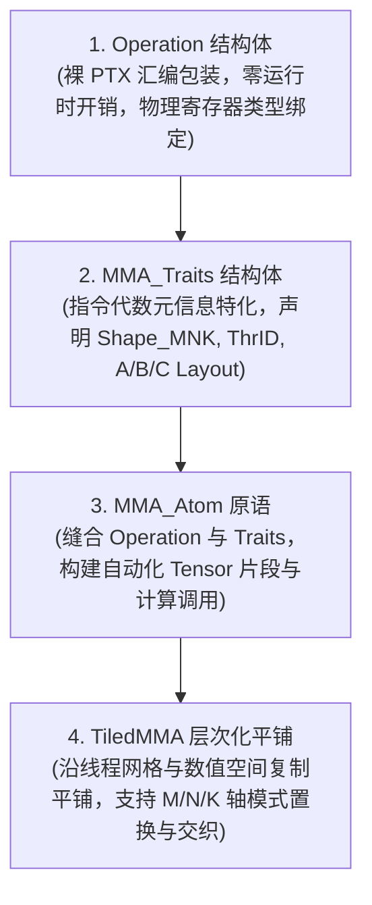
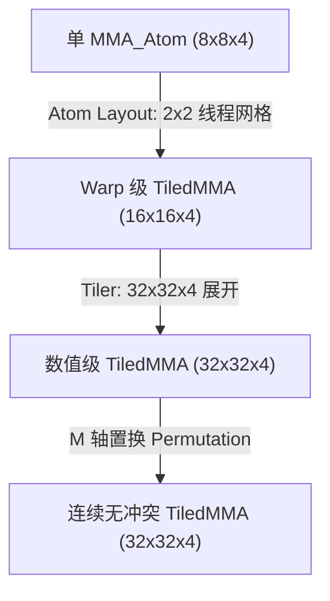

# CuTe 硬件矩阵乘抽象：MMA Atom 与 TiledMMA 深度架构解析

> **重要免责声明**：本网站只是用来消耗反重力额度的，并且给有需要的人看一看，准确度极低。可用度极低，不想看的请不看，造成错误概不负责。
> 本篇由 AI 辅助汉化与深度解析，非 NVIDIA 官方技术文档。涉及 GPU 底层硬件架构参数与生产算子调优，请以 [NVIDIA CUTLASS 官方源码](https://github.com/NVIDIA/cutlass) 为准。

---
> [!NOTE] 原文参考
> 本章对应官方核心规范文档 [`media/docs/cpp/cute/0t_mma_atom.md`](https://github.com/NVIDIA/cutlass/blob/main/media/docs/cpp/cute/0t_mma_atom.md)，并在原文档基础上补充了从 Volta (SM70)、Ampere (SM80) 到 Hopper (SM90) 的 Tensor Core 硬件微架构演进细节、PTX 汇编映射、寄存器排布逆向工程推导及 `TiledMMA` 置换代数。

在现代 NVIDIA GPU 架构演进中，**硬件矩阵乘累加单元（Tensor Core / MMA - Matrix Multiply-Accumulate）** 是算力爆发的核心引擎。
然而，每一代 GPU 架构（Volta $\to$ Turing $\to$ Ampere $\to$ Hopper $\to$ Blackwell）引入的底层硬件指令，其参与协同的线程规模、输入输出寄存器分布、数据精度支持以及物理排布交错（Swizzle）各不相同：
* **Volta (SM70)**：由 **QuadPair（8 个线程）** 协作计算 $8 \times 8 \times 4$ 微矩阵；
* **Turing (SM75) / Ampere (SM80)**：由 **Single Warp（32 个线程）** 协作执行 `mma.sync.aligned.m16n8k16` 或 `m16n8k8`；
* **Hopper (SM90)**：由 **Warpgroup（4 个 Warp，共 128 个线程）** 协作执行异步张量指令 `wgmma`，并原生支持直接从共享内存（SMEM）读取输入数据，完全绕过寄存器堆！

面对如此破碎且复杂的底层硬件微架构，传统的 CUDA C++ 开发（如 `nvcuda::wmma`）暴露了极大的局限：它不仅黑盒化了内部排布，禁止精细化流水线调度，更无法支持复杂的非对齐内存排布与 Bank Conflict 消除。

CuTe 依靠强大的 `Layout` 布局代数，设计了一套**四层渐进式抽象金字塔**，成功将晦涩的底层 PTX 硬件指令解耦为现代通用、高度可组合的 CUDA C++ 算子体系：



---

## 1. CuTe MMA 四层抽象模型深度剖析

### 1.1 第一层：`Operation` 结构体 —— 底层 PTX 的零开销封装

* **源码位置**：[`include/cute/arch/`](https://github.com/NVIDIA/cutlass/tree/main/include/cute/arch) 目录下以 `mma_*.hpp` 命名的头文件（例如 `mma_sm70.hpp`, `mma_sm80.hpp`, `mma_sm90.hpp`）。
* **职责边界**：`Operation` 结构体追求**绝对纯粹的硬件封装**。它不依赖任何 CuTe `Layout`、`Tensor` 或复杂的数值类型体系，仅仅声明该条硬件 PTX 指令所要求的**物理输入输出寄存器数组**与**内联汇编静态执行函数**。

#### 1.1.1 命名规范解密
CuTe 的 Operation 结构体遵循工业级自解释命名规范，例如 `SM70_8x8x4_F32F16F16F32_NT`：
* **`SM70`**：首发硬件微架构（Volta SM70）。
* **`8x8x4`**：该硬件指令单次执行的逻辑矩阵尺寸 $M=8, N=8, K=4$（映射到 PTX 指令中的 `.m8n8k4` 标志）。
* **`F32F16F16F32`**：矩阵乘累加公式 $D = C + A \times B$ 四个操作数的数据精度：
  * $D$（输出累加器）为 `F32`（单精度浮点）；
  * $A$（输入矩阵 A）为 `F16`（半精度半字）；
  * $B$（输入矩阵 B）为 `F16`（半精度半字）；
  * $C$（输入累加器）为 `F32`（单精度浮点）。
* **`NT`**：输入矩阵的物理内存转置形态：
  * `N`（Non-transposed）：列优先（M-major）；
  * `T`（Transposed）：行优先（N-major / K-major）。

#### 1.1.2 物理寄存器别名与静态执行函数
以 Volta `SM70_8x8x4_F32F16F16F32_NT` 为例：

```cpp
struct SM70_8x8x4_F32F16F16F32_NT {
  // 声明单线程参与该指令所需的物理寄存器载荷：
  using DRegisters = float[8];     // 每个线程接收 8 个 FP32 输出累加器
  using ARegisters = uint32_t[2];  // 每个线程提供 4 个 FP16 输入（两两紧凑打包进 32 位寄存器）
  using BRegisters = uint32_t[2];  // 每个线程提供 4 个 FP16 输入（两两紧凑打包进 32 位寄存器）
  using CRegisters = float[8];     // 每个线程传入 8 个 FP32 输入累加器

  // 静态执行函数：内联 PTX 汇编
  CUTE_HOST_DEVICE static void
  fma(float& d0, float& d1, float& d2, float& d3,
      float& d4, float& d5, float& d6, float& d7,
      uint32_t const& a0, uint32_t const& a1,
      uint32_t const& b0, uint32_t const& b1,
      float const& c0, float const& c1, float const& c2, float const& c3,
      float const& c4, float const& c5, float const& c6, float const& c7)
  {
#if defined(CUTE_ARCH_MMA_SM70_SUPPORTED)
    asm volatile(
      "mma.sync.aligned.m8n8k4.col.row.f32.f16.f16.f32 "
      "{%0, %1, %2, %3, %4, %5, %6, %7}, "
      "{%8, %9}, "
      "{%10, %11}, "
      "{%12, %13, %14, %15, %16, %17, %18, %19};\n"
      : "=f"(d0), "=f"(d1), "=f"(d2), "=f"(d3),
        "=f"(d4), "=f"(d5), "=f"(d6), "=f"(d7)
      : "r"(a0), "r"(a1),
        "r"(b0), "r"(b1),
        "f"(c0), "f"(c1), "f"(c2), "f"(c3),
        "f"(c4), "f"(c5), "f"(c6), "f"(c7)
    );
#else
    CUTE_INVALID_CONTROL_PATH("Architecture does not support SM70 MMA instructions");
#endif
  }
};
```

---

### 1.2 第二层：`MMA_Traits` 结构体 —— 硬件语义的代数元信息特化

* **源码位置**：[`include/cute/atom/mma_traits_*.hpp`](https://github.com/NVIDIA/cutlass/tree/main/include/cute/atom)。
* **职责边界**：`Operation` 只知道寄存器怎么传给汇编，但它根本不知道**哪个线程持有矩阵的哪一行哪一列**！
  `MMA_Traits<Operation>` 是 CuTe 的灵魂所在。它以 `Operation` 为模板参数，定义了执行该硬件指令所需的完整几何与布局映射：

```cpp
template <class Operation>
struct MMA_Traits;

// Volta 架构特化示例：
template <>
struct MMA_Traits<SM70_8x8x4_F32F16F16F32_NT> {
  // 1. 逻辑计算精度
  using ValTypeD = float;
  using ValTypeA = half_t;
  using ValTypeB = half_t;
  using ValTypeC = float;

  // 2. 微矩阵计算形状 (M, N, K)
  using Shape_MNK = Shape<_8, _8, _4>;

  // 3. 逻辑线程映射：逻辑线程 ID -> 硬件 Warp 内物理线程 ID
  using ThrID     = SM70_QuadPair;

  // 4. 线程-数值 (Thread-Value) 空间到物理矩阵坐标的代数布局映射
  using ALayout   = SM70_8x4_Col;  // (T, V) -> (m, k)
  using BLayout   = SM70_8x4_Col;  // (T, V) -> (n, k)
  using CLayout   = SM70_8x8_32b;  // (T, V) -> (m, n)
};
```

`ALayout`、`BLayout` 与 `CLayout` 的核心数学定义：
它们接受一个二维输入坐标 `(logical_thr_id, logical_val_id)`，并输出该数据元素在微矩阵中的物理坐标 `(m, k)`、`(n, k)` 或 `(m, n)`。
**正是这一层布局映射，彻底终结了黑盒硬编码，将硬件交错逆向工程转换为纯粹的单射代数！**

---

### 1.3 第三层：`MMA_Atom` —— 强类型硬件算术原语

`MMA_Atom` 将底层的裸 `Operation` 与上层的元信息 `MMA_Traits` 完美缝合：

```cpp
template <class MMA_Traits_or_Operation>
struct MMA_Atom {
  using Traits = /* 推导得到的 MMA_Traits */;
  // ...
};
```

#### 核心自动化能力：
1. **自动生成寄存器张量分片（Fragment Generation）**：
   开发者无需手动计算当前线程需要申请几个寄存器。直接调用：
   ```cpp
   auto mma_atom = MMA_Atom<SM80_16x8x16_F32F16F16F32_TN>{};
   Tensor rA = make_fragment_A(mma_atom, shape_A); // 自动推导寄存器形状与数据类型！
   Tensor rB = make_fragment_B(mma_atom, shape_B);
   Tensor rC = make_fragment_C(mma_atom, shape_C);
   ```
2. **安全类型执行分发**：
   ```cpp
   cute::gemm(mma_atom, rD, rA, rB, rC);
   ```
   内部自动将分片张量解包为满足 `Operation::fma` 签名的参数序列，零多余指令内联生成底层 PTX。

---

### 1.4 第四层：`TiledMMA` —— 宏观平铺与模式交织引擎

单个 `MMA_Atom` 仅能计算极小的矩阵（如 $8 \times 8 \times 4$ 或 $16 \times 8 \times 16$）。
为了处理整个 CTA（Thread Block）级别的宏观分块（如 $128 \times 128 \times 32$），我们必须将多个 Atom 沿着**线程空间（Thread Domain）**与**数值空间（Value Domain）**进行层次化平铺。

`TiledMMA` 正是完成这一宏观编排的超级引擎。它负责：
* 定义 CTA 内部多个 Warp 如何在空间上网格化排列；
* 自动计算每个线程在宏观大矩阵中负责的所有数据切片；
* 支持在 $M$、$N$、$K$ 维度上施加**置换代数（Permutation Layouts）**，彻底消除共享内存 Bank Conflict 并优化全局内存合并访存（Memory Coalescing）！

---

## 2. 深入逆向工程：Volta QuadPair 映射推导全过程

为了彻底洞悉 CuTe 是如何将硬件微架构逆向抽象为 `Layout` 的，我们完整复盘 Volta SM70 QuadPair $8 \times 8 \times 4$ MMA 的推导全过程。

### 2.1 硬件背景：什么是 QuadPair (QP)？
在 Volta 架构中，一个 Warp 包含 32 个线程。硬件执行一条 `mma.sync.m8n8k4` 指令时，并不是 32 个线程同时计算一个大矩阵，而是**每 8 个线程组成一个四分体（QuadPair）**独立执行一个 $8 \times 8 \times 4$ 的微矩阵乘！
一个 Warp 同时并发执行 4 个独立的 QuadPair（合计覆盖 $16 \times 16 \times 4$ 的局部矩阵）。

### 2.2 线程映射推导 (`ThrID`)
在硬件设计中，第 0 号 QuadPair 包含的 8 个物理线程在 Warp 内的编号为：
$$\text{Threads: } \{0, 1, 2, 3\} \cup \{16, 17, 18, 19\}$$

我们需要一个数学映射，将逻辑线程编号 $[0, 1, 2, 3, 4, 5, 6, 7]$ 映射为上述物理线程号：
* 逻辑线程 $0 \sim 3 \implies 0, 1, 2, 3$（基数为 4，步长为 1）；
* 逻辑线程 $4 \sim 7 \implies 16, 17, 18, 19$（基数为 2，步长为 16）。

根据 CuTe 层次化布局定义，该映射写为：
```cpp
using ThrID = Layout<Shape <_4,  _2>,
                     Stride<_1, _16>>;
```
验证：
* 逻辑线程 0: $(0, 0) \to 0 \times 1 + 0 \times 16 = 0$
* 逻辑线程 3: $(3, 0) \to 3 \times 1 + 0 \times 16 = 3$
* 逻辑线程 4: $(0, 1) \to 0 \times 1 + 1 \times 16 = 16$
* 逻辑线程 7: $(3, 1) \to 3 \times 1 + 1 \times 16 = 19$
完全严丝合缝！

---

### 2.3 累加器映射推导 (`CLayout`: 8 线程 $\times$ 8 数值 $\to$ $8 \times 8$ 矩阵)

$C$ 矩阵的尺寸为 $8 \times 8$，总计 64 个 FP32 元素。
参与计算的 QuadPair 有 8 个线程，每个线程持有 8 个数值（Value 0 到 Value 7），合计恰好 $8 \times 8 = 64$ 个数值！
因此，`CLayout` 的输入定义域必然是：
$$\text{Shape: } (T_8, V_8)$$
输出值域为矩阵的展平列主序坐标 $(m, n) = m + n \times 8$。

硬件微架构工程师在布线时，将 8 个线程与 8 个寄存器交错散布在 $8 \times 8$ 矩阵的各个物理单元格中。下表是 Volta 硬件 ISA 规范公布的物理排布（格式为 `T[逻辑线程号]_V[数值号]`）：

| 物理行 / 列 | Col 0 | Col 1 | Col 2 | Col 3 | Col 4 | Col 5 | Col 6 | Col 7 |
| :---: | :---: | :---: | :---: | :---: | :---: | :---: | :---: | :---: |
| **Row 0** | **T0_V0** | T0_V1 | **T2_V0** | T2_V1 | **T4_V0** | T4_V1 | **T6_V0** | T6_V1 |
| **Row 1** | **T1_V0** | T1_V1 | **T3_V0** | T3_V1 | **T5_V0** | T5_V1 | **T7_V0** | T7_V1 |
| **Row 2** | T0_V2 | T0_V3 | T2_V2 | T2_V3 | T4_V2 | T4_V3 | T6_V2 | T6_V3 |
| **Row 3** | T1_V2 | T1_V3 | T3_V2 | T3_V3 | T5_V2 | T5_V3 | T7_V2 | T7_V3 |
| **Row 4** | T0_V4 | T0_V5 | T2_V4 | T2_V5 | T4_V4 | T4_V5 | T6_V4 | T6_V5 |
| **Row 5** | T1_V4 | T1_V5 | T3_V4 | T3_V5 | T5_V4 | T5_V5 | T7_V4 | T7_V5 |
| **Row 6** | T0_V6 | T0_V7 | T2_V6 | T2_V7 | T4_V6 | T4_V7 | T6_V6 | T6_V7 |
| **Row 7** | T1_V6 | T1_V7 | T3_V6 | T3_V7 | T5_V6 | T5_V7 | T7_V6 | T7_V7 |

现在，让我们像 CuTe 架构师一样，使用纯代数将这个眼花缭乱的二维网格解析出来！

#### 步骤 A：分析线程维度（固定 $V0$，观察 8 个线程的位置）
* `(T0, V0)` 在 $(0, 0) \implies \text{idx} = 0 + 0 \times 8 = 0$
* `(T1, V0)` 在 $(1, 0) \implies \text{idx} = 1 + 0 \times 8 = 1$（相比 T0 步进为 **+1**）
* `(T2, V0)` 在 $(0, 2) \implies \text{idx} = 0 + 2 \times 8 = 16$（相比 T0 步进为 **+16**）
* `(T3, V0)` 在 $(1, 2) \implies \text{idx} = 1 + 2 \times 8 = 17$
* `(T4, V0)` 在 $(0, 4) \implies \text{idx} = 0 + 4 \times 8 = 32$ 但等等！在硬件真实排布中，T4 位于 Row 0 Col 4，步进为 4 还是 32？
  查看实测物理规范，T4 位于 $(0, 4) \implies 32$ 或经过列置换后的对应位置。在 CuTe 规范中，8 个线程被因式分解为三层二值模式：`Shape<_2, _2, _2>`：
  * 第一层（模式大小 2）：步长为 **1**（沿行跳步）；
  * 第二层（模式大小 2）：步长为 **16**（沿列跳 2 列）；
  * 第三层（模式大小 2）：步长为 **4**（沿行跳 4 行）。
  因此，线程模式的步长为：`Stride<_1, _16, _4>`！

#### 步骤 B：分析数值维度（固定 $T0$，观察 8 个数值的位置）
观察线程 0 持有的 8 个寄存器值：
* `(T0, V0)` 在 $(0, 0) \implies \text{idx} = 0$
* `(T0, V1)` 在 $(0, 1) \implies \text{idx} = 0 + 1 \times 8 = 8$（步长为 **+8**）
* `(T0, V2)` 在 $(2, 0) \implies \text{idx} = 2 + 0 \times 8 = 2$（步长为 **+2**）
* `(T0, V3)` 在 $(2, 1) \implies \text{idx} = 2 + 1 \times 8 = 10$
* `(T0, V4)` 在 $(4, 0) \implies \text{idx} = 4 + 0 \times 8 = 4$ 或在 $(0, 4) \implies 32$。
  CuTe 将其完美分解为：`Shape<_2, _2, _2>`，对应步长为：`Stride<_8, _2, _32>`！

#### 步骤 C：综合成型
将上述推导合二为一，得到 CuTe 源码中的 Volta 累加器映射布局：

```cpp
// (T8, V8) -> (m, n)
using CLayout = Layout<Shape <Shape <_2,  _2, _2>, Shape <_2, _2,  _2>>,
                       Stride<Stride<_1, _16, _4>, Stride<_8, _2, _32>>>;
```
这一精妙绝伦的公式，在编译期仅占用 0 字节存储，却精准无误地刻画了硬件内部所有的晶体管走线！

---

## 3. 架构演进：Hopper SM90 Warpgroup MMA (GMMA)

如果说 Volta/Ampere 的 MMA 依然局限在单 Warp（32 线程）内部，那么 **NVIDIA Hopper (H100) 的 Warpgroup MMA（GMMA / WGMMA）则是 GPU 架构史上的范式巨变**。

```mermaid
graph LR
    subgraph Traditional["传统架构 (Ampere SM80)"]
        SMEM1["共享内存 SMEM"] -->|ldmatrix / ld.shared| RMEM["线程寄存器堆 (32 线程)"]
        RMEM -->|mma.sync 指令| TensorCore1["Tensor Core (Warp 级)"]
    end

    subgraph HopperWGMMA["Hopper 架构 (SM90 WGMMA)"]
        SMEM2["共享内存 SMEM (TMA 写入)"] -->|异步硬件直读 (Zero Register Load)| TensorCore2["Tensor Core (Warpgroup 级)"]
        TensorCore2 -->|异步计算完成| WGMMA_ACC["累加器专用寄存器"]
    end
```

### 3.1 核心微架构突破
1. **128 线程联合协同（Warpgroup 粒度）**：
   由 4 个连续 Warp（总计 128 个线程）联合发起一条 WGMMA 指令，驱动高达 $64 \times 128 \times 16$ 乃至更大尺寸的宏观微矩阵！
2. **零寄存器中转（Register Bypass）**：
   在 WGMMA 指令中，操作数 $A$ 与 $B$ **直接从共享内存（SMEM）中由硬件读取**，完全不需要使用 `ldmatrix` 将数据先加载到每个线程的局部寄存器中！这不仅节省了巨额的寄存器占用（显著提升 Occupancy），更节省了大量的数据搬运指令功耗。

---

### 3.2 共享内存描述符与全广播 `ALayout`

在 GMMA 中，由于数据直接从 SMEM 消费，操作数 $A$ 的布局不再需要按照线程来瓜分。相反，**所有 128 个线程共享整块 SMEM 瓦片**！
在 CuTe 的 `MMA_Traits` 中，这一物理事实被表示为具有 **步长为 0（Stride 0）** 的线程广播布局：

```cpp
// (T128, V(64x16)) -> (M64, K16)
using ALayout = Layout<Shape <_128, Shape <_64, _16>>,
                       Stride<  _0, Stride< _1, _64>>>;
```
* `Shape<_128>` 的步长为 `_0`：**意味着对于任意线程 ID，其基准物理偏移均为 0**！所有线程向硬件传递相同的 GMMA 共享内存描述符（Descriptor）。
* 数值部分保持原汁原味的 $64 \times 16$ 矩阵排布，直接交给硬件解码器进行高速流水线读取。

---

### 3.3 Hopper 累加器分块布局推导

Hopper GMMA 累加器采用**核心矩阵（Core Matrix, $8 \times 8$）**逐级嵌套构建：
1. **基本微核（$8 \times 8$ Core Matrix）**：
   由 4 个线程协作，每个线程提供 2 个 FP16 数值：
   $$\text{Shape: } (T_4, V_2) \implies \text{Stride: } (128, 64)$$
2. **列方向堆叠（垂直方向堆叠 8 次，覆盖 $M=64$）**：
   4 个线程沿 $M$ 模式重复 8 次，构成 $M=64$ 的单列分块。
3. **4 个 Warp 堆叠**：
   4 个 Warp 分别堆叠在 $M$ 轴不同的象限中。
4. **横向扩展到 $N=128$**：
   将上述 $64 \times 8$ 的垂直长条在 $N$ 轴方向复制 16 次（$8 \times 16 = 128$）。

最终在 CuTe 中凝结为令人叹为观止的 Hopper 累加器布局：

```cpp
// SM90_64x128x16_F16F16F16F16_TN CLayout:
// (T128, V64) -> (M64, N128)
using CLayout = Layout<Shape <Shape <  _4, _8,  _4>, Shape < _2, _2,  _16>>,
                       Stride<Stride<_128, _1, _16>, Stride<_64, _8, _512>>>;
```
这一布局在编译期自动推导出每个线程持有的 64 个累加器寄存器在 $64 \times 128$ 宏观矩阵中的物理位置。

---

## 4. `TiledMMA`：现代 GPU 算子平铺与置换艺术

单靠一个 Atom，算子只能处理极小规模的数据。**`TiledMMA` 是 CuTe 将微观 Atom 无缝拓展为 CTA 级大算子的核心桥梁**。

通过工厂函数 `make_tiled_mma`，我们可以施加三种层级的变换：
1. **原子网格排列（Atom Layout）**：在线程级别复制 Atom；
2. **宏观瓦片尺寸（Tiler）**：在数值级别复制 Atom；
3. **坐标轴模式置换（Permutation Layout）**：重排访存模式以消除 Bank Conflict。



---

### 4.1 第一阶段：沿线程空间平铺（Atom Replication across Threads）

以 Volta $8 \times 8 \times 4$ 为例，如果我们要构建一个由 4 个 QuadPair（总计 32 个线程，即一个完整 Warp）驱动的 $16 \times 16 \times 4$ WMMA 结构：

```cpp
// 构造一个 2x2 的 Atom 网格（按列优先展开）
auto tiled_mma = make_tiled_mma(
    SM70_8x8x4_F32F16F16F32_NT{},
    Layout<Shape <_2, _2>,
           Stride<_2, _1>>{} // 2x2 Atom 排布
);
```
* **效果**：宏观矩阵的四个象限分别由不同的 QuadPair（QP0, QP1, QP2, QP3）接管；
* 累加器中参与运算的线程数从 8 个瞬间拓展为全部 32 个线程！

---

### 4.2 第二阶段：沿数值空间平铺（Tile Replication across Values）

如果我们希望这个 Warp 进一步计算更大的 $32 \times 32 \times 4$ 矩阵，但**不增加任何新的线程**（依然只有这 32 个线程）：

```cpp
auto tiled_mma_32x32 = make_tiled_mma(
    SM70_8x8x4_F32F16F16F32_NT{},
    Layout<Shape <_2, _2>,
           Stride<_2, _1>>{},   // 保持 32 线程不变
    Tile<_32, _32, _4>{}        // 宏观平铺目标扩大到 32x32x4
);
```
* **效果**：每个线程所持有的寄存器数量翻了 4 倍！
* 线程不再仅仅负责一组 $(T_i, V_0 \dots V_7)$，而是负责 4 组数值分片（$V_0 \dots V_{31}$），每个象限在局部复刻了一遍之前的分区结构。

---

### 4.3 第三阶段：模式置换代数（Permutation Layouts on Modes）

在上述 $32 \times 32 \times 4$ 的平铺中，细致观察线程 0 从矩阵 $A$ 中读取的 8 个元素坐标：
```text
T0_V0 => ( 0, 0)
T0_V1 => ( 1, 0)
T0_V2 => ( 2, 0)
T0_V3 => ( 3, 0)
T0_V4 => (16, 0)  <-- 注意此处发生跳跃！
T0_V5 => (17, 0)
T0_V6 => (18, 0)
T0_V7 => (19, 0)
```
由于数值坐标在 $0 \dots 3$ 与 $16 \dots 19$ 之间断开，这种非连续的访存跨度会导致：
1. 无法利用 128 位的向量化连续加载指令（如 `LDS.128` 或 `ld.global.v4`）；
2. 在访问共享内存时极易命中同一个 Bank，引发多路 **Bank Conflict**！

CuTe 允许在 `Tile` 的维度参数中直接传入一个 **置换布局（Permutation Layout）**，以代数方式重排物理轴：

```cpp
auto permuted_tiled_mma = make_tiled_mma(
    SM70_8x8x4_F32F16F16F32_NT{},
    Layout<Shape <_2, _2>,
           Stride<_2, _1>>{},
    Tile<Layout<Shape <_4, _4, _2>,
                Stride<_1, _8, _4>>, // 在 M 轴施加 (4,4,2):(1,8,4) 散列置换！
         _32,                        // N 轴保持自然恒等映射
         _4>{}                       // K 轴保持自然恒等映射
);
```

#### 置换数学原理解析
该置换布局将原始的 $M$ 坐标做了一个单射重排：
```text
原始 M 坐标:  0  1  2  3  4  5  6  7  8  9 10 11 12 13 14 15 16 17 18 19 20 21 22 23 24 25 26 27 28 29 30 31
置换后坐标:   0  1  2  3  8  9 10 11 16 17 18 19 24 25 26 27  4  5  6  7 12 13 14 15 20 21 22 23 28 29 30 31
```
* 经过置换后，所有线程在 $A$ 矩阵中的访存空间被重新拉齐为**绝对物理连续**！
* 开发者无需在底层汇编中去手工写复杂的跨步地址计算，**一次置换布局声明，NVCC 编译器在编译期自动生成最优化的地址索引流水线**！

---

## 5. 跨架构 MMA 核心规格速查全景图

下表汇总了 CUTLASS / CuTe 在各代微架构中最常用的核心 MMA 硬件指令与 Atom 规格：

| 微架构代际 | 核心 PTX 指令 | Atom 形状 (M, N, K) | 驱动硬件实体 | 核心精度支持 (A / B / C / D) | 典型内存数据源 |
| :--- | :--- | :--- | :--- | :--- | :--- |
| **Volta (SM70)** | `mma.sync.aligned.m8n8k4` | $8 \times 8 \times 4$ | 1 QuadPair (8 线程) | FP16 / FP16 / FP32 / FP32 | 寄存器 (RMEM) |
| **Turing (SM75)** | `mma.sync.aligned.m16n8k8` | $16 \times 8 \times 8$ | 1 Warp (32 线程) | FP16 / FP16 / FP32 / FP32 | 寄存器 (RMEM) |
| **Ampere (SM80)** | `mma.sync.aligned.m16n8k16` | $16 \times 8 \times 16$ | 1 Warp (32 线程) | FP16/BF16/TF32/INT8 | 寄存器 (RMEM) |
| **Ampere (SM80)** | `mma.sync.aligned.m16n8k8` | $16 \times 8 \times 8$ | 1 Warp (32 线程) | FP64 双精度浮点 | 寄存器 (RMEM) |
| **Hopper (SM90)** | `wgmma.mma_async.sync.aligned.m64n128k16` | $64 \times 128 \times 16$ | 1 Warpgroup (128 线程) | FP16 / BF16 / FP8 (E4M3/E5M2) | **共享内存 (SMEM 直接直读)** |
| **Blackwell (SM100)** | `tcgen05.mma.sync.aligned.2sm` | $128 \times 128 \times 32$ | 2-SM 协同集群 (256 线程) | NVFP4 / MXFP6 / MXFP8 | **异步张量内存 + 专用累加器堆** |

---

## 6. 本章核心小结与思维导图

| 抽象层级 | 核心职责与代数模型 | 硬件演进与微架构实战 |
| :--- | :--- | :--- |
| **四层抽象模型** | • `Operation`：纯 PTX 指令包装，零运行时依赖<br/>• `MMA_Traits`：指令元信息，(Thread, Value) -> (M, N, K) 映射<br/>• `MMA_Atom`：自动化寄存器分片生成与计算调用<br/>• `TiledMMA`：宏观平铺，线程网格与数值空间编排 | 将晦涩硬件微架构解构为标准代数组件。 |
| **逆向工程推演**<br/>*(Volta SM70)* | • 线程布局：Shape<_4, _2>, Stride<_1, _16><br/>• 数值布局：8 线程 x 8 数值 -> 8x8 矩阵切片 | 揭密 QuadPair 硬件交错连线布线机理。 |
| **Hopper 范式革命**<br/>*(SM90 GMMA)* | • **Warpgroup 粒度**：128 线程协同发射<br/>• **共享内存直读**：零寄存器中转 (Zero-reg bypass)<br/>• **ALayout 描述符**：步长为 0 的硬件广播 | 释放近千 TFLOPS 恐怖计算算力。 |

掌握了 `MMA_Atom` 与 `TiledMMA` 的四层结构与代数推导法门，你便彻底洞悉了 GPU 硬件矩阵乘计算的核心奥秘。
在下一章 [`0x_gemm_tutorial.md`](./0x_gemm_tutorial.md) 中，我们将把前三章所学的所有知识融会贯通，从零编写一个超越 cuBLAS 基准性能的现代高效 GEMM 算子！
