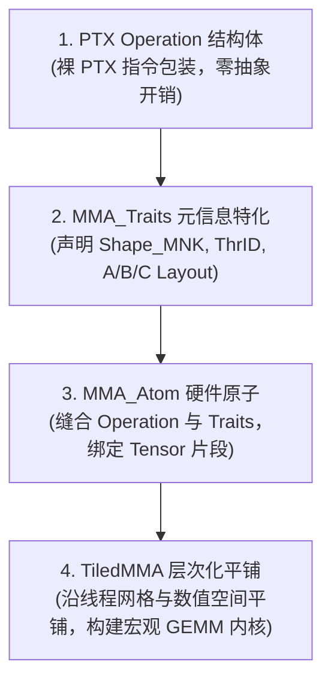

# CuTe 硬件矩阵乘抽象：MMA Atom 与 TiledMMA 深度解析

> [!NOTE] 原文出处
> 本文翻译自 NVIDIA CUTLASS 官方核心规范文档 [`media/docs/cpp/cute/0t_mma_atom.md`](https://github.com/NVIDIA/cutlass/blob/main/media/docs/cpp/cute/0t_mma_atom.md)。

现代 NVIDIA GPU 架构演进中，**矩阵乘累加硬件指令（MMA / Tensor Core）** 是算力爆发的核心源泉。然而，每一代 GPU 架构（Volta $\to$ Turing $\to$ Ampere $\to$ Hopper $\to$ Blackwell）引入的底层 MMA 指令集其线程协同方式、数据排布、精度与分块粒度各不相同。

CuTe 依靠强大的 `Layout` 布局代数，设计了一套四层渐进式抽象模型，成功将晦涩的底层 PTX 硬件指令解耦为现代通用 CUDA C++ 算子：



---

## 1. CuTe MMA Atom 四层核心概念

### 1.1 Operation 结构体 (PTX 指令封装)
* 源码位置：[`include/cute/arch/`](https://github.com/NVIDIA/cutlass/tree/main/include/cute/arch) 目录下以 `mma_*.hpp` 命名的头文件。
* **极简依赖**：不依赖任何复杂的高层布局或张量抽象，仅描述当前 PTX 指令所需的物理寄存器类型。
* **工业级命名规范**（以 `SM70_8x8x4_F32F16F16F32_NT` 为例）：
  * `SM70`：首发硬件微架构（Volta 架构）；
  * `8x8x4`：单条指令执行的微观矩阵乘大小 $M=8, N=8, K=4$（对应 PTX 指令中的 `.m8n8k4.`）；
  * `F32F16F16F32`：四个矩阵操作数 $D = C + A \times B$ 的数据类型，顺序对应 $D(\text{FP32}), A(\text{FP16}), B(\text{FP16}), C(\text{FP32})$；
  * `NT`：操作数 $A$ 与 $B$ 的转置形态（`N` 代表 Non-transposed 列主序，`T` 代表 Transposed 行主序）。

#### Operation 结构体内容：
包含公共类型别名（如 `DRegisters = float[8]`, `ARegisters = uint32_t[2]`）以及静态执行函数：
```cpp
CUTE_HOST_DEVICE static void fma(...);
```

---

### 1.2 MMA_Traits 特化 (指令元信息声明)
* 源码位置：[`include/cute/atom/mma_traits_*.hpp`](https://github.com/NVIDIA/cutlass/tree/main/include/cute/atom)。
* 它以 `Operation` 作为模板参数，定义了执行该硬件指令所需的完整代数元数据：
  * `ValTypeD/A/B/C`：各矩阵在逻辑计算上的元素精度；
  * `Shape_MNK`：单次硬件操作的逻辑分块形状（如 `Shape<_8, _8, _4>`）；
  * `ThrID`：参与该指令的逻辑线程在 Warp 内部的映射关系；
  * `ALayout / BLayout / CLayout`：核心映射！将 `(逻辑线程 ID, 逻辑数值 ID)` 的二元组，精准映射为矩阵内部的逻辑坐标 $(m, k)$、$(n, k)$ 或 $(m, n)$。

---

### 1.3 MMA_Atom (原子原语)
将 `Operation` 与 `MMA_Traits` 缝合绑定，对外屏蔽底层的寄存器位宽与排列乱序，允许直接针对高阶 `Tensor` 片段执行矩阵乘。
CuTe 支持不同硬件粒度的 Atom：
* **单线程**（普通 FMA 乘加指令）；
* **QuadPair / 8 线程**（Volta 架构）；
* **Single Warp / 32 线程**（Ampere 架构的 `mma.sync`）；
* **Warpgroup / 128 线程**（Hopper 架构的 `wgmma` 异步硬件单元）。

---

## 2. 深入剖析：Volta QuadPair 线程与数据映射推导

在 Volta 架构中，硬件 Tensor Core 并非由整个 Warp 驱动，而是由一组 **8 个线程组成的“四分体（QuadPair, QP）”** 联合执行一个 $8 \times 8 \times 4$ 的 FP16 矩阵乘。

### 2.1 线程映射 (ThrID)
一个 Warp 拥有 32 个线程，逻辑编号为 $[0 \dots 31]$。第 0 号 QuadPair 由线程 $[0, 1, 2, 3] \cup [16, 17, 18, 19]$ 组成。
CuTe 将逻辑线程编号 $[0 \dots 7]$ 映射到 Warp 物理线程号：

```cpp
// 4 个步长为 1 的线程，加 2 个步长为 16 的跨度：
using ThrID = Layout<Shape <_4,  _2>,
                     Stride<_1, _16>>;
```

---

### 2.2 累加器 C 矩阵布局推导 (CLayout)
累加器由 8 个线程持有，每个线程维护 8 个 FP32 标量值（总计 $8 \times 8 = 64$ 个数值，恰好覆盖 $8 \times 8$ 的 $C$ 矩阵）。
因此，映射函数的定义域必然是 `Shape<_8, _8>`（8 线程 $\times$ 8 数值）。
CuTe 采用列优先编码将坐标 $(m, n)$ 展平为一维索引：$(m, n) = m + n \times M$。

通过对硬件寄存器排布逆向分析：
* 8 个线程在矩阵中的空间步进被推导为：`Stride<Stride<_1, _16, _4>, ...>`；
* 8 个数值在单线程内的跳步被推导为：`Stride<..., Stride<_8, _2, _32>>`；

最终构成了著名的 Volta 累加器 TV 布局：
```cpp
// (T8, V8) -> (m, n)
using CLayout = Layout<Shape <Shape <_2,  _2, _2>, Shape <_2, _2,  _2>>,
                       Stride<Stride<_1, _16, _4>, Stride<_8, _2, _32>>>;
```
这一布局将所有错综复杂的寄存器交织，浓缩为纯粹的代数公式！

---

## 3. 跨越代际：Hopper Warpgroup MMA (GMMA)

在 NVIDIA Hopper (H100) 架构中，Tensor Core 迎来了革命性飞跃 —— **Warpgroup MMA（WGMMA，由 4 个 Warp、总计 128 个线程联合驱动）**。

### 3.1 线程映射
128 个连续线程天然形成一维线性排布：
```cpp
using ThrID = Layout<_128, _1>;
```

### 3.2 核心矩阵与级联平铺 (Core Matrix Tiling)
Hopper GMMA 在微架构上引入了 **核心矩阵（Core Matrix）** 概念：
* 基础核心矩阵大小为 $8 \times 8$；
* 4 个 Warp 的核心矩阵在纵向（$M$ 维度）层叠堆聚，构建出 $64 \times 8$ 的基础切片；
* 随后在横向（$N$ 维度）按 16 周期重复广播，扩展出支持 $N=16, 32, 64, 128, 256$ 的超大规模硬件矩阵乘（如 $64 \times 128 \times 16$）！

其 128 线程累加器布局推导如下：
```cpp
// (T128, V64) -> (M64, N128)
using CLayout = Layout<Shape <Shape <  _4, _8,  _4>, Shape < _2, _2,  _16>>,
                       Stride<Stride<_128, _1, _16>, Stride<_64, _8, _512>>>;
```

---

## 4. 矩阵乘扩展执行体：`TiledMMA`

有了单条指令级别的 `MMA_Atom`，我们如何将其扩展为一个完整的线程块/Warp 矩阵乘？
这就是 **`TiledMMA`** 的职责。

### 4.1 在线程维度平铺 (Thread Replication)
单条 `SM70_8x8x4` 仅用了 8 个线程。我们将 4 个 Atom 按照 $2 \times 2$ 的网格排布，组成完整的 32 线程 Warp 级矩阵乘（WMMA $16 \times 16 \times 4$）：

```cpp
TiledMMA wmma = make_tiled_mma(SM70_8x8x4_F32F16F16F32_NT{},
                               Layout<Shape <_2, _2>,
                                      Stride<_2, _1>>{}); // 2x2 行主序 Atom 排布
```

---

### 4.2 在数值维度平铺 (Value Replication)
继续将该结构在每个线程的寄存器内部翻倍扩展，将分块大小扩展至 $32 \times 32 \times 4$：

```cpp
TiledMMA mma32 = make_tiled_mma(SM70_8x8x4_F32F16F16F32_NT{},
                                Layout<Shape <_2, _2>, Stride<_2, _1>>{},
                                Tile<_32, _32, _4>{}); // 32x32x4 Tiler
```
每个线程持有的累加器寄存器数量成倍增加，但上层编程范式完全统一！

---

### 4.3 访存连续化置换 (Permutation)

在默认平铺下，某个线程在读取矩阵 $A$ 时的访问坐标可能是跳跃离散的（如分别读取第 0, 1, 2, 3 行与第 16, 17, 18, 19 行）。
CuTe 允许在 `Tile` 中直接注入一个**置换布局（Permutation Layout）**，例如：

```cpp
TiledMMA mma_perm = make_tiled_mma(
    SM70_8x8x4_F32F16F16F32_NT{},
    Layout<Shape <_2, _2>, Stride<_2, _1>>{},
    Tile<Layout<Shape <_4, _4, _2>, Stride<_1, _8, _4>>, // M 轴置换散列
         _32, _4>{});
```

该代数变换直接将所有线程在 $M$ 维度的离散读取就地重排为**物理连续读取**，从而在共享内存与全局内存中达成极致的合并访存（Memory Coalescing）！
