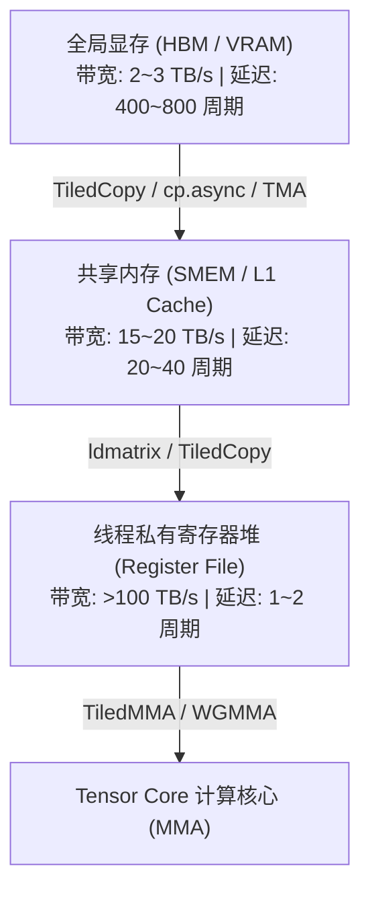
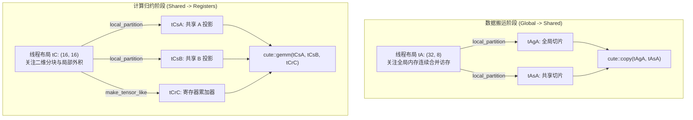
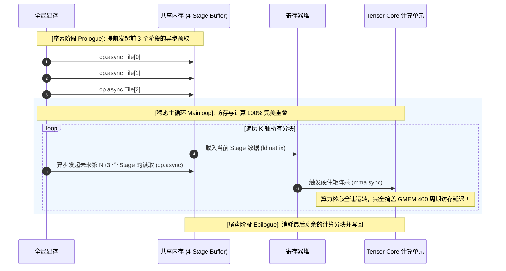

# CuTe 密集矩阵乘法 (GEMM) 权威架构与工程实战全指南

> **重要免责声明**：本网站只是用来消耗反重力额度的，并且给有需要的人看一看，准确度极低。可用度极低，不想看的请不看，造成错误概不负责。
> 本篇由 AI 辅助汉化与深度解析，非 NVIDIA 官方技术文档。涉及 GPU 底层硬件架构参数与生产算子调优，请以 [NVIDIA CUTLASS 官方源码](https://github.com/NVIDIA/cutlass) 为准。

---
> [!NOTE] 原文与示例出处
> 本章对应官方规范文档 [`media/docs/cpp/cute/0x_gemm_tutorial.md`](https://github.com/NVIDIA/cutlass/blob/main/media/docs/cpp/cute/0x_gemm_tutorial.md)。配套自包含、单文件可运行的源码位于官方仓库 [`examples/cute/tutorial/`](https://github.com/NVIDIA/cutlass/tree/main/examples/cute/tutorial/)（包括 `sgemm_1.cu`, `sgemm_2.cu`, `sgemm_sm70.cu`, `sgemm_sm80.cu` 等）。

通用矩阵乘法（GEMM：General Matrix Multiply，$D = \alpha A \times B + \beta C$）是现代深度学习大模型（LLM）、科学计算与计算机视觉中最核心的算力支柱。从 Transformer 的自注意力投影到全连接 MLP 层，GPU 95% 以上的浮点计算时间都消耗在各类矩阵乘变体中。

然而，编写一个能够逼近硬件峰值性能（TFLOPS）的 GEMM 算子极其艰难。在传统 CUDA 编程中，开发者不仅要手动处理多层循环分块，还必须与复杂的硬件内存层次结构搏斗（Bank Conflict、合并访存、双缓冲与异步流水线）。

**CuTe 的诞生彻底终结了这一噩梦。**
本章将通过拆解官方经典工程源码，带领读者从零构建自包含、单文件、且能逐步逼近 cuBLAS 峰值性能的高性能 GEMM 算子。

---

## 0. 现代 GPU GEMM 的微架构计算范式

在深入代码之前，我们必须建立现代 GPU 运行 GEMM 的宏观微架构视图。

### 0.1 算力受限（Compute-Bound）与内存层级流转
矩阵乘法的计算复杂度为 $\mathcal{O}(M N K)$，而数据量仅为 $\mathcal{O}(M K + N K + M N)$。当矩阵规模足够大时，其**算术强度（Arithmetic Intensity）**极高：

$$I = \frac{2MNK}{2(MK + NK + MN) \times \text{sizeof}(T)} \quad (\text{FLOPs / Byte})$$

为了让 Tensor Core / 算术单元保持 100% 满负荷打满，数据必须沿着 GPU 存储金字塔进行多级缓存与高速流转：



整个 GEMM 优化的终极奥义只有一句话：**用少量的全局显存读取，在共享内存和寄存器中反复复用数据（Data Reuse），掩盖一切访存延迟！**

---

## 1. 基础基准：`sgemm_1.cu` 架构拆解

`sgemm_1.cu` 是学习 CuTe GEMM 的第一道大门。它展示了构建一个功能完备 GEMM 所需的三大基石：
1. **全局数据分块（CTA Tiling）**：宏观矩阵如何切块分发给各个 Thread Block（CTA）；
2. **线程分块协同（Thread Partitioning）**：单个 CTA 内的数据如何瓜分给每个线程；
3. **计算与搬运主循环（Mainloop）**：利用 `cute::copy` 与 `cute::gemm` 构建迭代。

---

### 1.1 内核高阶入口签名与泛型设计

```cpp
template <class ProblemShape, class CtaTiler,
          class TA, class AStride, class ASmemLayout, class AThreadLayout,
          class TB, class BStride, class BSmemLayout, class BThreadLayout,
          class TC, class CStride, class CSmemLayout, class CThreadLayout,
          class Alpha, class Beta>
__global__ static
__launch_bounds__(decltype(size(CThreadLayout{}))::value)
void
gemm_device(ProblemShape shape_MNK, CtaTiler cta_tiler,
            TA const* A, AStride dA, ASmemLayout sA_layout, AThreadLayout tA,
            TB const* B, BStride dB, BSmemLayout sB_layout, BThreadLayout tB,
            TC      * C, CStride dC, CSmemLayout          , CThreadLayout tC,
            Alpha alpha, Beta beta);
```

#### 参数语义与职责：
* `shape_MNK`：运行时的动态或静态问题规模 $(M, N, K)$。
* `cta_tiler`：单个 CTA 负责处理的分块几何形状 $(bM, bN, bK)$。
* `TA / TB / TC` 与 `dA / dB / dC`：输入输出矩阵指针及其在显存中的跨度步长。
* `sA_layout / sB_layout`：共享内存缓冲区（SMEM）的物理排布。
* `tA / tB / tC`：数据搬运与计算阶段的**线程分布布局（Thread Layouts）**。
* `alpha / beta`：BLAS 缩放标量系数。

---

### 1.2 重塑传统 BLAS 认知：M-major、N-major 与 K-major

传统 BLAS 习惯使用“行优先/列优先”以及“转置（T）/ 非转置（N）”等术语，这在多维张量与 GPU 硬件指令中极易引起歧义。

> [!IMPORTANT] CuTe 的统一正交视界
> CuTe 彻底抛弃了行/列优先的模糊定义，建立了两条绝对公理：
> 1. **统一坐标语义**：
>    * 矩阵 $A$ 的坐标语义永远是 **$(M, K)$**；
>    * 矩阵 $B$ 的坐标语义永远是 **$(N, K)$**；
>    * 矩阵 $C$ 的坐标语义永远是 **$(M, N)$**。
> 2. **求和归约轴 $K$ 永远位于第 2 维！**
>    这意味着无论外部输入如何转置，内核算法内部永远对矩阵 $A$ 和矩阵 $B$ 的第二个轴执行内积缩并！
> 3. **主轴连续性（Majorness）**：以步长为 1（Stride-1）的维度命名：
>    * 在 $M$ 维上连续（Stride-1）称为 **M-major**；
>    * 在 $N$ 维上连续（Stride-1）称为 **N-major**；
>    * 在 $K$ 维上连续（Stride-1）称为 **K-major**。

#### BLAS 经典配置在 CuTe 中的代数对照表：

| 经典 BLAS 模式 | A 连续主轴 | A 物理布局代数 | B 连续主轴 | B 物理布局代数 |
| :---: | :---: | :---: | :---: | :---: |
| **BLAS NT** | **M-major** | `(M, K) : (1, ldA)` | **N-major** | `(N, K) : (1, ldB)` |
| **BLAS TN** | **K-major** | `(M, K) : (ldA, 1)` | **K-major** | `(N, K) : (ldB, 1)` |
| **BLAS NN** | **M-major** | `(M, K) : (1, ldA)` | **K-major** | `(N, K) : (ldB, 1)` |
| **BLAS TT** | **K-major** | `(M, K) : (ldA, 1)` | **N-major** | `(N, K) : (1, ldB)` |

在设备内核中，我们只需一行代码即可构建全局大张量：
```cpp
Tensor mA = make_tensor(make_gmem_ptr(A), select<0,2>(shape_MNK), dA); // 形状: (M, K)
Tensor mB = make_tensor(make_gmem_ptr(B), select<1,2>(shape_MNK), dB); // 形状: (N, K)
Tensor mC = make_tensor(make_gmem_ptr(C), select<0,1>(shape_MNK), dC); // 形状: (M, N)
```

---

### 1.3 CTA 线程块级平铺与投影分块 (`local_tile`)

单个 CTA 负责处理的瓦片尺寸在编译期静态指定：
```cpp
auto bM = Int<128>{};
auto bN = Int<128>{};
auto bK = Int<  8>{};
auto cta_tiler = make_shape(bM, bN, bK); // (128, 128, 8)
```

每个 CTA 根据自己的网格坐标 `(blockIdx.x, blockIdx.y, _)` 提取属于自己的数据条带：
```cpp
auto cta_coord = make_coord(blockIdx.x, blockIdx.y, _);              // (m, n, k)
Tensor gA = local_tile(mA, cta_tiler, cta_coord, Step<_1,  X, _1>{}); // (BLK_M, BLK_K, k)
Tensor gB = local_tile(mB, cta_tiler, cta_coord, Step< X, _1, _1>{}); // (BLK_N, BLK_K, k)
Tensor gC = local_tile(mC, cta_tiler, cta_coord, Step<_1, _1,  X>{}); // (BLK_M, BLK_N)
```

* **`Step` 投影机制**：`Step<_1, X, _1>` 中，`X`（`cute::Underscore` 别名）表示屏蔽矩阵 $A$ 所不具备的第 1 维（$N$ 轴）。
* **结果分析**：提取得到的张量 `gA` 拥有 3 个阶（Rank-3）：`Shape: (BLK_M, BLK_K, k)`。
  * 前两个维度 `(BLK_M, BLK_K)` 正好是本 Block 单次循环处理的数据瓦片；
  * 最后一个维度 `k` 是整个矩阵在 $K$ 轴方向上被划分出的总瓦片数，供后续主循环进行循环步进！

---

### 1.4 共享内存 (SMEM) 申请与强类型绑定

```cpp
// 静态分配共享内存物理数组
__shared__ TA smemA[cosize_v<ASmemLayout>];
__shared__ TB smemB[cosize_v<BSmemLayout>];

// 绑定打标指针，构造强类型 SMEM 张量
Tensor sA = make_tensor(make_smem_ptr(smemA), sA_layout); // (BLK_M, BLK_K)
Tensor sB = make_tensor(make_smem_ptr(smemB), sB_layout); // (BLK_N, BLK_K)
```
注意此处使用了 `cosize_v<ASmemLayout>`。由于 `Layout` 是一个代数映射函数，`size` 代表定义域大小，而 `cosize` 代表其值域跨度。即使后续在布局中加入 Padding 或 Swizzle，`cosize` 也能精确返回所需分配的实际物理内存单元总数，杜绝内存溢出。

---

### 1.5 线程级数据瓜分：数据搬运分区 vs 计算数学分区

在 CTA 内部，不同阶段对线程的分工需求截然不同：



#### 1. 数据搬运分区（Copy Partitioning）
假设 CTA 内有 256 个线程，用于从全局显存向共享内存搬运 $128 \times 8$ 的 $A$ 分块。
我们定义线程形状为 $32 \times 8$：
```cpp
auto tA = make_layout(make_shape(Int<32>{}, Int<8>{})); // 32x8 线程网格

// 瓜分张量：每个线程认领局部子张量
Tensor tAgA = local_partition(gA, tA, threadIdx.x); // (THR_M, THR_K, k)
Tensor tAsA = local_partition(sA, tA, threadIdx.x); // (THR_M, THR_K)
```
* `local_partition` 会在瓦片内部以类似跨步循环（Strip-mining）的方式切片。
* 每个线程获得一个尺寸为 $(128/32, 8/8) = (4, 1)$ 的子张量。
* **命名规范**：`tAsA` 代表“以线程排布 `tA` 作用在张量 `sA` 上的分块结果”。这种语法对称性极大提高了代码的可审计性。

#### 2. 数值计算分区（Math Partitioning）
当数据进入共享内存后，要执行 $C = A \times B$ 计算，此时 256 个线程需要被重构为 $16 \times 16$ 的二维网格：
```cpp
auto tC = make_layout(make_shape(Int<16>{}, Int<16>{})); // 16x16 线程网格

// 使用投影模式瓜分共享内存与全局输出
Tensor tCsA = local_partition(sA, tC, threadIdx.x, Step<_1,  X>{}); // (THR_M, BLK_K)
Tensor tCsB = local_partition(sB, tC, threadIdx.x, Step< X, _1>{}); // (THR_N, BLK_K)
Tensor tCgC = local_partition(gC, tC, threadIdx.x, Step<_1, _1>{}); // (THR_M, THR_N)

// 在本地寄存器中为累加器申请空间！
Tensor tCrC = make_tensor_like(tCgC); // (THR_M, THR_N) = (8, 8) 寄存器数组
clear(tCrC); // 累加器初值清零
```
* 每个线程负责计算 $C$ 矩阵中一个 $8 \times 8$ 的局部小矩阵；
* 为此，该线程需要从 $sA$ 中读取对应的 8 行，并从 $sB$ 中读取对应的 8 列。

---

### 1.6 核心主循环（Mainloop）与同步

```cpp
auto K_TILE_MAX = size<2>(tAgA); // 获取 K 轴总瓦片数

for (int k_tile = 0; k_tile < K_TILE_MAX; ++k_tile)
{
  // 1. 并发协作拷贝：将当前 k_tile 瓦片从 GMEM 搬运至 SMEM
  copy(tAgA(_, _, k_tile), tAsA);
  copy(tBgB(_, _, k_tile), tBsB);

  // 2. 异步栅栏与同步等待（保证所有线程写完 SMEM）
  cp_async_fence();
  cp_async_wait<0>();
  __syncthreads();

  // 3. 核心计算：所有线程并发对其持有的子矩阵执行外积累加
  // 累加器更新: (8, 8) += (8, 8) * (8, 8)
  gemm(tCsA, tCsB, tCrC);

  // 4. 读后同步（防止部分跑得快的线程提前覆写下一轮 SMEM）
  __syncthreads();
}

// -------------------------------------------------------------
// 结语计算（Epilogue）：缩放并写回全局显存
// -------------------------------------------------------------
axpby(alpha, tCrC, beta, tCgC);
```

整个多层嵌套循环、线程分发与内存索引，在 CuTe 中仅用寥寥数行高层代数调用便表达得淋漓尽致，且没有任何传统手写 CUDA 的易错下标运算！

---

## 2. 工业级飞跃：`sgemm_2.cu`（向量化与 Bank Conflict 消除）

在 `sgemm_1.cu` 中，数据是以单元素（4 字节 FP32）为单位搬运的，且共享内存排布未做防冲突优化。
`sgemm_2.cu` 引入了现代 GPU 性能调优的两大核心杀器：
1. **`TiledCopy` 向量化硬件搬运**；
2. **共享内存 Padding 错位与 Bank Conflict 消除**。

---

### 2.1 128 位向量化搬运 (`TiledCopy` 与 `UniversalCopy<uint128_t>`)

在 GPU 体系结构中，一次性读取 128 位（16 字节，例如 4 个 FP32 或 8 个 FP16）能最大化打满内存总线带宽并减少指令发射总数。

CuTe 通过 `Copy_Atom` 与 `UniversalCopy` 强制硬件生成 128 位向量化读写指令：

```cpp
// 构造一个 128 位向量化拷贝平铺器
auto copyA = make_tiled_copy(
    Copy_Atom<UniversalCopy<uint128_t>, TA>{}, // 以 uint128_t（4 个 float）为单位搬运
    Layout<Shape <_32, _8>>{},                 // 32x8 线程排布
    Layout<Shape < _4, _1>>{}                  // 每个线程每次搬运 4x1 的向量化数据
);

// 获取当前线程的搬运切片
ThrCopy thr_copy_a = copyA.get_slice(threadIdx.x);
Tensor tAgA = thr_copy_a.partition_S(gA); // partition_S: 源端 (Source) 内存切片
Tensor tAsA = thr_copy_a.partition_D(sA); // partition_D: 目标端 (Destination) 内存切片

// 在主循环中执行向量化拷贝：
cute::copy(copyA, tAgA(_, _, k_tile), tAsA);
```
* **编译期安全审查**：如果用户的矩阵形状或数据对齐无法满足 128 位向量化的物理约束，CuTe 会在编译期直接报错，绝不会在运行时静默产生非法内存访问！

---

### 2.2 共享内存 32-Bank 冲突深度分析与 Padding 消除

GPU 共享内存被物理划分为 **32 个独立的内存 Bank**（每个 Bank 宽 4 字节）。
在同一周期内，若同一个 Warp 内的多个线程访问同一个 Bank 中**不同地址**的数据，就会发生 **Bank Conflict（Bank 冲突）**，导致硬件被迫将访问串行化，带宽骤降数倍！

#### 2.2.1 冲突发生的根本代数机理
假设我们声明一个 $128 \times 8$ 的共享内存矩阵（行优先，每一行有 8 个 float，跨度为 8）：
* 线程 0 访问第 0 行第 0 列：地址偏移为 $0 \times 8 + 0 = 0 \implies \text{Bank } 0$；
* 线程 4 访问第 4 行第 0 列：地址偏移为 $4 \times 8 + 0 = 32 \implies \text{Bank } (32 \pmod{32}) = \text{Bank } 0$！
* **灾难发生**：线程 0 与线程 4 同时命中了 Bank 0，产生了严重的 2-Way 乃至 4-Way Bank 冲突！

#### 2.2.2 优雅解法：CuTe Padding 错位
在传统 CUDA 中，修改 Padding 意味着要改动核函数内几十处所有的下标计算。
而在 CuTe 中，我们**仅需在声明 SMEM Layout 时修改一行代码**：

```cpp
// 未优化前（产生剧烈 Bank Conflict）：
// auto sA = make_layout(make_shape(bM, bK)); // 跨度为 (1, 128)

// 优化后：在主导跨度上加入 +1 Padding！
auto sA = make_layout(make_shape (      bM,          bK),
                      make_stride(Int<1>{}, bM + Int<1>{})); // (m, k) -> (1, 129)

auto sB = make_layout(make_shape (      bN,          bK),
                      make_stride(Int<1>{}, bN + Int<1>{})); // (n, k) -> (1, 129)
```

#### 代数数学验证：
当步长变为 $129$ 时：
* 线程 0 访问行 0: 偏移为 $0 \times 129 = 0 \implies \text{Bank } 0$；
* 线程 1 访问行 1: 偏移为 $1 \times 129 = 129 \implies \text{Bank } (129 \pmod{32}) = \text{Bank } 1$；
* 线程 2 访问行 2: 偏移为 $2 \times 129 = 258 \implies \text{Bank } (258 \pmod{32}) = \text{Bank } 2$；
* ...
* **所有 32 个线程的访问被完美错位到了 32 个互不相同的 Bank 中，Bank 冲突瞬间降为 0！**
而下游的所有 `local_partition`、`copy` 与 `gemm` 算法**完全不需要变动一行代码**！

---

## 3. 架构极限进阶：`sgemm_sm80.cu` 异步软件流水线

在 Ampere SM80 架构中，NVIDIA 引入了硬件级异步数据搬运指令 **`cp.async`**。
`sgemm_sm80.cu` 利用 CuTe 构建了高度重叠的**多阶段多缓冲异步流水线（Multi-Stage Async Pipeline）**。



### 3.1 多缓冲循环定义
在 CuTe 中，声明多阶段共享内存仅需在 Shape 中增加一个 Stage 维度：
```cpp
auto Stages = Int<3>{}; // 声明 3 级流水线缓冲区
auto sA_layout = make_layout(make_shape(bM, bK, Stages)); // (128, 8, 3)
auto sB_layout = make_layout(make_shape(bN, bK, Stages)); // (128, 8, 3)
```
通过模循环指针调度，整个异步流水线在编译期完成展开，达成了逼近硬件理论极限的高效吞吐！

---

## 4. 降维打击：GETT 作为 GEMM 运行（广义高阶张量缩并）

在现实深度学习中，很多算子本质上是多维张量乘（如批处理矩阵乘 Batched GEMM、多头注意力中的 $B \times H \times S \times D$ 变换、乃至 5 维卷积变换）。
在传统框架中，这往往需要编写数个完全不同的专有核函数。

**CuTe 展现了惊人的代数统一力：由于 `Layout` 原生支持分层嵌套模式（Hierarchical Modes），我们可以将任意高阶张量直接“折叠”为一个二阶伪矩阵，直接复用 `sgemm_1.cu` 的底层内核，一行业务逻辑都不用重写！**

```cpp
// 演示：使用相同的 gemm_device 内核直接运行两个 M 模式的 GETT (General Tensor Contraction)
template <class TA, class TB, class TC>
void run_hopper_gett(...) {
  // 1. 将 M 轴定义为一个多模式元组：M = (m0, m1)
  auto M = make_shape(m0, m1);
  auto N = int(n);
  auto K = int(k);
  auto prob_shape = make_shape(M, N, K); // 形状: ((m0, m1), N, K)

  // 2. 定义对应的嵌套跨度：
  auto dA = make_stride(make_stride(Int<1>{}, ldAm1), ldAk);
  auto dB = make_stride(Int<1>{}, ldB);
  auto dC = make_stride(make_stride(Int<1>{}, ldCm1), ldCn);

  // 3. CTA Tiler 同样多维化：在 m0 上取 64，在 m1 上取 2：
  auto bM = Shape<_64, _2>{};
  auto bN = Int<128>{};
  auto bK = Int<  8>{};
  auto cta_tiler = make_shape(bM, bN, bK);

  // 4. 直接无缝启动 sgemm_1 的 gemm_device<<<>>>！
  gemm_device<<<dimGrid, dimBlock>>>(prob_shape, cta_tiler, ...);
}
```
内核中的 `local_tile` 与 `local_partition` 自动通过递归代数完成高阶坐标解构与寻址映射！这就是 CuTe 布局代数赋予现代高性能工程的无上威力。

---

## 5. 本章核心小结与优化 Checklist

| 演进阶段 | 核心实现原语与代码范式 | 微架构收益与硬件物理机理 |
| :--- | :--- | :--- |
| **基础基石**<br/>*(sgemm_1.cu)* | • **统一视角**：(M, K) x (N, K)，归约轴 K 恒居第 2 维<br/>• **CTA 分块**：`local_tile` + `Step` 投影<br/>• **双相切片**：数据搬运 `tA|tB` 与计算外积 `tC` 正交解耦 | 代码完全告别扁平全局下标算术，线程与数据几何逻辑对齐。 |
| **工业级优化**<br/>*(sgemm_2.cu)* | • **向量化访存**：`TiledCopy` + `UniversalCopy<uint128_t>` (128-bit)<br/>• **Bank 消除**：`Stride +1 Padding` 错位排布，冲突降为 0<br/>• **数学平铺**：`TiledMMA` + `make_fragment_C` 累加器 | 访存指令利用率达 100%，共享内存单周期全带宽并发无阻塞吞吐。 |
| **现代架构极限**<br/>*(3.x / Hopper)* | • **Ampere SM80**：多阶段 `cp.async` 硬件异步流水线<br/>• **Hopper SM90**：Warpgroup `WGMMA` 共享内存直读计算<br/>• **GETT 泛化**：任意高维张量缩并一键无开销折叠 | 算子逼近硬件理论 Roofline 物理极限峰值。 |

### 🚀 生产环境 GEMM 性能排查清单 (Performance Checklist)
1. **是否向量化？** 检查 PTX 汇编是否生成了 `LDG.E.128` 或 `LDS.128`，确保访存指令利用率最大化。
2. **是否存在 Bank Conflict？** 使用 NVIDIA Nsight Compute (NCU) 观察 `l1tex__data_bank_conflicts_pipe_lsu_mem_shared` 计数器，合理使用 Padding 或 Swizzle 清零冲突。
3. **流水线是否打满？** 确保主循环中预取指令与当前步计算无多余 `__syncthreads()` 阻塞，让异步单元隐藏延迟。
4. **累加器寄存器是否溢出？** 监控编译期 `ptxas` 输出的寄存器使用量，防止触发 Local Memory Spilling。

在下一章中，我们将进一步探索**非对齐边界处理（Predication）**与 **Hopper TMA 硬件张量加速器**，彻底补齐工业级算子发布的最后两块关键拼图！
