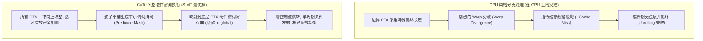

# CuTe 谓词判定与非对齐边界裁剪：影子平铺与零分歧工程 (Predication)

> **重要免责声明**：本网站只是用来消耗反重力额度的，并且给有需要的人看一看，准确度极低。可用度极低，不想看的请不看，造成错误概不负责。
> 本篇由 AI 辅助汉化与深度解析，非 NVIDIA 官方技术文档。涉及 GPU 底层硬件架构参数与生产算子调优，请以 [NVIDIA CUTLASS 官方源码](https://github.com/NVIDIA/cutlass) 为准。

---
> [!NOTE] 原文参考
> 本章对应官方核心规范文档 [`media/docs/cpp/cute/0y_predication.md`](https://github.com/NVIDIA/cutlass/blob/main/media/docs/cpp/cute/0y_predication.md)，并在原文档基础上补充了 GPU 硬件谓词执行机制（Predicate Registers）、影子平铺代数（Shadow Tiling）同构证明、Stride-0 零开销广播及生产级任意动态尺寸 GEMM 实战。

在基础 CUDA 教程中，绝大多数示例都做了一个极其理想化的假设：**矩阵的尺寸能够被分块瓦片整除**（例如矩阵规模为 $1024 \times 1024$，恰好能被 $128 \times 128$ 的 CTA 瓦片整除为 $8 \times 8$ 个网格）。

然而在现实世界的生产环境与大语言模型（LLM）推理中，**非对齐与动态形状（Dynamic / Ragged Shapes）才是绝对常态**：
* 文本生成的 Prompt 序列长度（Sequence Length）随用户输入随时变化（如 $M = 37, 1023, 137$）；
* 批处理大小（Batch Size）随高并发请求动态伸缩；
* 视觉模型中的图像特征图尺寸经过卷积池化后可能出现各类奇数尺寸。

假设我们要用 $4 \times 8$ 的微瓦片去平铺一个 $41 \times 55$ 的矩阵：
* 行方向：$41 / 4 = 10 \text{ 余 } 1$；
* 列方向：$55 / 8 = 6 \text{ 余 } 7$。

**面对这些多出来的边缘残差，我们如何在保证不发生非法显存越界（Illegal Memory Access）崩溃的同时，最大化榨干 GPU 的算力，避免出现剧烈的控制流分歧？**

---

## 0. 硬件微架构视界：为什么 GPU 痛恨动态循环边界？

在 CPU 编程中，处理残余数据最直观的写法是在主循环结束后，再写一个处理剩余零头的循环（Remainder Loop）：
```cpp
// CPU 传统思路：主循环处理整块，尾部循环处理零头
for (int i = 0; i < N / 128; ++i) { process_128(data + i * 128); }
for (int i = (N / 128) * 128; i < N; ++i) { process_scalar(data[i]); }
```
**如果在 GPU 上采用这种思路，算子性能将会惨烈雪崩！**



### 0.1 传统方案在 GPU 上的四大灾难
1. **Warp 分歧（Warp Divergence）**：
   同一个 Warp 内的 32 个线程必须以相同的程序计数器（PC）单步锁步执行。一旦部分线程落入残差分支，整个 Warp 的执行时间将变成两条分支的总和，算力利用率直接腰斩。
2. **编译期循环展开（Loop Unrolling）失效**：
   如果循环上界是动态变量，NVCC 编译器将无法执行 `#pragma unroll`，流水线调度与双缓冲预取机制瞬间瘫痪。
3. **指令缓存污染（I-Cache Thrashing）**：
   为了处理边缘情况而生成多份专用核函数代码，极易撑爆 SM 内部仅有几十 KB 的指令 L1 缓存。

### 0.2 GPU 硬件谓词寄存器（Predicate Registers）
现代 NVIDIA GPU 在微架构底层配备了数十个专门的**单比特谓词寄存器（Predicate Registers，记作 `p0, p1, ...`）**。
在 PTX 汇编层面，几乎所有的指令都可以附带谓词修饰符：
```cpp
@p0 ld.global.v4.u32 {r0, r1, r2, r3}, [gmem_ptr];
```
* 当 `@p0` 为真（1）时，该指令在单周期内正常发射并执行；
* 当 `@p0` 为假（0）时，**硬件发射单元将其视为空操作（NOP），直接取消其物理执行，绝不向内存控制器发出读取请求，更不会触发地址越界非法中断！**

**CuTe 的核心哲学正是：保持所有 CTA 的循环结构与分块完全同构统一，在指令发射层级通过纯代数方式推导出布尔谓词，零分歧阻断越界访存！**

---

## 1. 核心代数公理：`logical_divide` 向上取整机制

在 CuTe 的布局代数中，`logical_divide` 面对无法整除的尺寸时**天然采用“向上取整（Round Up）”**策略。

假设原始数据规模为 $N = 1000$，数据步长为 $1$（即布局为 `1000:1`），我们希望以 $B = 128$ 的块大小进行平铺：
```cpp
Layout gmem_layout = make_layout(1000); // 形状 1000
auto tile_size     = Int<128>{};

// 执行逻辑除法
auto tiled_layout  = logical_divide(gmem_layout, tile_size);
```
在 CuTe 的代数推导下，得到的结果是：
$$\text{tiled\_layout} = (128, 8) : (1, 128)$$
计算其总覆盖容量：$128 \times 8 = 1024$。
CuTe 自动将 $1000$ 向上取整到了能被 $128$ 整除的最小倍数 $1024$！

那么，**多出来的 $1024 - 1000 = 24$ 个物理上根本不存在的元素，该如何标记并安全剔除？**

---

## 2. 核心架构：影子平铺与恒等坐标张量 (Shadow Tiling)

CuTe 解决多维非对齐边界裁剪的数学终极法门，被称为**“影子平铺机制（Shadow Tiling）”**。

```mermaid
flowchart TD
    subgraph RealWorld["物理数据世界 (Data Domain)"]
        RealData["真实全局张量 mA<br/>Shape: (M, K) | GMEM 指针"] -->|local_tile| RealTile["CTA 瓦片 gA<br/>Shape: (bM, bK, k)"]
        RealTile -->|local_partition| RealFrag["线程数据分片 tAgA<br/>Shape: (THR_M, THR_K, k)"]
    end

    subgraph ShadowWorld["代数影子世界 (Coordinate Domain)"]
        Identity["恒等坐标张量 cA = make_identity_tensor(shape(mA))<br/>(m, k) -> (m, k) 映射自身"] -->|local_tile (镜像同步)| ShadowTile["影子 CTA 瓦片 cta_cA<br/>Shape: (bM, bK, k)"]
        ShadowTile -->|local_partition (镜像同步)| ShadowFrag["影子线程坐标分片 tAcA<br/>Shape: (THR_M, THR_K, k)"]
    end

    RealFrag & ShadowFrag --> EvalPred["逐元素比较: elem_less(tAcA, shape(mA))"]
    EvalPred --> PredMask["布尔谓词张量 tApA<br/>make_tensor<bool>"]
    PredMask & RealFrag --> CopyIf["cute::copy_if(tApA, tAgA, sA)"]
```

### 2.1 什么是恒等坐标张量？
CuTe 提供了核心原语 **`make_identity_tensor`**：
```cpp
Tensor cA = make_identity_tensor(shape(mA));
```
* **定义**：对于宏观张量 `mA` 的任意多维逻辑坐标 $\mathbf{c} = (m, k)$，恒等坐标张量在解引用时**直接返回该坐标本身**！
  $$\text{cA}(\mathbf{c}) = \mathbf{c}$$
* 它不占用任何全局显存，本质上是一个基于整数模隐式迭代器构造的虚拟张量；
* 它记录了整个张量内部每一个空间槽位的**绝对逻辑坐标**。

### 2.2 影子平铺同构定理 (Isomorphism of Shadow Tiling)
既然 `cA` 是一个形状与 `mA` 完全同构的合法张量，那么**我们在 `mA` 上施加的一切变换（分块器、线程布局、投影步长），都可以毫无差别地同步施加在 `cA` 上！**

```cpp
// 1. 对真实数据执行 CTA 平铺与线程切片：
Tensor gA   = local_tile(mA, cta_tiler, cta_coord, Step<_1, X, _1>{});
Tensor tAgA = local_partition(gA, tA, thread_idx);

// 2. 施加完全一模一样的影子变换：
Tensor cta_cA = local_tile(cA, cta_tiler, cta_coord, Step<_1, X, _1>{});
Tensor tAcA   = local_partition(cta_cA, tA, thread_idx);
```

#### 数学美感所在：
经过上述变换后，`tAgA` 与 `tAcA` 在形状模式（Shape）上完全全等（Congruent）！
* `tAgA(i)`：代表当前线程持有的第 $i$ 个物理数据元素；
* `tAcA(i)`：代表当前线程持有的第 $i$ 个数据元素**在原始宏观全局大矩阵中的绝对全局坐标 $(m_{\text{global}}, k_{\text{global}})$**！

无论底层的平铺经过了多少级复杂的嵌套（CTA Tile $\to$ Warp Layout $\to$ MMA Atom $\to$ Swizzle），**影子张量永远能以 100% 的数学精准度，直接说出每个寄存器槽位对应的全局绝对坐标！**

---

## 3. 多维坐标边界判定：`elem_less`

当获取到全局坐标后，我们只需将其与原始大矩阵的几何边界 `shape(mA)` 进行比较。

CuTe 提供了专用的分层元素级比较函数：**`cute::elem_less`**。

### 3.1 为什么不能用 C++ 原生 `<` 运算符？
在 C++ 中，元组（Tuple）的原生 `<` 运算符采用的是**字典序比较（Lexicographical Comparison）**：
$$(10, 100) < (20, 50) \implies \text{True (因为 10 < 20)}$$
然而，在多维几何边界判定中，我们要求的必须是**严格超矩形盒包含（Strict Box Containment）**：
$$\mathbf{c} \in \text{Box}(\mathbf{B}) \iff c_d < B_d \quad (\forall d \in [0, D-1])$$
`elem_less(coord, bound)` 在编译期递归遍历多维元组的每一个分量，只有当**所有分量都严格小于对应的边界值**时才返回 `true`，其定义与 GPU 空间边界裁剪完美契合！

```cpp
auto coord = make_coord(10, 100);
auto bound = make_coord(20,  50);

// 判定：10 < 20 (满足), 但 100 < 50 (不满足)
bool valid = elem_less(coord, bound); // 返回 false！
```

---

## 4. 极致性能杀手锏：Stride-0 谓词广播机制

在 GEMM 算子中，输入矩阵 $A$ 尺寸为 $(M, K)$，输入矩阵 $B$ 尺寸为 $(N, K)$。
主循环需要沿着 $K$ 轴迭代成百上千次。

> [!WARNING] 性能致命陷阱
> 很多初学者会在主循环内层，每一次从全局内存搬运数据时，都动态重新计算一次坐标并执行 `elem_less`：
> ```cpp
> for (int k_tile = 0; k_tile < K_TILE_MAX; ++k_tile) {
>   for (int i = 0; i < size(tAgA); ++i) {
>     if (elem_less(tAcA(i, k_tile), shape(mA))) { ... } // ❌ 极其昂贵的重复计算！
>   }
> }
> ```
> 这样写会导致每一次迭代都发射大量的整数比较指令，彻底扼杀指令发射吞吐量。

### 4.1 几何不变量分析
仔细观察矩阵 $A$ 的几何特性：
* 矩阵 $A$ 在 $M$ 轴上的越界与否，**完全由行坐标 $m$ 决定，与当前正在遍历哪一个 $K$ 瓦片（$k_{\text{tile}}$）毫无关系！**
* 换言之，**$M$ 维度的谓词掩码在整个主循环的所有迭代中是绝对恒定不变的！**

### 4.2 Stride-0 空间折叠与广播
利用这一数学不变量，CuTe 创造性地构造了一个**在 $K$ 模式上步长为 0（Stride 0）的谓词张量**：

```cpp
// 构造谓词张量：Shape 匹配 (THR_M, THR_K)，但在 K 模式上步长为 0！
Tensor tApA = make_tensor<bool>(make_shape (size<0>(tAcA), size<1>(tAcA)),
                                make_stride(     Int<1>{},      Int<0>{}));

Tensor tBpB = make_tensor<bool>(make_shape (size<0>(tBcB), size<1>(tBcB)),
                                make_stride(     Int<1>{},      Int<0>{}));
```

#### 代数奇迹：
* 由于第 1 维（$K$ 轴）的步长为 `Int<0>{}`，因此无论访问 `tApA(m, 0)` 还是 `tApA(m, 5)`，其底层内存偏移量恒等于 $m \times 1 + 0 = m$！
* 这意味着：**我们仅需在整个内核启动的序言阶段（Prologue）执行一次极简循环，初始化 $M$ 轴的布尔值**；
* 随后在主循环的所有迭代中，直接将 `tApA` 当作一个完整的二维张量传递给 `cute::copy_if`，硬件会自动完成沿 $K$ 轴的零开销逻辑广播！

```cpp
// -------------------------------------------------------------
// 序言段 (Prologue): 单次初始化, 耗时仅几个周期
// -------------------------------------------------------------
CUTE_UNROLL
for (int m = 0; m < size<0>(tApA); ++m) {
  // 提取第 0 个 K-tile 对应的全局 M 坐标并比较
  tApA(m, 0) = elem_less(get<0>(tAcA(m, 0, 0)), shape<0>(mA));
}

CUTE_UNROLL
for (int n = 0; n < size<0>(tBpB); ++n) {
  // 提取第 0 个 K-tile 对应的全局 N 坐标并比较
  tBpB(n, 0) = elem_less(get<0>(tBcB(n, 0, 0)), shape<0>(mB));
}

// -------------------------------------------------------------
// 稳态主循环 (Mainloop): 纯硬件谓词发射, 零冗余计算！
// -------------------------------------------------------------
for (int k_tile = 0; k_tile < K_TILE_MAX; ++k_tile) {
  // copy_if 内部自动解压 tApA 的 Stride-0 广播, 零额外内存开销
  copy_if(tApA, tAgA(_, _, k_tile), tAsA);
  copy_if(tBpB, tBgB(_, _, k_tile), tBsB);
  // ... 计算与流水线同步 ...
}
```

---

## 5. 生产级实战：端到端非对齐 GEMM 边界保护

为了让读者掌握工业级代码标准，我们给出一个包含**主循环数据读取谓词保护**与**尾声段写回谓词保护**的完整 GEMM 算子架构。

### 5.1 尾声段（Epilogue）写回时的边界保护

GEMM 的最终输出累加器保存在每个线程的私有寄存器 `tCrC` 中，最终需要缩放并写回全局显存 `tCgC`。如果矩阵尺寸 $(M, N)$ 无法整除 CTA 瓦片，尾部的 CTA 绝对不能将越界部分写回显存，否则会踩坏相邻显存数据，引发未定义行为。

```cpp
template <class TensorC, class TensorC_coord, class FragC, class Alpha, class Beta>
__device__ void predicated_epilogue(
    TensorC       tCgC,        // 全局显存目标切片
    TensorC_coord tCcC,        // 影子坐标张量切片: (m, n) -> 全局坐标
    FragC const&  tCrC,        // 寄存器累加器分片
    Alpha         alpha,
    Beta          beta,
    Shape<int, int> prob_MN)   // 运行时真实矩阵形状 (M, N)
{
  // 遍历当前线程持有的所有输出元素
  CUTE_UNROLL
  for (int i = 0; i < size(tCgC); ++i) {
    // 获取当前元素的绝对全局二维坐标: (m_global, n_global)
    auto global_coord = tCcC(i);

    // 严密判定: 只有当 m_global < M 且 n_global < N 时才允许写回显存
    if (elem_less(global_coord, prob_MN)) {
      tCgC(i) = alpha * tCrC(i) + beta * tCgC(i);
    }
  }
}
```

---

### 5.2 向量化搬运（Vectorized Loads）与边界对齐的权衡

当我们在 `0x_gemm_tutorial.md` 中使用 `UniversalCopy<uint128_t>`（128 位向量化读取）时，会面临一个严峻的工程约束：
* **128 位读取要求显存地址必须对齐到 16 字节边界，且一次读取连续的 4 个 float 元素**；
* 如果矩阵的实际尺寸刚好在第 2 个 float 处截断（例如行长为 62，不是 4 的倍数），直接发射 128 位向量化加载将导致最后 2 个元素越界踩内存，甚至引发硬件对齐故障（Misaligned Address Fault）！

#### CUTLASS / CuTe 的工业级解决方案：
1. **张量对齐静态断言**：
   在核函数入口，CuTe 允许断言矩阵连续维度的步长必须是向量化宽度的整数倍：
   ```cpp
   static_assert(shape<0>(mA) % 4 == 0, "M dimension must be multiple of 4 for 128-bit load");
   ```
2. **标量与向量双轨回退（Peeling / Masked Vectorization）**：
   对于无法对齐的残余维度，CuTe 的 `Copy_Atom` 支持在编译期配置掩码填充模式（如以 0 填充非法越界位），确保即使向量化读取越过边界，写入共享内存的值也是安全的数值 0，不影响后续的矩阵乘累加正确性！

---

## 6. 本章核心小结与思维导图

| 判定机制 | 核心代数理论与原语 | 硬件机理与优化收益 |
| :--- | :--- | :--- |
| **微架构动因** | 传统动态边界引发严重 Warp 分歧与循环展开瘫痪 | 激发 GPU 硬件谓词寄存器 (@p0)，单周期无损条件发射。 |
| **核心代数理论** | • **向上取整**：`logical_divide` 保证所有 CTA 结构完全同构<br/>• **恒等坐标张量**：`make_identity_tensor` 记录全局绝对坐标<br/>• **影子平铺**：镜像同步数据变换，保证几何模式全等 | 坐标计算与数据搬运严格同步，逻辑零死角。 |
| **关键优化原语** | • `elem_less`：严格超矩形盒多维包含判定<br/>• **Stride-0 广播**：序言段单次预计算，主循环沿 K 轴零开销复用<br/>• `copy_if`：声明式硬件掩码安全拷贝 | 彻底消灭动态分支判断与越界踩内存。 |

通过本章的学习，你已经掌握了如何在复杂动态形状下构建稳如磐石的现代 GPU 算子。CuTe 的影子平铺与谓词代数，将曾经让无数工程师头疼不已的边界分支，化作了编译器指令流中优雅流淌的硬件单比特掩码。
在下一章 [`04_algorithms.md`](./04_algorithms.md) 中，我们将全盘梳理 CuTe 算子库中最为核心的算法集合，包括数据搬运、代数求和与高阶变换函数！
