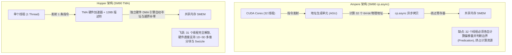
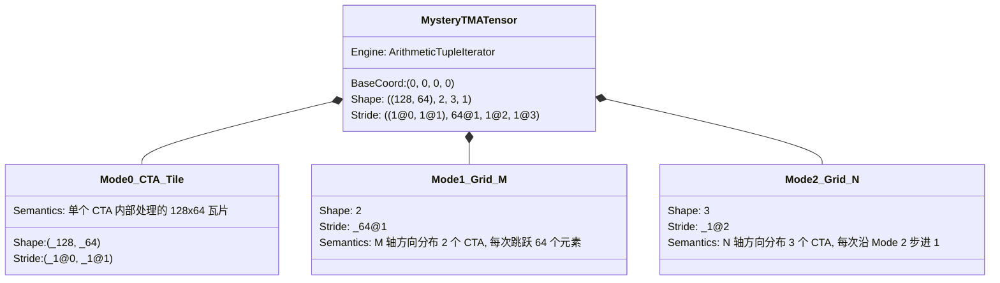

# CuTe TMA 张量：硬件张量加速器、隐式迭代器与整数模代数 (TMA Tensors)

> **重要免责声明**：本网站只是用来消耗反重力额度的，并且给有需要的人看一看，准确度极低。可用度极低，不想看的请不看，造成错误概不负责。
> 本篇由 AI 辅助汉化与深度解析，非 NVIDIA 官方技术文档。涉及 GPU 底层硬件架构参数与生产算子调优，请以 [NVIDIA CUTLASS 官方源码](https://github.com/NVIDIA/cutlass) 为准。

---
> [!NOTE] 原文参考
> 本章对应官方核心规范文档 [`media/docs/cpp/cute/0z_tma_tensors.md`](https://github.com/NVIDIA/cutlass/blob/main/media/docs/cpp/cute/0z_tma_tensors.md)，并在原文档基础上补充了 Hopper (SM90) / Blackwell (SM100) TMA 硬件 DMA 架构细节、`mbarrier` 硬件事务计数、$\mathbb{Z}$-模（Integer Module）形式化数学证明与工业级端到端代码实战。

在阅读或调试基于 NVIDIA Hopper 架构（H100/H800）与 Blackwell 架构（B200/GB200）的 CUTLASS 3.x 算子时，你会在控制台或日志中偶遇如下形式极其奇特、宛若外星密码的 CuTe 张量：

```text
ArithTuple(0, _0, _0, _0) o ((_128, _64), 2, 3, 1) : ((_1@0, _1@1), _64@1, _1@2, _1@3)
```

什么是 `ArithTuple`？`_1@0`、`_1@1`、`_64@1` 难道是张量的步长（Stride）吗？`@` 符号在代数上究竟代表什么含义？为什么在 Hopper 架构之后，CuTe 的布局代数会演化出这套看似离经叛道的数学符号？

本章将为你彻底解密 CuTe 最具革命性、也是最优雅的高阶代数扩展 —— **TMA 张量与整数模抽象**。

---

## 0. 硬件微架构革命：从 CUDA Core 软件搬运到 TMA 硬件 DMA

为了理解 TMA 张量为何存在，我们必须首先看清 GPU 数据搬运微架构的演进史。



### 0.1 传统搬运的算力瓶颈
在 Ampere (SM80) 引入 `cp.async` 之前，将全局显存拷贝到共享内存需要 CUDA Core 执行繁重的指令序列：
1. 线程通过算术逻辑单元（ALU）计算自己的物理地址：`base_ptr + (row * stride + col) * sizeof(T)`；
2. 遇到非对齐边界时，每个线程执行条件分支预测（Predication）；
3. 发射 `ld.global` 将数据读入寄存器，再发射 `st.shared` 写入共享内存。

即使在 Ampere 中使用了 `cp.async` 绕过了寄存器，**每个线程依然必须独立计算目标地址并参与指令发射**。在大型矩阵乘中，仅仅维护搬运地址就吃掉了 15%~20% 的 CUDA Core 发射槽位！

### 0.2 Hopper TMA（Tensor Memory Accelerator）硬件加速器
Hopper (SM90) 彻底革新了这一范式，引入了专用的硬件张量搬运引擎 —— **TMA**。
* **极简指令发射**：整个 Warp 中**仅需一个线程发射一条 TMA 指令**，其余 31 个线程可以立即去执行数学计算或进入睡眠休眠状态！
* **硬件级多维地址生成**：TMA 硬件单元内部集成了专用的硬件多维地址生成器，硬件直接识别 1D、2D、3D、4D 乃至 5D 的多维张量瓦片。
* **自动边界裁剪与补零（Hardware Out-of-Bounds Predication）**：当搬运的分块超出全局矩阵边界时，TMA 硬件会自动对超出部分填零（Zero-fill）或填 NaN，无需任何软件 `if` 分支！
* **硬件级无冲突混洗（Hardware Swizzling）**：硬件在向共享内存写入的同时，直接完成 32B、64B 或 128B 的 Bank-conflict-free 物理混洗。

---

## 1. 理论绝境：为什么传统指针张量在 TMA 面前彻底失效？

既然 TMA 如此强悍，为什么 CuTe 不能直接使用普通的 `make_tensor(gmem_ptr, layout)`？

让我们查看底层 PTX 硬件指令中 TMA 存储与加载的真实接口签名：

```cpp
// Hopper SM90 TMA 3D 加载硬件指令封装
struct SM90_TMA_LOAD_3D {
  CUTE_DEVICE static void
  copy(void const* const desc_ptr,   // 1. 指向 128 字节 TMA 描述符的常量指针
       void const* const mbar_ptr,   // 2. 硬件异步事务屏障指针 (mbarrier)
       void const* const smem_ptr,   // 3. 共享内存目标基准地址
       int32_t const& crd0,          // 4. 宏观张量坐标 0 (例如 M 方向瓦片索引)
       int32_t const& crd1,          // 5. 宏观张量坐标 1 (例如 K 方向瓦片索引)
       int32_t const& crd2)          // 6. 宏观张量坐标 2 (例如 Batch 方向索引)
  {
    // 内联汇编: cp.async.bulk.tensor.3d ...
  }
};
```

> [!CAUTION] 致命的矛盾
> 仔细审视上述函数参数：**TMA 硬件指令根本不接受全局显存的内存地址指针（`gmem_ptr`）！**
> 1. 全局显存的基地址、数据宽度、全图维度和物理跨度，早已在内核启动前由 Host 端打包并**固化在了 128 字节的 `desc_ptr` 描述符中**；
> 2. TMA 指令在设备端真正需要的，是当前 Thread Block 想要搬运的瓦片在全图中的**多维逻辑坐标（`crd0, crd1, crd2`）**！

在经典的 CuTe 抽象中：
$$\text{Tensor} = \text{Engine}(\text{Pointer}) + \text{Layout}$$
对张量进行切片操作（`local_tile` 或 `A(crd)`）时，CuTe 的底层机制是**计算出一维内存线性字节偏移，并将内部持有的裸指针 `ptr` 向前推进 `ptr + offset`**。

然而，**如果给 TMA 一个向前偏移了的裸指针，TMA 硬件根本无法消费！TMA 需要的是原汁原味的多维离散坐标元组 $(m, k, b)$！**

如果继续沿用传统指针设计，CuTe 就必须彻底推翻之前的 `local_tile`、`zipped_divide` 和切片代数，为 TMA 单独编写一套完全不兼容的专属 API。这违背了 CuTe “一切皆代数” 的至高设计哲学。

**CuTe 架构师给出的绝妙答案是：保留所有切片代数与张量接口不变，将指针抽象升维为“隐式坐标迭代器”，并将步长抽象升维为“整数模基底”！**

---

## 2. 代数升维：隐式张量与算术元组迭代器

### 2.1 隐式张量 (Implicit Tensors)
在 CuTe 的公理体系中，张量的底层引擎（Engine）只要满足**随机访问迭代器（Random-access Iterator）**的契约即可，它未必真要在内存中持有一块物理显存。

例如，CuTe 提供了生成无限等差数列的 `counting_iterator<T>`：
```cpp
// 构造一个起始值为 42 的隐式计数张量
Tensor A = make_tensor(counting_iterator<int>(42), make_shape(4, 5));
```
打印输出结果：
```text
counting_iter(42) o (4, 5):(_1, 4):
   42   46   50   54   58
   43   47   51   55   59
   44   48   52   56   60
   45   49   53   57   61
```
该张量内部没有任何物理内存数组，它的元素是**在解引用时由迭代器动态计算生成的**。关键在于：它依然是一个完全合法的 CuTe `Tensor`，可以无缝施加 `local_tile`、`composition` 和切片运算！

---

### 2.2 算术元组 (`ArithmeticTuple`) 与多维坐标迭代器
为了让张量能够存储并维护 TMA 所需的多维坐标，CuTe 引入了 **`ArithmeticTuple`**（算术元组）。

`ArithmeticTuple` 是 `cute::tuple` 的派生类，但它具备严格的向量代数特性 —— **重载了 `operator+` 与标量乘法 `operator*`**：

$$(a_0, a_1, \dots, a_{n-1}) + (b_0, b_1, \dots, b_{n-1}) = (a_0 + b_0, a_1 + b_1, \dots, a_{n-1} + b_{n-1})$$

$$k \times (a_0, a_1, \dots, a_{n-1}) = (k \cdot a_0, k \cdot a_1, \dots, k \cdot a_{n-1})$$

基于此，CuTe 构建了 **`ArithmeticTupleIterator`（算术元组迭代器）**：
* 迭代器内部封装的不是一个 `float*` 物理地址，而是一个**当前坐标的 `ArithmeticTuple`**；
* 当外部算法对该迭代器施加“偏移（Offset）”时，迭代器内部执行的是**多维坐标的向量加法**！
* 当算法对迭代器执行“解引用（`*iter`）”时，它直接输出**当前位置的多维 TMA 硬件坐标**！

```cpp
// 构造一个初始坐标为 (42, 2, 7) 的算术元组迭代器
ArithmeticTupleIterator iter_1 = make_inttuple_iter(42, Int<2>{}, Int<7>{});

// 施加一个多维偏移量 (0, 5, 2)
ArithmeticTupleIterator iter_2 = iter_1 + make_tuple(Int<0>{}, 5, Int<2>{});

// 解引用输出：
print(*iter_2); // 准确输出 (42, 7, _9)！
```

---

## 3. 数学基石：步长不只是整数，它是 $\mathbb{Z}$-模（Integer Module）！

我们解决了迭代器存储多维坐标的问题。但接踵而来的是一个更深邃的数学难题：
在 CuTe 的求值机制中：

$$\text{Offset} = \text{Layout}(\text{Coord}) = \langle \text{Coord}, \text{Stride} \rangle = \sum_{d} \text{Coord}_d \times \text{Stride}_d$$

如果 `Coord` 是多维的整数元组，而 `Stride` 还是传统的标量整数（如 $1, 128$），那么它们的内积依然会坍缩为一个一维标量整数，根本无法驱动 `ArithmeticTupleIterator` 进行多维向量累加！

**CuTe 架构师在此展现了极其深厚的抽象代数功底：他们重构了 `Stride` 的公理定义！**

### 3.1 形式化定义：$\mathbb{Z}$-模步长代数
在近世代数中，一个代数系统 $(M, +)$ 如果是一个阿贝尔群，并且配备了一个数乘运算 $\mathbb{Z} \times M \to M$（其中 $\mathbb{Z}$ 是整数环），满足：
1. $k \cdot (x + y) = k \cdot x + k \cdot y$
2. $(k + m) \cdot x = k \cdot x + m \cdot x$
3. $(k \cdot m) \cdot x = k \cdot (m \cdot x)$
4. $1 \cdot x = x$

则称 $M$ 为一个 **$\mathbb{Z}$-模（Integer Module）**。

> [!NOTE] 核心推论
> 1. 普通整数标量 $\mathbb{Z}$ 自身是一个显然的 $\mathbb{Z}$-模；
> 2. **任意阶数的整数元组群 $\mathbb{Z}^R$ 也是严格合法的 $\mathbb{Z}$-模！**
> 
> 因此，在 CuTe 中，**步长（Stride）不必局限于整数标量，它可以是任意满足 $\mathbb{Z}$-模性质的代数实体！**

---

### 3.2 规范基底：`E` 符号与 `@` 投影记法

为了在 C++ 模板元编程中轻便地构造高阶 $\mathbb{Z}$-模步长，CuTe 在 `cute/numeric/arithmetic_tuple.hpp` 中定义了**规范基底对象 `E<...>`**。

* 这里的 `E` 本质上就是线性代数中的标准正交基底向量 $\mathbf{e}_0, \mathbf{e}_1, \dots$；
* 记法 `1@k` 表示：**一个在第 $k$ 个分量上为 1、其余分量全为 0 的无限维基底向量**！

#### 规范基底速查表：

| C++ 模板表达式 | 形式化代数向量表示 | 控制台打印形式 | 空间几何含义 |
| :--- | :--- | :---: | :--- |
| **`E<>{}`** | $1$ | `1` | 普通标量整数 1 |
| **`E<0>{}`** | $(1, 0, 0, \dots)$ | `1@0` | 沿 Mode 0 方向行进 1 个单位 |
| **`E<1>{}`** | $(0, 1, 0, \dots)$ | `1@1` | 沿 Mode 1 方向行进 1 个单位 |
| **`E<2>{}`** | $(0, 0, 1, \dots)$ | `1@2` | 沿 Mode 2 方向行进 1 个单位 |
| **`E<0, 0>{}`** | $((1, 0, \dots), 0, \dots)$ | `1@0@0` | 嵌套元组：在 Mode 0 内部的 SubMode 0 上行进 1 |
| **`E<1, 0>{}`** | $(0, (1, 0, \dots), 0, \dots)$ | `1@0@1` | 嵌套元组：在 Mode 1 内部的 SubMode 0 上行进 1 |
| **`5 * E<1>{}`** | $(0, 5, 0, \dots)$ | `5@1` | 基底数乘：沿 Mode 1 方向大步跳跃 5 个单位 |

#### 基底的代数运算公理：
1. **数乘交换律**：标量系数可以任意穿透嵌套层级：
   $$5 \times E\langle 0, 1 \rangle = 5 \times (1@1@0) = 5@1@0 = ((0, 5, 0, \dots), 0, \dots)$$
2. **相容向量加法**：只要分层结构同构，不同基底可以自由线性叠加：
   $$3 \times E\langle 0 \rangle + 4 \times E\langle 1 \rangle = 3@0 + 4@1 = (3, 4, 0, \dots)$$

---

### 3.3 步长线性组合如何生成 TMA 坐标？

现在，让我们亲眼见证 Layout 如何将自然坐标转换为 TMA 坐标。

假设我们定义一个二阶步长：
$$\text{Stride} = (E\langle 0 \rangle, E\langle 1 \rangle) = (1@0, 1@1)$$
当输入二维逻辑坐标 $(i, j)$ 时，求值器计算内积：

$$\text{Offset} = i \cdot (1@0) + j \cdot (1@1) = (i, 0, \dots) + (0, j, \dots) = (i, j)$$

**输入是逻辑坐标 $(i, j)$，经过 Layout 变换后，输出直接变成了多维 TMA 硬件坐标 $(i, j)$！**

如果我们需要执行转置（Transpose），只需调换基底步长：
$$\text{Stride} = (E\langle 1 \rangle, E\langle 0 \rangle) = (1@1, 1@0)$$
求值计算内积：

$$\text{Offset} = i \cdot (1@1) + j \cdot (1@0) = (j, i)$$

**没有任何指针偏移，矩阵的行列转置在 TMA 硬件坐标系中瞬间完成！**

---

## 4. 全景解密：那一串“外星密码”的真相

现在，我们终于拥有了足够的代数武器，来彻底解构引言中那一行令人望而生畏的神秘签名：

```text
ArithTuple(0, _0, _0, _0) o ((_128, _64), 2, 3, 1) : ((_1@0, _1@1), _64@1, _1@2, _1@3)
```



### 4.1 逐项结构拆解对照表：

| 组成部分 | 原始表达式 | 深度代数语义剖析 |
| :--- | :--- | :--- |
| **存储引擎** | `ArithTuple(0, _0, _0, _0)` | 底层迭代器不是指针，而是一个 4 维坐标原点初始向量 $(0, 0, 0, 0)$ |
| **整体分块形状** | `((_128, _64), 2, 3, 1)` | **Rank-4 嵌套结构**：<br/>• Mode 0: `(_128, _64)` 是 CTA 瓦片几何形状；<br/>• Mode 1: `2` 是 $M$ 轴方向的 CTA 网格数；<br/>• Mode 2: `3` 是 $N$ 轴方向的 CTA 网格数；<br/>• Mode 3: `1` 是 Batch 批次维度。 |
| **整数模步长** | `((_1@0, _1@1), _64@1, _1@2, _1@3)` | **TMA 坐标生成律**：<br/>• `(_1@0, _1@1)`：瓦片内部沿 $(m, n)$ 连续步进；<br/>• `_64@1`：网格在 $M$ 轴切换时，TMA 坐标沿 Mode 1 步进 64；<br/>• `_1@2`：网格在 $N$ 轴切换时，TMA 坐标沿 Mode 2 步进 1；<br/>• `_1@3`：批次切换时沿 Mode 3 步进 1。 |

**真相大白**：这根本不是什么难以捉摸的乱码，而是一个**经过 `local_tile` 完美平铺后、专门用来给 Hopper TMA 硬件发射指令的多维宏观坐标生成器！**

---

## 5. 工程实战：端到端构建 Hopper TMA 异步加载流水线

为了将上述理论彻底落地，我们给出一个在 NVIDIA H100 GPU 上真实运行 TMA 异步数据搬运的标准工程模板。

### 5.1 Host 端：创建 TMA 描述符与 `make_tma_copy`

在 Host 端，TMA 描述符必须在编译期与运行时混合构建，并拷贝至 Global 常量内存中：

```cpp
#include <cute/tensor.hpp>
#include <cute/arch/copy_sm90_tma.hpp>
using namespace cute;

// 1. 定义全局大矩阵的几何布局 (M=2048, K=1024, 列优先)
auto gmem_layout = make_layout(make_shape(2048, 1024), GenColMajor{});

// 2. 定义单个 CTA 共享内存分块的排布 (128x64 列优先)
auto smem_layout = make_layout(Shape<_128, _64>{}, GenColMajor{});

// 3. 构造 TMA Copy 算子（自动生成 128 字节硬件描述符）
// 启用硬件级 128B Swizzle 以彻底清零共享内存 Bank 冲突！
auto tma_copy_a = make_tma_copy(
    SM90_TMA_LOAD{},                                    // TMA 加载原语
    make_tensor(make_gmem_ptr(d_A), gmem_layout),       // 全局显存张量
    smem_layout                                         // 目标共享内存布局
);
```

---

### 5.2 Device 端：TMA 指令发射与异步硬件事务屏障 (`mbarrier`)

在 Device 端，TMA 必须与 Hopper 硬件事务屏障（`cuda::barrier` / `mbarrier`）强绑定，以实现硬件自动跟踪传输字节数并释放等待线程：

```cpp
__global__ void hopper_tma_kernel(
    CUTE_GRID_CONSTANT TMA_Copy_A const tma_a, // TMA 描述符通过常量内存传入
    int const num_tiles_k)
{
  // 1. 静态申请支持 TMA 描述符约束的共享内存缓冲区
  extern __shared__ char raw_smem[];
  Tensor sA = make_tensor(make_smem_ptr<half_t>(raw_smem), Shape<_128, _64>{});

  // 2. 初始化硬件异步事务屏障 (mbarrier)
  __shared__ uint64_t mbar;
  if (thread0()) {
    // 参与该屏障的线程数为 1 (仅需单线程同步或驱动)
    asm volatile("mbarrier.init.shared.b64 [%0], %1;\n" :: "r"(__cvta_generic_to_shared(&mbar)), "r"(1));
  }
  __syncthreads();

  // 3. 关键步骤：创建设备端 TMA 张量视图！
  // 此处得到的 gA 正是我们前面解析的包含 ArithTuple 的神秘张量！
  Tensor gA = tma_a.get_tma_tensor(Shape<2048, 1024>{});

  // 4. 每个 CTA 提取属于自己的切片
  Tensor cta_gA = local_tile(gA, Shape<_128, _64>{}, make_coord(blockIdx.x, _));

  // 5. 主循环中发射 TMA 异步硬件搬运
  for (int k_tile = 0; k_tile < num_tiles_k; ++k_tile) {
    if (thread0()) {
      // 计算本次搬运传输的实际物理字节数 (128 * 64 * sizeof(half) = 16384 Bytes)
      constexpr uint32_t transaction_bytes = sizeof(Array<half_t, 128 * 64>);

      // 告知硬件屏障：期待接收 16384 字节的 TMA 事务数据
      asm volatile("mbarrier.arrive.expect_tx.shared.b64 _, [%0], %1;\n"
                   :: "r"(__cvta_generic_to_shared(&mbar)), "r"(transaction_bytes));

      // 💥 终极发射：单线程发射 1 条指令，硬件直接读取 cta_gA 的解引用坐标！
      copy(tma_a.with(mbar), cta_gA(_, _, k_tile), sA);
    }

    // 6. 其余 127 个线程无需参与任何搬运，直接在屏障处硬件休眠等待传输完毕！
    // 硬件 DMA 控制器在搬运完 16384 字节后，会自动在硬件层面翻转屏障相位，唤醒所有线程！
    asm volatile(
      "{\n\t"
      ".reg .pred p;\n\t"
      "LAB_WAIT:\n\t"
      "mbarrier.try_wait.parity.shared.b64 p, [%0], %1;\n\t"
      "@!p nanosleep.u32 20;\n\t"
      "@!p bra LAB_WAIT;\n\t"
      "}\n"
      :: "r"(__cvta_generic_to_shared(&mbar)), "r"(0)
    );

    // 此时 sA 中的数据已经全部就绪，立即交由 WGMMA 张量核心全速计算！
    // ...
  }
}
```

---

## 6. 本章核心小结与思维导图

```mermaid
mindmap
  root((CuTe TMA 张量体系))
    微架构动因
      传统痛点: 32 线程频繁发射, 挤占 CUDA Core
      Hopper TMA: 单线程 1 条指令, 独立 DMA 多维硬件搬运
      硬件优势: 自动边界填零, 硬件 128B Swizzle, 事务屏障协同
    理论困境与破局
      致命矛盾: TMA 硬件只吃多维坐标, 不吃显存裸指针
      解决方案: 保持切片代数同构, 引入隐式张量与多维迭代器
    整数模代数体系
      ArithmeticTuple: 具备向量加法与标量乘法的坐标元组
      Z-模步长公理: 步长从单标量扩展为整数模群
      规范基底 E: 1@0, 1@1 坐标投影, 纯代数实现无成本转置
    神秘张量解码
      ArithTuple o (Shape) : (Stride)
      将宏观网格切片无缝转换为 TMA 坐标流水线
```

至此，CuTe 中最具神秘色彩的 TMA 整数模代数已被我们彻底攻克。你不仅理解了控制台上那一串“外星密码”的数学本质，更掌握了在 Hopper 及 Blackwell 微架构上编写新一代硬件级异步算子的终极利器！
在下一章 [`0y_predication.md`](./0y_predication.md) 中，我们将聚焦于工程落地的另一大核心痛点 —— **任意动态形状下的张量谓词边界保护（Predication）**！
