::: warning ⚠️ 重要免责与非官方声明
1. **非官方文档**：本项目完全由 **AI（人工智能）辅助汉化、批注、代码走读与长篇技术解析**，**绝非 NVIDIA 官方文档，亦非官方授权译本**。
2. **准确性声明**：AI 在长文本翻译与复杂数学代数推演中**不保证 100% 绝对准确**，可能存在语义偏差、术语不当或局部推导缺陷。
3. **权威准则**：在生产环境使用或进行关键性能调优时，请务必以 [NVIDIA CUTLASS 官方 GitHub 仓库](https://github.com/NVIDIA/cutlass) 的原版英文源码与规范为准！
:::

### 💡 为什么需要本项目？

在现代大语言模型（LLM）推理与训练加速领域，**NVIDIA CUTLASS 3.x 及 CuTe（CUDA Tensor Extensions）** 是构建硬件物理极限性能 GPU 算子的行业事实标准。

然而，CuTe 文档充斥着高度抽象的数学概念（如单射/双射坐标变换、布局代数微积分）、高阶 C++ 模板元编程与前沿 GPU 微架构细节，官方纯英文文档晦涩难懂，而普通机器翻译则由于缺乏代数语境往往词不达意、完全失真。

本项目旨在为华语社区的 **GPU 系统工程师、AI 编译器开发者、高校体系结构学者与 HPC 算法专家**，提供一套**条理清晰、源码逐行剖析、万字长篇展开、附带内存地址算例**的深度自学宝典。

---

## 🗺️ 推荐系统化进阶学习路径

```mermaid
graph LR
    subgraph Path1["第一步: 夯实纯代数基石"]
        A1["00_quickstart<br/>心智模型重塑"] --> A2["01_layout<br/>Layout 映射本质"]
        A2 --> A3["02_layout_algebra<br/>复合/划分运算法则"]
    end

    subgraph Path2["第二步: 硬件张量与切片"]
        A3 --> B1["03_tensor<br/>Engine+Layout 载体"]
        B1 --> B2["0t_mma_atom<br/>Tensor Core 硬件原子"]
        B2 --> B3["04_algorithms<br/>泛型数据流分发"]
    end

    subgraph Path3["第三步: 工业级内核实战"]
        B3 --> C1["0x_gemm_tutorial<br/>端到端从零手写 GEMM"]
        C1 --> C2["0y_predication<br/>动态形状影子平铺保护"]
        C2 --> C3["0z_tma_tensors<br/>Hopper TMA 整数模代数"]
    end

    subgraph Path4["第四步: 宏观架构与前沿极限"]
        C3 --> D1["cutlass_3x_design<br/>设计哲学与词汇类型"]
        D1 --> D2["pipeline<br/>异步多级流水线"]
        D2 --> D3["gemm_api_3x<br/>五层金字塔与 Builder"]
        D3 --> D4["efficient_gemm<br/>Roofline 与微架构调优"]
        D4 --> D5["blackwell_functionality<br/>Blackwell SM100 终极前沿"]
    end
```

---

## 📚 全景文档专著索引

### 第一部分：CuTe 核心规范与布局代数体系 (CuTe Monograph Series)

* [**00. CuTe 快速上手与心智模型构建 (Getting Started)**](/cute/00_quickstart)：环境搭建、源码拓扑、单文件可运行 Demo、调试与 TikZ LaTeX 矢量图生成。
* [**01. CuTe Layout 核心抽象与映射公理 (Layout)**](/cute/01_layout)：函数映射本质、静态整数 `Int<N>`、EBO 内存优化、反向字典序（Colexicographical Order）与物理地址对照。
* [**02. CuTe 布局代数运算法则 (Layout Algebra)**](/cute/02_layout_algebra)：合并化简（Coalesce）、函数复合（Composition）、正交补（Complement）、逻辑划分（Logical/Zipped/Tiled/Flat Divide）。
* [**03. CuTe Tensor 核心抽象与切片机制 (Tensors)**](/cute/03_tensor)：`Tensor = Engine + Layout`，强类型指针打标（GMEM/SMEM）、通配符 `_` 切片魔术与 TV（Thread-Value）布局分区。
* [**04. CuTe 泛型张量算法体系 (Algorithms)**](/cute/04_algorithms)：数据搬运 `copy` 三级分发、边界保护 `copy_if`、五大模式 `gemm`、尾声操作 `axpby` 与硬件清零 `clear`。
* [**05. MMA Atom 硬件矩阵乘抽象 (MMA Atom & TiledMMA)**](/cute/0t_mma_atom)：四层抽象模型、Volta QuadPair 逆向工程、Hopper Warpgroup (WGMMA) 核心矩阵与模式置换代数。
* [**06. CuTe 密集矩阵乘法 (GEMM) 完整实战教程**](/cute/0x_gemm_tutorial)：从基础 `sgemm_1.cu` 到 128 位向量化访存、Padding 消除 Bank Conflict、多阶段流水线与 GETT 泛化。
* [**07. 谓词判定与非对齐边界裁剪 (Predication)**](/cute/0y_predication)：动态形状下的超矩形盒判定，基于恒等坐标张量的影子平铺（Shadow Tiling）与 Stride-0 零开销广播。
* [**08. CuTe TMA 张量与整数模代数 (TMA Tensors)**](/cute/0z_tma_tensors)：解密神秘签名，$\mathbb{Z}$-模步长公理、规范基底 $E$ 与 `@` 语法，构建 Hopper 硬件 DMA 数据流。

### 第二部分：CUTLASS 3.x 宏观架构与硬件极限 (Architecture & Modern GPUs)

* [**01. CUTLASS 3.x 核心架构演进与设计哲学 (Design)**](/architecture/cutlass_3x_design)：从 2.x 僵化绑定到 3.x 算法解耦、单一词汇类型设计、标签分发（Tag-Dispatch）与“构造即正确”保证。
* [**02. CUTLASS 3.x GEMM API 体系与五层架构全景 (GEMM API)**](/architecture/gemm_api_3x)：Device $\to$ Kernel $\to$ Collective $\to$ Tiled $\to$ Atom 五层金字塔、`CollectiveBuilder` 自动合成与 EVT 算子融合树。
* [**03. CUTLASS 异步软件流水线与同步机制 (Pipeline)**](/architecture/pipeline)：利特尔法则延迟隐藏、Warp Specialization 生产者-消费者解耦、`mbarrier` 硬件事务计数与相位反转无锁同步。
* [**04. 高性能 GEMM 硬件物理极限与优化法则 (Efficient GEMM)**](/architecture/efficient_gemm)：Roofline 模型、三级嵌套分块、L2 缓存蛇形混洗、Split-K / Sliced-K 极端长条矩阵优化与 NCU 调优清单。
* [**05. NVIDIA Blackwell (SM100) 架构核心特性 (Blackwell Functionality)**](/architecture/blackwell_functionality)：第 5 代 Tensor Core `tcgen05.mma`、OCP MXFP4 / NVFP4 块级微缩放（Microscaling）与双 SM 协同执行（2SM Cooperative）。

### 第三部分：权威术语与符号词典
* [**📐 核心术语与代数符号权威词典 (Glossary)**](/glossary)：统一的中英双语术语对照与形式化数学符号检索手册。
