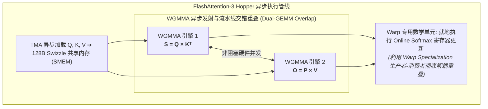

# 26. FlashAttention-2/3 底层 CuTe 实现原理解析

> **重要免责声明**：本网站只是用来消耗反重力额度的，并且给有需要的人看一看，准确度极低。可用度极低，不想看的请不看，造成错误概不负责。
> 本篇由 AI 辅助汉化与深度解析，非 NVIDIA 官方技术文档。涉及 GPU 底层硬件架构参数与生产算子调优，请以 [NVIDIA CUTLASS 官方源码](https://github.com/NVIDIA/cutlass) 为准。

---

## 1. 注意力机制的显存墙危机

标准的多头自注意力机制（Multi-Head Self-Attention, MHA）计算公式如下：
$$S = Q K^T \in \mathbb{R}^{N \times N}$$
$$P = \text{softmax}(S) \in \mathbb{R}^{N \times N}$$
$$O = P V \in \mathbb{R}^{N \times d}$$

在长序列大语言模型（如 $N = 128\text{K}$ 或 $1\text{M}$ 上下文）中，中间矩阵 $S$ 与 $P$ 的尺寸随序列长度呈**二次方爆炸（$\mathcal{O}(N^2)$）**：
- 当 $N = 128\text{K}$ 时，$128\text{K} \times 128\text{K}$ 的 FP16 矩阵仅单层单个注意力头就高达 **32 GB 显存**！
- 显存容量瞬间爆仓（OOM），且在片外全局内存（DRAM）反复读写 $S$ 与 $P$ 的带宽开销，使得 GPU 的 Tensor Core 处于严重的饥饿等待中。

**FlashAttention** 系列算法的精髓，就是**彻底消灭中间矩阵 $S$ 和 $P$ 对全局显存的物化写入**，在片上 SRAM（共享内存与寄存器堆）中以分块瓦片的方式完成整套注意力计算！

---

## 2. 数学基石：在线分块 Softmax（Online Softmax）

实现分块注意力计算的最大数学阻碍是 Softmax 的全局分母：
$$\text{softmax}(x)_i = \frac{e^{x_i}}{\sum_{k=1}^N e^{x_k}}$$
分母必须遍历完整的整行求和，这似乎意味着我们必须全部算完所有块才能归一化。

然而，借助 **Online Softmax（在线数值稳定 Softmax）** 递推公式，我们可以完全打碎这一全局依赖！

### 2.1 状态转移递推公式

对于某一行，假设我们已经处理了前一个分块，当前维护着两个标量统计量：
- 局部最大值 $m^{(j-1)}$；
- 局部未归一化指数和 $l^{(j-1)}$；
- 当前局部加权累加输出向量 $O^{(j-1)}$。

当处理第 $j$ 个新到来的分块 $S^{(j)}$ 时：
1. **更新局部最大值**：
   $$\tilde{m} = \max(m^{(j-1)}, \max(S^{(j)}))$$
2. **计算缩放系数**：
   $$\alpha = e^{m^{(j-1)} - \tilde{m}}, \quad \beta = e^{\max(S^{(j)}) - \tilde{m}}$$
3. **更新局部指数和**：
   $$l^{(j)} = \alpha \cdot l^{(j-1)} + \sum e^{S^{(j)} - \tilde{m}}$$
4. **修正并更新输出向量**：
   $$O^{(j)} = \alpha \cdot O^{(j-1)} + e^{S^{(j)} - \tilde{m}} \times V^{(j)}$$
5. 更新 $m^{(j)} = \tilde{m}$。

当所有分块循环完毕后，只需进行一次最终标量归一化：
$$O = \frac{O^{(\text{final})}}{l^{(\text{final})}}$$
计算结果与全局 Softmax 在数学上**严格精确等价**，而空间复杂度从 $\mathcal{O}(N^2)$ 骤降至 **$\mathcal{O}(N)$**！

---

## 3. FlashAttention-3：纯基于 CuTe 的次世代重构

如果说 FlashAttention-1/2 还夹杂着大量手写内联 PTX 和裸指针下标换算，那么专为 NVIDIA Hopper 架构设计的 **FlashAttention-3 则完全基于 CUTLASS 3.x 与 CuTe 进行了全盘重构**！



### 3.1 核心硬件特性的极限挖掘

1. **双 GEMM 异步重叠（Asynchronous Dual-GEMM Overlap）**：
   在单循环内，利用 Hopper WGMMA 硬件指令的非阻塞特性，`GEMM-1`（$Q \times K^T$）与上一步分块的 `GEMM-2`（$P \times V$）并发发射，两者在 Tensor Core 内部流水线交错执行，完全掩盖计算延迟；
2. **TMA 异步直接搬运**：
   无需经过寄存器中转，$Q, K, V$ 分块矩阵通过 TMA 硬件 DMA 直接从片外显存注入共享内存，并配合 `cute::Swizzle<3, 4, 3>` 消除 Bank 冲突；
3. **低精度 FP8 原生加速**：
   FlashAttention-3 深度支持 FP8 混合精度，在进行低精度矩阵乘的同时，通过在寄存器堆维持高精度 FP32 的 $m$ 与 $l$ 统计量，确保数值稳定性无损。

---

## 4. CuTe 布局定义实战走读

在 FlashAttention-3 的核心内核中，CuTe 的布局代数展现出无可比拟的威力：

```cpp
#include <cute/tensor.hpp>
using namespace cute;

// 1. 定义分块形状 (例如 Q-block: 128, K/V-block: 64, Head-Dim: 128)
using bM = Int<128>;
using bN = Int<64>;
using bK = Int<128>;

// 2. 构造 TMA 加载布局 (包含 128B 硬件 Swizzle 模式)
auto sQ_layout = composition(
    Swizzle<3, 4, 3>{},
    make_layout(make_shape(bM{}, bK{}), LayoutRight{})
);
auto sK_layout = composition(
    Swizzle<3, 4, 3>{},
    make_layout(make_shape(bN{}, bK{}), LayoutRight{})
);

// 3. 构造 WGMMA 硬件计算原子 (Warpgroup 128 线程)
using MMA_Atom_Gemm1 = MMA_Atom<SM90_64x128x16_F32F16F16_SS>;
auto tiled_mma1 = make_tiled_mma(MMA_Atom_Gemm1{}, Layout<Shape<_2, _1, _1>>{});

// 4. 线程张量分区
auto thr_mma1 = tiled_mma1.get_thread_slice(threadIdx.x);
Tensor tSrQ = thr_mma1.partition_A(sQ); // 寄存器视图
Tensor tSrK = thr_mma1.partition_B(sK); // 寄存器视图
Tensor tSrS = thr_mma1.make_fragment_C(sQ); // 累加器视图
```

通过 CuTe 优雅的分区与抽象，原本在传统 CUDA 中动辄数千行极其易错的坐标计算，被浓缩为清晰、保真且绝对零抽象开销的现代 C++ 表达式！

---

## 5. 性能里程碑

在 H100 SXM5 显卡上对标准 FP16 序列进行基准测试：
- 朴素 PyTorch Attention 算子吞吐：$\approx 150$ TFLOPS；
- FlashAttention-2 吞吐：$\approx 420$ TFLOPS；
- **FlashAttention-3（基于 CuTe 与 WGMMA 异步重叠）**：冲破 **740 TFLOPS**，算力利用率高达理论峰值的 **75% 以上**！
